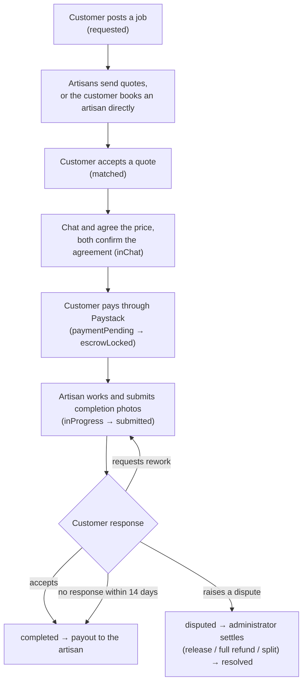
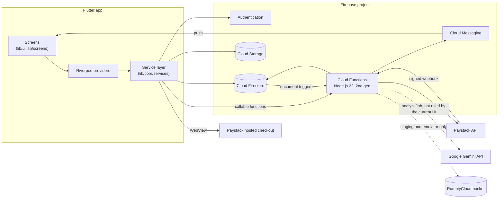

# HandyTrust

HandyTrust is a Flutter and Firebase marketplace that connects customers in Nigeria with identity-verified artisans: plumbers, electricians, carpenters and similar trades. It covers the full job lifecycle: posting a job, quoting or booking, in-app chat, payment held until the work is accepted, reviews, disputes, and an administrator back office.

> **Project status: in active development; not production-ready.**
> The application code and the backend have been verified with automated tests on the **local Firebase emulators**. The current backend (Cloud Functions, security rules, indexes) is **not deployed** to the production Firebase project. Live Paystack processing and testing on physical devices have **not** been carried out. See [Current status and limitations](#p-current-status-and-limitations).

---

## Contents

- [A. Project overview](#a-project-overview)
- [B. Key features](#b-key-features)
- [C. Technology stack](#c-technology-stack)
- [D. System architecture](#d-system-architecture)
- [E. Project structure](#e-project-structure)
- [F. Prerequisites](#f-prerequisites)
- [G. Installation and local setup](#g-installation-and-local-setup)
- [H. Environment configuration](#h-environment-configuration)
- [I. Firebase configuration](#i-firebase-configuration)
- [J. Running the application](#j-running-the-application)
- [K. Testing](#k-testing)
- [L. Payments and financial workflows](#l-payments-and-financial-workflows)
- [M. Security](#m-security)
- [N. Deployment guide](#n-deployment-guide)
- [O. Troubleshooting](#o-troubleshooting)
- [P. Current status and limitations](#p-current-status-and-limitations)
- [Q. Contributing](#q-contributing)
- [R. Licence and contact](#r-licence-and-contact)
- [Further documentation](#further-documentation)

---

## A. Project overview

### The problem

Hiring an artisan in Nigeria's informal services market usually depends on word of mouth:
- there's no shared, verifiable trust signal;
- payment is often in cash with no recourse if the work is incomplete;
- there's no structured way to compare offers or settle disagreements.

### The approach

HandyTrust adds three things:
- **Verification:** an identity-verification step for artisans, reviewed by an administrator, plus a computed trust score.
- **Payment hold:** the customer's payment is held until the customer accepts the completed work. It's auto-released after a review period, or settled by an administrator if there's a dispute.
- **Back office:** one dashboard for approvals, verification, disputes, refunds, payouts and support.

### Users

| Role | What they do |
|---|---|
| **Customer** | Posts jobs or books an artisan; compares quotes; chats; pays; accepts the work or asks for rework; reviews; raises disputes |
| **Artisan** | Registers a professional profile; verifies identity; sets a service area; finds work and sends quotes; does the job; submits completion photos; receives payouts |
| **Administrator** | Approves artisans; reviews identity documents; resolves disputes and paid cancellations; manages refunds, payouts and chargebacks; handles support and account deletion requests |

One account can hold both the customer and artisan roles and switch between them. Administrator access is granted separately (see [Granting administrator access](#granting-administrator-access)).

### Main workflow



Other end states:
- `cancelled`: unpaid jobs can be cancelled; paid cancellations are settled by an administrator.
- `expired`: an open job with no booking is expired by the server after the configured window (7 days by default).

---

## B. Key features

**Status legend:**
- **Implemented:** present in the code and covered by automated tests on the local Firebase emulators. "Implemented" does **not** mean deployed or verified in production; see [section P](#p-current-status-and-limitations).
- **Partial:** present but incomplete, or not reachable from the current UI.
- **Not implemented:** absent from the code.

### Customer features

| Feature | Status | Notes |
|---|---|---|
| Sign up, email verification, password reset | Implemented | Email and password only. No phone, Google or anonymous sign-in |
| Post a job with photos, category, description, budget and location | Implemented | At least one photo is required. The exact address is stored separately from the public job (see [Security](#m-security)) |
| Discover artisans by category and distance | Implemented | Straight-line distance against each artisan's service radius |
| Compare quotes; accept or reject | Implemented | Quotes expire after 48 hours by default |
| Book a specific artisan directly | Implemented | The artisan must confirm within the booking window (24 hours by default) |
| Chat per job, and agree the price | Implemented | Text, image, price-negotiation and system messages; read and delivered receipts |
| Pay through Paystack checkout | Implemented (emulator-tested, Paystack stubbed) | Not yet run against Paystack; see [section L](#l-payments-and-financial-workflows) |
| Accept the work, request rework, or raise a dispute | Implemented | |
| Reviews and ratings | Implemented | Feeds the artisan's rating and trust score |
| Favourite artisans | Implemented | |
| Support tickets | Implemented | |
| Request account deletion | Implemented | Reviewed by an administrator |
| AI-assisted job description (Gemini) | Partial | The `analyzeJob` Cloud Function and a client service exist, but **no screen uses them** |

### Artisan features

| Feature | Status | Notes |
|---|---|---|
| Registration and professional profile | Implemented | Administrator approval is needed before the profile goes public |
| Identity verification (selfie plus government ID) | Implemented | Reviewed in the admin dashboard. A "verify later" option exists |
| Service area (centre plus radius) | Implemented | 10 km by default, 25 km maximum (configurable) |
| Find work: open jobs and booking requests | Implemented | Quoting and being booked require approved **and** identity-verified status, or an administrator-set beta-tester flag |
| Quotes, withdrawal and job withdrawal | Implemented | |
| Work orders: start, progress, completion photos, rework | Implemented | |
| Earnings view and payout bank account | Implemented | The bank account is verified with Paystack before payouts |
| Portfolio projects | Implemented | |
| Trust score breakdown | Implemented | Computed server-side by Cloud Functions triggers |

### Administrator features

The admin dashboard has five sections: Overview, People, Operations, Finance and Compliance.

| Feature | Status | Notes |
|---|---|---|
| Approve or reject artisans; review identity submissions | Implemented | |
| Users: suspend, reactivate, delete | Implemented | Deletion runs in the `adminDeleteUser` Cloud Function (admin-checked and audit-logged) |
| Disputes and paid cancellations: release, full refund or split | Implemented | Server-side settlement (`adminResolveDispute`, `adminResolveCancellation`) |
| Refunds, payout retries, payout freeze, chargebacks | Implemented | Admin-only callable functions |
| Support tickets, reviews, account deletion requests | Implemented | |
| Administrator audit log | Implemented | `admin_audit_logs` collection |

### Payments and financial workflows

The full payment cycle is implemented: server-computed charge, Paystack checkout, webhook verification, payment hold, auto-release, payout transfer, refunds, chargebacks and reconciliation jobs. It's covered by emulator tests with Paystack calls stubbed. **It hasn't been run against Paystack test mode or live mode.** Details are in [section L](#l-payments-and-financial-workflows).

### Communication and notifications

| Feature | Status | Notes |
|---|---|---|
| In-app notification feed | Implemented | Generated **server-side** by Cloud Functions triggers. The only client writes allowed are by administrators (verification decisions) |
| Push notifications (FCM) | Implemented (emulator-tested) | Up to 10 devices per user; respects the user's notification setting; invalid tokens are removed; push text never includes message content. Real delivery to a physical device hasn't been tested |

### Location and discovery

| Feature | Status | Notes |
|---|---|---|
| Current location | Implemented | `geolocator`, medium accuracy, on request (no background tracking) |
| Reverse geocoding to an address | Implemented | `geocoding` package (the device's platform geocoder) |
| Exact address privacy | Implemented | Jobs expose only a coarse area (about 1 km). The exact address is shown to the customer, administrators, and the assigned artisan **after** the booking is confirmed |
| Distance-first matching | Implemented | Straight-line distance; not road distance |
| Map-based picking, address search or autocomplete | Not implemented | No map or places provider is integrated |

### Security and access control

Firestore and Storage security rules, server-side checks in Cloud Functions, private sub-documents for sensitive data, and audit logging. See [section M](#m-security).

---

## C. Technology stack

Versions are taken from `pubspec.yaml`, `functions/package.json` and the Android Gradle files. Caret ranges are the declared constraints; `pubspec.lock` and `functions/package-lock.json` pin the exact versions.

| Layer | Technology |
|---|---|
| Client framework | Flutter (Dart SDK `^3.11.4`). Developed with Flutter 3.41.6 stable |
| State management | `flutter_riverpod` ^2.4.0 |
| Navigation | `go_router` ^13.0.0, with an authentication- and role-aware redirect |
| Authentication | Firebase Authentication (`firebase_auth` ^6.5.7): email and password |
| Database | Cloud Firestore (`cloud_firestore` ^6.8.0) |
| File storage | Cloud Storage for Firebase (`firebase_storage` ^13.4.6) for job photos, profile and verification documents, portfolio and dispute evidence |
| Backend | Cloud Functions for Firebase, 2nd generation: Node.js 22, `firebase-functions` ^5.1.1, `firebase-admin` ^12.6.0, `axios` |
| Payments | Paystack: server-side REST API from Cloud Functions; hosted checkout opened in `webview_flutter` |
| Push notifications | Firebase Cloud Messaging (`firebase_messaging` ^16.5.0) and `flutter_local_notifications` |
| Location | `geolocator`, `geocoding` |
| Media | `image_picker`, `flutter_image_compress`, `cached_network_image` |
| AI (server only) | `@google/generative-ai` (Gemini) in the `analyzeJob` function |
| Staging object storage | RumptyCloud (S3-compatible) through `@aws-sdk/client-s3`. **Staging and emulator only** |
| Testing | `flutter_test` (unit, widget, golden); Node.js `node:test`; `@firebase/rules-unit-testing`; Firebase Emulator Suite |
| Android build | Android Gradle Plugin 8.11.1, Gradle 8.14, Kotlin 2.0.10, Java 17 source and target, core library desugaring |

---

## D. System architecture



Dashed lines are integrations that exist in code but aren't part of the normal production flow.

**How the parts talk to each other:**

- **Client to Firebase:** the app reads and writes Firestore and Storage directly. **Security rules are the authorisation boundary.** The router only controls navigation.
- **Callable functions:**
  - payment breakdown, Paystack initialisation and verification;
  - artisan withdrawal;
  - all administrator finance actions;
  - user deletion.

  Each checks the caller server-side; admin functions require an `admins/{uid}` document.
- **Triggers and schedules:**
  - Firestore triggers generate notifications, update ratings and trust scores, move exact job locations into a private sub-document, set administrator custom claims and queue payouts.
  - Scheduled functions handle auto-release, deadlines, abandoned payments, refund reconciliation and stale device tokens.
- **Paystack:** the app never holds a Paystack key. Charges are computed and initialised by Cloud Functions. Paystack's webhook is verified with HMAC-SHA512 over the raw request body.

### Cloud Functions (defined in `functions/index.js`)

No region is set in code, so Firebase's default region (`us-central1`) applies.

| Kind | Count | Functions |
|---|---|---|
| HTTPS endpoint | 1 | `paystackWebhook` |
| Callable: payments | 3 | `getPaymentBreakdown`, `initializePaystackTransaction`, `verifyPayment` |
| Callable: marketplace | 2 | `artisanWithdrawFromJob`, `analyzeJob` |
| Callable: administrator | 10 | `adminResolveDispute`, `adminResolveCancellation`, `adminRefundCharge`, `adminRetryRefund`, `adminRetryPayout`, `adminCloseChargeback`, `adminSetChargebackInvestigation`, `adminSetPayoutFreeze`, `adminBackfillJobLocationPrivacy`, `adminDeleteUser` |
| Scheduled | 6 | `autoReleaseEscrow`, `expireMarketplaceDeadlines` and `expireAbandonedPayments` (hourly); `reconcileStuckEscrowReleases` and `sweepStaleDeviceTokens` (daily); `reconcileRefunds` (every 3 hours) |
| Firestore triggers | 13 | `processEscrowRelease`, `onNotificationCreated`, `onDeviceTokenWritten`, `onQuoteWritten`, `onMessageCreated`, `onJobCreatedProtectLocation`, `onJobCompleted`, `onReviewCreated`, `onArtisanRatingChanged`, `onArtisanVerificationChanged`, `onAdminGranted`, `onAdminRevoked`, `onDisputeCreated` |
| Staging media (`functions/media.js`) | 6 | `requestMediaUpload`, `uploadMediaContent`, `confirmMediaUpload`, `getMediaUrl`, `deleteMedia`, `runMediaSweep`. **Exported only for `demo-*` emulator projects and `handytrust-staging`, never for production** |

### Firestore data model (from `firestore.rules`)

| Collection | Purpose |
|---|---|
| `users/{uid}` | Account profile, roles, account status, notification preference |
| `artisans/{uid}` | Public artisan profile, approval and verification status, service area, rating, trust score |
| `artisan_private/{uid}` | Bank and payout details (owner and admin only) |
| `jobs/{jobId}` | Job lifecycle document, with a coarse public area only |
| `jobs/{jobId}/private/location` | Exact address and coordinates (restricted) |
| `jobs/{jobId}/quotes`, `/messages`, `/auditLogs` | Quotes, chat, job audit trail |
| `booking_responses` | Immutable booking request/response records behind the trust score's response-time input (server-written) |
| `payments`, `escrow_releases`, `settlements`, `refunds`, `chargebacks` (with an `events` log), `financial_events`, `platform_losses` | Payment and settlement records. Server-written (except pending release requests); restricted reads |
| `disputes`, `reviews`, `support_tickets`, `account_deletion_requests` | Dispute, review, support and deletion records |
| `notifications`, `fcm_tokens/{uid}/devices/{deviceId}` | In-app notifications; per-device push registrations |
| `verifications`, `portfolio_projects`, `portfolio_analytics` | Identity submissions, portfolio, portfolio views |
| `admins`, `admin_audit_logs`, `admin_alerts` | Administrator registry, audit trail, operational alerts |
| `config/{doc}` | Platform configuration, e.g. `config/platform` |
| `media`, `media_quotas`, `media_system` | RumptyCloud staging media records (server-written) |

---

## E. Project structure

```text
.
├── lib/                      Flutter application
│   ├── core/
│   │   ├── services/         Business logic and Firestore/Functions access (jobs, quotes, chat,
│   │   │                     payments, disputes, verification, notifications, matching, …)
│   │   ├── firebase/         Firebase initialisation and local-emulator mode (emulator_config.dart)
│   │   ├── utils/            Helpers, including geo (distance, geohash, coarse area)
│   │   ├── validation/       Input validation
│   │   └── auth/, constants/, errors/, network/
│   ├── firebase/             Auth repository, Firestore repository, messaging helpers
│   ├── models/               Data models (JobModel, ArtisanModel, PaymentModel, MessageModel, …)
│   ├── providers/            Riverpod providers
│   ├── routes/router.dart    GoRouter routes and role-aware redirects
│   ├── ui/                   Current UI: customer shell and screens, artisan shell and screens,
│   │                         admin dashboard, settings, shared components, theme,
│   │                         staging/ (emulator-only media test screen)
│   ├── screens/              Earlier screens still routed (auth, job detail, payment WebView,
│   │                         review, dispute, artisan list, booking)
│   ├── main.dart             Entry point
│   └── firebase_options.dart Firebase client options (generated by FlutterFire)
├── functions/                Cloud Functions (Node.js 22)
│   ├── index.js              Payments, payment hold, settlement, notifications, triggers, schedules
│   ├── media.js              RumptyCloud staging media (emulator/staging only)
│   ├── test/                 Node test suites (unit, emulator, end-to-end, media)
│   └── tools/                Helper scripts for the RumptyCloud live test
├── firestore-tests/          Firestore and Storage security-rules tests (emulator only)
├── test/                     Flutter unit and widget tests
├── test_visual/              Flutter golden (visual regression) tests and goldens
├── tool/                     Developer scripts (emulator-mode app runner, RumptyCloud tooling,
│                             pre-commit secret scan)
├── design/                   Design, audit and implementation reports
├── redesign/, v1-audit/      Earlier design and audit notes
├── assets/                   Images, icons, fonts
├── android/ ios/ web/ macos/ windows/ linux/   Platform projects
├── firebase.json             Firebase configuration (rules, indexes, functions, hosting, emulators)
├── .firebaserc               Project aliases: default = handytrust, staging = handytrust-staging
├── firestore.rules           Firestore security rules
├── firestore.indexes.json    Composite indexes
└── storage.rules             Storage security rules
```

---

## F. Prerequisites

| Tool | Version | Required? | Used for |
|---|---|---|---|
| Git | any recent | Mandatory | Source control |
| Flutter SDK | a release providing Dart `^3.11.4` (developed with Flutter 3.41.6 stable) | Mandatory | The app |
| Android SDK and an Android emulator or device | via Android Studio | Mandatory for Android | Running and building the app |
| JDK 17 or newer | Android Studio's bundled JDK works | Mandatory for Android builds | Gradle (the project compiles to Java 17) |
| Node.js | **22** (`functions/package.json` → `engines.node`) | Mandatory for backend work and tests | Cloud Functions and the emulator test suites |
| Firebase CLI (`firebase-tools`) | recent (verified with 15.22.0) | Mandatory for emulators, tests and deployment | `npm install -g firebase-tools` |
| Java runtime on `PATH` for the Firebase emulators | verified with Java 25.0.1 | Mandatory for the emulators | The Firestore emulator runs on Java; check the Firebase CLI's current minimum |
| FlutterFire CLI | any | Optional | Only to point the app at **your own** Firebase project |
| PowerShell | Windows PowerShell 5.1 or 7 | Optional | Scripts in `tool/*.ps1` (Windows) |
| Xcode | — | Optional, unverified | iOS/macOS builds haven't been verified |

Gradle builds and the emulators need several gigabytes of free disk space.

---

## G. Installation and local setup

**Local development should use the Firebase Emulator Suite.** The committed Firebase configuration (`lib/firebase_options.dart`, `android/app/google-services.json`) points at the **production** project `handytrust`. A normal `flutter run` therefore connects to production. Don't experiment against it.

### 1. Clone and open the project

```bash
git clone https://github.com/ayooluwa-sijuwola/HANDYTRUST.git
cd HANDYTRUST
```

### 2. Install Flutter dependencies

```bash
flutter pub get
```

### 3. Install Cloud Functions and rules-test dependencies

```bash
cd functions && npm ci && cd ..
cd firestore-tests && npm ci && cd ..
```

### 4. Firebase CLI

The emulators run a `demo-` project, which needs no login and can never reach real Firebase resources. You only need to sign in to deploy:

```bash
firebase login
firebase use staging    # alias for handytrust-staging; use only if that project exists and you have access
```

`firebase use default` selects the **production** project `handytrust`. Use it only for an approved deployment.

### 5. Local secrets for the Functions emulator (optional)

Functions that use secrets read them, in the emulator, from `functions/.secret.local`. This file is git-ignored and must **never** be committed. Create it only if you need those functions locally:

```dotenv
# functions/.secret.local: emulator only, never commit
PAYSTACK_SECRET_KEY=<your own Paystack TEST secret key, or a placeholder>
GEMINI_API_KEY=<placeholder unless you are testing analyzeJob>
```

Never put a Paystack **live** key here. Without this file, the Functions emulator logs that it can't access Secret Manager for the declared secrets, and calls that need those secrets fail. The rest of the backend still runs.

### 6. Start the emulators

```bash
firebase emulators:start --only auth,firestore,functions,storage --project demo-handytrust-media
```

| Emulator | Port |
|---|---|
| Authentication | 9099 |
| Firestore | 8090 |
| Functions | 5001 |
| Storage | 9199 |

The project ID must be `demo-handytrust-media`, because the app's emulator mode uses that ID (`lib/core/firebase/emulator_config.dart`). The emulator UI is disabled in `firebase.json`.

### 7. Run the app against the emulators

Emulator mode needs **both**:
- the Dart define `HT_EMULATOR=true`;
- the environment variable `HT_EMULATOR=true` during the Android build, so the production `google-services.json` isn't compiled in.

It's available in debug builds only.

**Windows (PowerShell):**

```powershell
powershell -ExecutionPolicy Bypass -File tool\run_handytrust_emulator_app.ps1
# physical phone over USB (uses adb reverse):
powershell -ExecutionPolicy Bypass -File tool\run_handytrust_emulator_app.ps1 -UsbPhone
```

**macOS or Linux:**

```bash
HT_EMULATOR=true flutter run --dart-define=HT_EMULATOR=true
```

The Android emulator reaches your computer at `10.0.2.2`, the default. For a USB phone, forward the ports with `adb reverse tcp:<port> tcp:<port>` (9099, 8090, 5001, 9199) and add `--dart-define=HT_EMULATOR_HOST=127.0.0.1`.

On start, the debug console prints `[emulator] EMULATOR MODE — project demo-handytrust-media …`.

### 8. First account in the emulator

Sign up in the app with a made-up address. The email-verification link appears in the emulator's terminal output; open it in a browser.

### Granting administrator access

There's no in-app administrator sign-up. Administrator rights come from a document at `admins/{uid}`:
- **Firestore rules and the app** read that document directly.
- **Storage rules** read a custom claim, which the `onAdminGranted` trigger sets once Cloud Functions run. The user must sign in again to receive it.

In the emulator, you can create the document through the Firestore REST API. The `owner` token bypasses rules in the emulator only:

```bash
curl -X PATCH -H "Authorization: Bearer owner" -H "Content-Type: application/json" \
  -d '{"fields":{}}' \
  "http://127.0.0.1:8090/v1/projects/demo-handytrust-media/databases/(default)/documents/admins/<uid>"
```

In a deployed project, create the document in the Firebase console. Only project owners should do this.

---

## H. Environment configuration

| Variable or configuration | Purpose | Required? | Where configured |
|---|---|---|---|
| `PAYSTACK_SECRET_KEY` | Paystack API calls and webhook signature verification | Required for payments in a deployed project | Cloud Functions secret (`firebase functions:secrets:set`); emulator: `functions/.secret.local` |
| `GEMINI_API_KEY` | `analyzeJob` (Gemini) | Optional; no screen uses it | Same as above |
| `HT_EMULATOR` (Dart define) | Runs the app against the local emulators; debug builds only | Optional (local development) | `flutter run/build --dart-define=HT_EMULATOR=true` |
| `HT_EMULATOR` (environment variable) | Leaves the production `google-services.json` out of the Android build | Required together with the Dart define on Android | Shell environment during the build |
| `HT_EMULATOR_HOST` (Dart define) | Emulator host override. Default `10.0.2.2` on Android, `localhost` on web | Optional | `--dart-define=HT_EMULATOR_HOST=127.0.0.1` (USB phone) |
| `RUMPTY_ACCESS_KEY_ID`, `RUMPTY_SECRET_ACCESS_KEY`, `RUMPTY_CLEANUP_ACCESS_KEY_ID`, `RUMPTY_CLEANUP_SECRET_ACCESS_KEY` | RumptyCloud staging keys | Only for RumptyCloud staging tests | `functions/.secret.local` (git-ignored), via `tool/set_rumpty_credentials.ps1` |
| `RUMPTY_ENDPOINT`, `RUMPTY_REGION`, `RUMPTY_BUCKET`, `RUMPTY_UPLOAD_MODE`, `RUMPTY_SINGLE_KEY_ACCEPTED`, `RUMPTY_KEY_PREFIX`, `RUMPTY_PRESIGNED_PUT_VERIFIED` | Non-secret RumptyCloud staging settings. The bucket, endpoint and region must match an allow-list in `functions/media.js` | Only for RumptyCloud staging | `functions/.env.local` (git-ignored) |
| `RUMPTY_LIVE`, `RUMPTY_LIVE_OWNER_CONFIRMED`, `RUMPTY_LIVE_REPORT_DIR` | Gates for the live RumptyCloud tests | Test only | Set by `tool/run_rumpty_live_tests.ps1` |
| `E2E_FIRESTORE_PORT`, `FIRESTORE_EMULATOR_PORT`, `STORAGE_EMULATOR_PORT` | Port overrides for some test suites (defaults from `firebase.json`) | Test only | Shell environment |
| `lib/firebase_options.dart`, `android/app/google-services.json` | Firebase client configuration (project `handytrust`) | Required | Generated by FlutterFire; committed. These are client identifiers, not secrets |
| `.firebaserc` | Project aliases (`default`, `staging`) | — | Repository |
| `config/platform` (Firestore document) | Overrides for platform fee %, minimum platform fee, minimum job value, service radius, quote/booking/open-job deadlines, abandoned-payment window | Optional; code defaults apply otherwise | Firestore (administrators) |
| `admins/{uid}` (Firestore document) | Grants administrator rights | Needed for admin features | Firestore console or emulator |

**Getting credentials safely:**
- **Paystack:** create your own Paystack account and use its **test** secret key for development.
- **Firebase:** use the emulators, or your own Firebase project. Never the production project.
- **Never commit:** `functions/.secret.local`, `functions/.env.local`, `android/key.properties`, keystores (`*.jks`, `*.keystore`), service-account files, or any key. These patterns are git-ignored, but check `git status` before every commit. `tool/check_no_secrets.js` can be installed as a pre-commit hook ([section Q](#q-contributing)).

---

## I. Firebase configuration

| Area | Configuration |
|---|---|
| **Projects** | `.firebaserc`: `default` → `handytrust` (production), `staging` → `handytrust-staging`. Whether the staging project exists hasn't been verified from this repository. Emulator work uses `demo-handytrust-media` |
| **Android app** | Package `com.example.handy_trust` (a placeholder that must change before a store release); config in `android/app/google-services.json` |
| **Other platforms** | `lib/firebase_options.dart` contains Android, iOS, macOS, web and Windows options. No `GoogleService-Info.plist` is committed; iOS/macOS haven't been verified |
| **Authentication** | Enable the **Email/Password** provider in the target project. Email verification and password reset use Firebase's hosted email actions |
| **Firestore** | Rules in `firestore.rules`, indexes in `firestore.indexes.json`. The repository's rules and indexes are the reference; deploy them together with the matching app and functions ([section N](#n-deployment-guide)) |
| **Cloud Functions** | `functions/` (Node.js 22, 2nd gen). Requires the **Blaze** plan to deploy. Secrets: `PAYSTACK_SECRET_KEY`, `GEMINI_API_KEY` |
| **Storage** | Rules in `storage.rules`. The default bucket must be provisioned in the Firebase console before rules can be deployed. Some rules read Firestore (cross-service rules); Firebase asks to grant the Storage service access on first deploy |
| **FCM** | Device tokens are registered per installation under `fcm_tokens/{uid}/devices/{deviceId}`; pushes are sent by `onNotificationCreated`. Real-device delivery hasn't been tested. iOS needs APNs configuration, which isn't set up here |
| **Hosting** | `firebase.json` serves `build/web` with SPA rewrites and cache headers. Deployment status isn't recorded in the repository |
| **Emulators** | Auth 9099, Firestore 8090, Functions 5001, Storage 9199; `singleProjectMode: true`; UI disabled |

**Local versus deployed:** everything under `--project demo-...` is local and disposable. Anything run with `firebase use default`, or a deploy without `--project demo-...`, targets a real project.

---

## J. Running the application

| Task | Command | Notes |
|---|---|---|
| List devices and emulators | `flutter devices` / `flutter emulators` | |
| Start an Android emulator | `flutter emulators --launch <emulator_id>` | |
| Run against the **local emulators** | See [G.7](#7-run-the-app-against-the-emulators) | Recommended for development |
| Run with the committed configuration | `flutter run -d <device_id>` | ⚠️ Connects to the **production** Firebase project |
| Debug APK | `flutter build apk --debug` | Output: `build/app/outputs/flutter-apk/app-debug.apk` |
| Emulator-mode debug APK | `HT_EMULATOR=true flutter build apk --debug --dart-define=HT_EMULATOR=true` | Only works with emulators reachable from the device |
| Release APK | `flutter build apk --release` | ⚠️ Signed with the **debug key** (`android/app/build.gradle.kts`); not suitable for Play Store or public distribution |
| Web build | `flutter build web --release` | Output: `build/web`, which Firebase Hosting serves. Web-specific QA isn't documented |

**Platforms:** Android is the primary target, tested on the Android emulator. The web target builds. The iOS, macOS, Windows and Linux folders exist, but those builds haven't been verified.

---

## K. Testing

There's no CI pipeline; run these locally before every change. All backend suites run **only** against the local emulators and never contact production Firebase or Paystack. Results aren't recorded in this README; run the commands to get current results.

| Suite | Command | What it validates |
|---|---|---|
| Static analysis | `flutter analyze` | Dart analyser and `flutter_lints` |
| Flutter unit and widget tests | `flutter test` | Models, business logic (agreements, matching, payments summary, notifications, image privacy), service clients, routing and UI widgets. `test/media_live_app_test.dart` is skipped unless `RUMPTY_LIVE=1` |
| Visual (golden) tests | `flutter test test_visual` | Screen renders against stored goldens (`test_visual/goldens`, `test_visual/previews`). Goldens are platform-sensitive; they were generated on Windows |
| Cloud Functions (unit and Firestore-emulator) | Start the emulator (below), then run the suite with `npm test` | Webhook signature, payment initialisation idempotency, escrow release guards, settlement, lifecycle, deadlines, migration, chargebacks, policy and trust, push delivery, runtime configuration |
| Cloud Functions, staging media (offline) | Same emulator, `npm run test:media` | RumptyCloud media handlers with an in-memory object store (no network) |
| End-to-end (Functions emulator) | See below | Real triggers and schedules running in the Functions emulator |
| Firestore rules | `firebase emulators:exec --only firestore --project handytrust-rules-test "cd firestore-tests && npm test"` | Payment-hold and payout rules, security regression suite |
| Additional rules suites | `firebase emulators:exec --only firestore --project handytrust-rules-test "cd firestore-tests && node --test media_rules.test.js stage8_2_messaging_rules.test.js"` | Staging media records; messaging and receipt rules |
| Storage rules | `firebase emulators:exec --only firestore,storage --project demo-handytrust-storage "cd firestore-tests && node --test storage_rules.test.js"` | Storage rules, including the cross-service (Firestore-reading) rules |
| RumptyCloud live staging | `tool/run_rumpty_live_tests.ps1` | Real staging bucket. Bounded and owner-gated; see [the guide](design/RUMPTYCLOUD_LIVE_STAGING_TEST_GUIDE.md). **Not yet run** |

**Cloud Functions suite.** Each test file sets its own project ID and clears only its own data:

```bash
# terminal 1
firebase emulators:start --only auth,firestore --project demo-handytrust-test
# terminal 2
cd functions
FIRESTORE_EMULATOR_HOST=127.0.0.1:8090 FIREBASE_AUTH_EMULATOR_HOST=127.0.0.1:9099 npm test
```

On Windows PowerShell, set the variables first: `$env:FIRESTORE_EMULATOR_HOST='127.0.0.1:8090'; $env:FIREBASE_AUTH_EMULATOR_HOST='127.0.0.1:9099'; npm test`.

**End-to-end suite** (from the repository root). The Functions emulator loads all functions, so declared secrets need values: use placeholder entries in `functions/.secret.local`. These tests never contact Paystack or FCM.

```bash
firebase emulators:exec --only functions,firestore,pubsub --project demo-handytrust-e2e \
  "node --test --test-concurrency=1 functions/test/e2e_triggers.functions-emulator.test.js functions/test/e2e_schedules.functions-emulator.test.js"
```

---

## L. Payments and financial workflows

HandyTrust uses **Paystack** in Nigerian naira (NGN). All amounts are computed and compared on the server in integer kobo. The app never holds a Paystack key.

> **"Escrow" in this codebase means an internal payment-hold state.** The customer's payment is collected into the platform operator's Paystack balance and paid out to the artisan by Paystack Transfer. HandyTrust isn't a licensed escrow provider, bank or trustee, and the repository makes no claim of regulatory approval.

| Step | Implemented behaviour |
|---|---|
| **Price** | Both parties confirm the agreed price in chat. `getPaymentBreakdown` returns the server-computed charge: **service price + platform fee**. The fee defaults to 5%, with an optional minimum fee; a minimum job value applies. All are configurable in `config/platform`. The artisan's payout is the service price |
| **Checkout** | `initializePaystackTransaction` (with an idempotency claim) creates the Paystack transaction; the app opens the hosted checkout in a WebView |
| **Verification** | `paystackWebhook` verifies Paystack's HMAC-SHA512 signature over the raw body, then checks currency, amount, reference and job before locking the job (`escrowLocked`). `verifyPayment` is the client-triggered fallback. Mismatched or unknown charges are flagged for refund, not accepted |
| **Abandoned payments** | `expireAbandonedPayments` (hourly) expires payments left unpaid past the window (24 h by default) |
| **Completion and release** | After the customer accepts, or automatically **14 days** after submission (`autoReleaseEscrow`, hourly) unless a rework or dispute is open, a release is queued. `processEscrowRelease` pays the artisan's Paystack-verified bank account by Transfer. `reconcileStuckEscrowReleases` (daily) repairs stuck releases; administrators can retry or freeze payouts |
| **Cancellation** | Unpaid jobs can be cancelled. A paid cancellation is requested and then settled by an administrator (`adminResolveCancellation`) |
| **Disputes** | Either party can raise a dispute; administrators are alerted (`onDisputeCreated`). `adminResolveDispute` settles it as **release**, **full refund** or **split**, with server-side bounds on every amount |
| **Refunds** | Issued through Paystack's Refund API. `reconcileRefunds` (every 3 hours) tracks them; administrators can retry |
| **Chargebacks** | Paystack dispute events are recorded; administrators manage the investigation and close-out |

**Test mode versus live mode.** Paystack's mode is decided by the key stored in `PAYSTACK_SECRET_KEY`: test keys begin `sk_test_`, live keys `sk_live_`. The automated tests stub Paystack and never call it. **No end-to-end run against Paystack test mode is recorded, and live processing hasn't been enabled or verified.** Some payload and refund behaviours still have to be confirmed in Paystack test mode before any go-live decision. Use only test keys in development.

After deploying the functions, set the `paystackWebhook` URL printed by `firebase deploy` as the webhook URL in the Paystack dashboard. Paystack can't reach a local emulator; locally, payment confirmation relies on `verifyPayment`.

---

## M. Security

- **Authentication:**
  - Firebase Authentication with email and password, plus email verification.
  - Every signed-in rule check excludes anonymous sessions.
  - Suspended accounts are blocked from key actions by the security rules.
- **Authorisation:**
  - Firestore and Storage security rules check the caller's identity against document ownership (customer, assigned artisan) and the workflow state.
  - Client navigation isn't a security control.
- **Role-based access:**
  - Artisans can quote or be booked only when approved **and** identity-verified, or flagged by an administrator as a beta tester.
  - Administrator rights come from `admins/{uid}` (Firestore rules and every admin Cloud Function), mirrored into a custom claim for Storage rules.
- **Server-side validation:**
  - Prices, fees, settlements, refunds and payouts are computed and checked in Cloud Functions.
  - Payment, settlement, refund, chargeback and financial-event records are written only by Cloud Functions.
  - A customer's acceptance only queues a pending release request, which the server validates before paying out.
- **Sensitive data:**
  - Bank details live in `artisan_private`.
  - A job's exact address lives in `jobs/{id}/private/location`, readable only by the customer, administrators and the assigned artisan after booking confirmation.
  - Push notifications never carry message text.
- **Secrets:**
  - Paystack and Gemini keys are Cloud Functions secrets.
  - Local emulator secrets live in git-ignored files.
  - No payment key exists in the app.
- **Payments:** webhook signature verification, amount, currency and reference checks, idempotent initialisation, and a server-side state machine for every money movement.
- **Auditability:** job audit logs and administrator audit logs.

**Production security configuration (rules deployment, App Check, signing and so on) must be reviewed before any deployment.** No encryption certification, compliance certification or uptime guarantee is claimed.

---

## N. Deployment guide

> **Nothing in this repository is currently deployed by these steps, and deploying needs the project owner's approval.** Deploy to a **staging** project first. Deploying the current backend changes several behaviours at once (server-generated notifications, private job locations, new indexes), so do it as one planned release with a matching app build.

### 1. Android application

| | |
|---|---|
| Prerequisites | Android SDK; for a store release, a release keystore and a final application ID |
| Commands | `flutter build apk --debug`, `flutter build apk --release` |
| Target | Testers' devices (debug or release APK) |
| Current limitation | Release builds use the **debug signing key**, and the application ID is the placeholder `com.example.handy_trust`. Both must be fixed before Play Store distribution; see [the signing plan](design/HANDYTRUST_ANDROID_RELEASE_SIGNING_PLAN.md) and [the application ID plan](design/HANDYTRUST_APPLICATION_ID_MIGRATION_PLAN.md) |
| Verify | Install the APK and sign in against the intended Firebase project |
| Rollback | Reinstall the previous APK; keep earlier build artefacts |

### 2. Cloud Functions

| | |
|---|---|
| Prerequisites | Target project on the **Blaze** plan; Node.js 22; an account with deploy rights (for example Owner or Editor) |
| Secrets | `firebase functions:secrets:set PAYSTACK_SECRET_KEY --project <project-id>` (use a **test** key until go-live is approved), and `GEMINI_API_KEY` if needed |
| Command | `firebase deploy --only functions --project <project-id>` |
| Target | `handytrust-staging` first. The staging media functions are exported only there and in `demo-*` emulator projects |
| After deploy | Set the Paystack webhook URL. Run the one-off administrator callable `adminBackfillJobLocationPrivacy` to move exact locations off existing jobs, repeating while it returns a `nextCursor`. No app screen calls it; invoke it with an administrator's credentials |
| Verify | `firebase functions:list --project <project-id>`; test a callable from a staging build |
| Rollback | Redeploy the previous commit; remove an unwanted function with `firebase functions:delete <name> --project <project-id>` |

### 3. Firestore rules and indexes

| | |
|---|---|
| Command | `firebase deploy --only firestore:rules,firestore:indexes --project <project-id>` |
| Notes | Deploy together with the matching Functions and app build: current app builds write data that only the current rules accept, and the current rules expect server-side functions to exist. New composite indexes can take time to build |
| Verify | Firebase console → Firestore → Rules (publish time) and Indexes (status *Enabled*) |
| Rollback | Redeploy the previous `firestore.rules` from Git; the console also keeps a rules history |

### 4. Storage rules

| | |
|---|---|
| Prerequisites | The default Storage bucket provisioned in the console (Build → Storage → Get started) |
| Command | `firebase deploy --only storage --project <project-id>` |
| Notes | Approve the cross-service access prompt (Storage rules read Firestore) |
| Rollback | Redeploy the previous `storage.rules` |

### 5. Web (Firebase Hosting)

| | |
|---|---|
| Commands | `flutter build web --release`, then `firebase deploy --only hosting --project <project-id>` |
| Notes | The web build uses the web options in `lib/firebase_options.dart` (project `handytrust`) |
| Verify | Open the Hosting URL printed by the deploy |
| Rollback | Firebase console → Hosting → release history → roll back |

### 6. RumptyCloud staging integration

**What exists:**
- The integration is implemented and tested **locally**: offline tests, rules tests, and the emulator-mode Android app with a staging-only test screen.
- It stores **synthetic test images only**, in a private RumptyCloud staging bucket. Every operation goes through Firebase-authenticated functions.

**What doesn't exist yet:**
- No RumptyCloud service is deployed.
- The live staging tests haven't been run.

**Scope:**
- Firebase remains the authoritative backend for authentication, data, functions, rules, notifications, the job lifecycle, Paystack, payment hold, payouts and disputes.
- RumptyCloud is limited to the planned hybrid **media** storage. Don't move Firebase services or payment processing to it.

See:
- [Live staging test guide](design/RUMPTYCLOUD_LIVE_STAGING_TEST_GUIDE.md)
- [Target architecture](design/RUMPTYCLOUD_TARGET_ARCHITECTURE.md)
- [Current implementation verification](design/RUMPTYCLOUD_CURRENT_IMPLEMENTATION_VERIFICATION.md)

---

## O. Troubleshooting

| Symptom | Likely cause | What to do |
|---|---|---|
| "Couldn't post your job: The server refused to save this job … (permission-denied)" | The connected Firebase project's rules are older than the app: current builds also write `jobs/{id}/private/location` | Deploy the current rules with the matching release, or use the emulators. See [the root-cause report](design/JOB_POSTING_FAILURE_ROOT_CAUSE.md) |
| Photo uploads fail with 404 or CORS-looking errors | The project's Storage bucket hasn't been provisioned | Provision Storage in the console, then deploy `storage.rules`. See [the report](design/STORAGE_UPLOAD_ROOT_CAUSE.md) |
| A callable returns `not-found` | The function isn't deployed in the connected project, or is deployed in a different region (the app calls the default region) | Check `firebase functions:list` |
| The app refuses to start: "Emulator mode needs an Android build made with HT_EMULATOR=true…" | The build still contained the production `google-services.json` | Set the `HT_EMULATOR=true` environment variable for the build as well as the Dart define (see [G.7](#7-run-the-app-against-the-emulators)) |
| The emulator-mode app can't reach the emulators | Android's `localhost` is the device itself | The Android emulator uses `10.0.2.2` (default). For a USB phone, use `adb reverse` and `HT_EMULATOR_HOST=127.0.0.1` |
| The Functions emulator logs "Unable to access secret … Secret Manager" | `functions/.secret.local` is missing for a declared secret | Add placeholder or test values ([G.5](#5-local-secrets-for-the-functions-emulator-optional)) |
| Payment initialisation fails locally | No Paystack test key configured, or Paystack can't reach your webhook | Use your own **test** key; locally, confirmation uses `verifyPayment` |
| `flutter pub get` fails on the SDK constraint | Flutter too old for Dart `^3.11.4` | Upgrade Flutter (`flutter upgrade`) |
| Gradle or JVM failures during Android builds | Wrong JDK, or low disk space | Use JDK 17 or newer (Android Studio's bundled JDK); free several GB of disk |
| Golden test differences | Platform or font rendering differences | Compare on the platform that generated the goldens (Windows) before updating |

---

## P. Current status and limitations

### Verified (local emulators and automated tests)

- **Marketplace:** the full job lifecycle, quoting and booking, chat with receipts, reviews and trust score, disputes, support and account deletion requests.
- **Back office:** the administrator dashboard and admin finance operations.
- **Money:** the server-side payment, payout, refund and chargeback logic, with Paystack stubbed.
- **Privacy and push:** private job locations and server-generated notifications with per-device push.
- **Rules:** Firestore and Storage rules regression tests.

### Not yet done or not yet verified

- **Deployment:**
  - The current Cloud Functions, rules and indexes aren't deployed to the production project.
  - Cloud Functions need the Blaze plan.
  - The production Storage bucket needs provisioning.
  - Until all of this is done, features that depend on them don't work against production.
- **Paystack:** no test-mode end-to-end run; live mode not enabled.
- **Physical devices:** no documented testing on Android or iOS phones, including real push delivery, payments in the WebView, location and camera.
- **iOS/macOS/Windows/Linux:** builds unverified.
- **RumptyCloud:** live staging tests not yet run; nothing deployed.
- **AI job description assist:** server function only; not in the UI.
- **Location:** no map-based picking or address search.

### Required before a production release (high level)

1. Release signing and a final application ID.
2. A staging Firebase project, and a staged rollout of Functions, rules and indexes with a matching app build.
3. Firestore backups or point-in-time recovery, and a restore runbook ([backup plan](design/HANDYTRUST_FIRESTORE_BACKUP_AND_RECOVERY_PLAN.md)).
4. Firebase App Check ([plan](design/HANDYTRUST_FIREBASE_APP_CHECK_PLAN.md)).
5. Paystack test-mode verification of every payment path before any live key.
6. Testing on physical devices.
7. CI for tests and builds.
8. A security and privacy review of the production configuration.

---

## Q. Contributing

1. Fork the repository, or clone it if you have access, and create a branch from `main`:

   ```bash
   git switch -c feature/<short-description>
   ```

2. Develop against the **emulators**, not the production project.
3. Before opening a pull request, run at least:
   - `flutter analyze`
   - `flutter test`
   - the Cloud Functions and rules suites relevant to your change ([section K](#k-testing))

   Update goldens (`flutter test test_visual --update-goldens`) only for intentional UI changes, and say so in the PR.
4. Open a pull request against `main`, describing the change, the tests you ran with their results, and any rules, indexes or deployment impact.
5. **Never commit secrets:**
   - `functions/.secret.local`, `functions/.env.local`, keystores, `key.properties`, service-account files and keys of any kind.
   - Run `git status` before committing.
   - Optionally install the secret scan as a pre-commit hook: create `.git/hooks/pre-commit` containing `node tool/check_no_secrets.js || exit 1`.

---

## R. Licence and contact

- **Licence:** no licence file is included in this repository; **no licence has been specified**.
- **Contact:** no project contact details are published in the repository. Use the issue tracker of the GitHub repository for questions and bug reports.

---

## Further documentation

| Topic | Document |
|---|---|
| Push notifications and messaging receipts | [design/STAGE8_2_BACKEND_NOTIFICATION_IMPLEMENTATION_REPORT.md](design/STAGE8_2_BACKEND_NOTIFICATION_IMPLEMENTATION_REPORT.md) |
| Firebase plan (Spark vs Blaze) dependencies | [design/BILLING_DEPENDENCY_AUDIT.md](design/BILLING_DEPENDENCY_AUDIT.md) |
| Android release signing | [design/HANDYTRUST_ANDROID_RELEASE_SIGNING_PLAN.md](design/HANDYTRUST_ANDROID_RELEASE_SIGNING_PLAN.md) |
| Application ID migration | [design/HANDYTRUST_APPLICATION_ID_MIGRATION_PLAN.md](design/HANDYTRUST_APPLICATION_ID_MIGRATION_PLAN.md) |
| Firestore backup and recovery | [design/HANDYTRUST_FIRESTORE_BACKUP_AND_RECOVERY_PLAN.md](design/HANDYTRUST_FIRESTORE_BACKUP_AND_RECOVERY_PLAN.md) |
| App Check | [design/HANDYTRUST_FIREBASE_APP_CHECK_PLAN.md](design/HANDYTRUST_FIREBASE_APP_CHECK_PLAN.md) |
| Media storage architecture | [design/HANDYTRUST_MEDIA_STORAGE_ARCHITECTURE.md](design/HANDYTRUST_MEDIA_STORAGE_ARCHITECTURE.md) |
| RumptyCloud staging | [Target architecture](design/RUMPTYCLOUD_TARGET_ARCHITECTURE.md) · [Live test guide](design/RUMPTYCLOUD_LIVE_STAGING_TEST_GUIDE.md) · [Implementation verification](design/RUMPTYCLOUD_CURRENT_IMPLEMENTATION_VERIFICATION.md) |
| Troubleshooting reports | [Job posting failure](design/JOB_POSTING_FAILURE_ROOT_CAUSE.md) · [Storage upload failure](design/STORAGE_UPLOAD_ROOT_CAUSE.md) |
