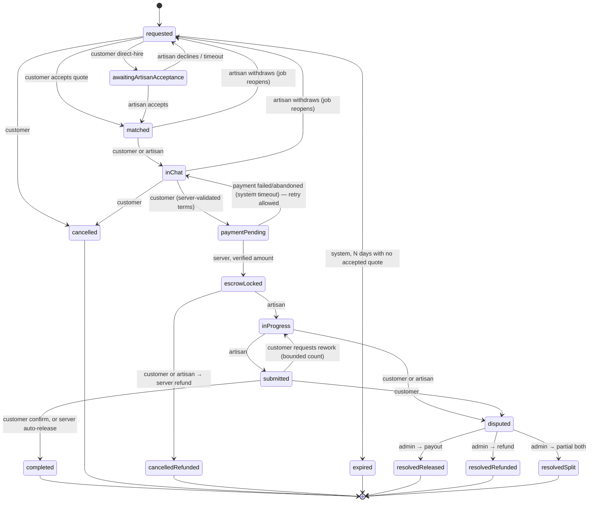
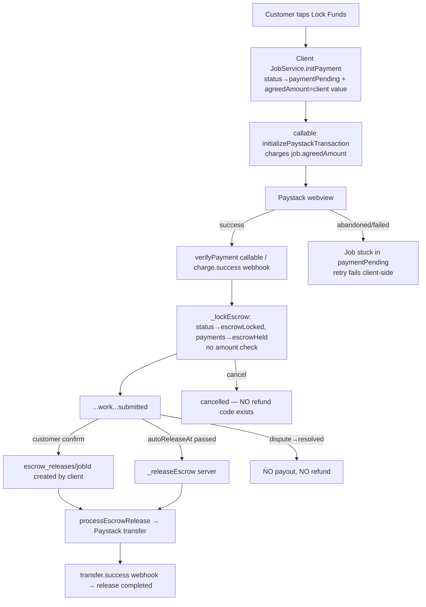

# HandyTrust — Workflow & Functional Audit (2026-11-03)

> **For the AI assistant reading this (e.g. ChatGPT):** This report was produced by auditing the HandyTrust repository's *working tree*. You do not have repository access, so every claim below cites an exact file and line to ask the developer for. Before proposing code, ask for the current contents of the files named in the issue you're fixing; line numbers may have drifted.
>
> **Ground rules the product owner set (keep them):**
> 1. Fix workflows and integrity. Do **not** redesign the UI.
> 2. Do not replace the architecture (Flutter + Riverpod + GoRouter + Firebase + Paystack) without strong evidence.
> 3. Do not weaken Firestore/Storage rules to make something "work".
> 4. The backend (Cloud Functions / Admin SDK) must be the source of truth for anything that moves money or changes trust data.
> 5. Never run real payments. Use the Firestore emulator and Paystack test mode only.
> 6. Work in the dependency order in §6. Do not start UI work before the backend and rules fixes it depends on.

---

## 0. How this audit was done and what was verified

| Evidence type | What it means in this report |
|---|---|
| **VERIFIED (code)** | The behaviour was confirmed by reading the exact source lines cited. |
| **VERIFIED (emulator)** | The behaviour was reproduced against the local Firestore emulator using the repo's real `firestore.rules` (probe file in Appendix A). |
| **POTENTIAL** | The code allows it, but exploitability depends on something not visible in the repo. |
| **UNVERIFIED** | Couldn't be confirmed from the repo. The report says what evidence is needed. |

**Tests actually executed (2026-11-03):**

| Suite | Command | Result |
|---|---|---|
| Flutter unit tests (`test/`, 8 files) | `flutter test` | **99/99 passed** |
| Cloud Functions tests (`functions/test/`, 4 files) | `npm test` with Firestore emulator on 127.0.0.1:8090 | **37/37 passed** |
| Firestore rules tests (`firestore-tests/escrow_payout.test.js`) | `npm test` with emulator | **26/26 passed** |
| Audit probes (Appendix A, written for this audit, not in the repo) | `node --test` with emulator | **12/12 behaved as predicted.** Every exploit probe succeeded; the control probe was correctly blocked. |

None of the existing tests are widget or integration tests, and **no existing test covers any end-to-end workflow.** The passing suites test pure helpers (transition tables, guards, signature hashing, idempotency locks) and the escrow-release create rule.

**Not inspected line by line (stated plainly):** `lib/screens/admin/admin_dashboard_screen.dart` (7,765 lines) was inspected only for its write operations; `settings_screen.dart`, `home_screen.dart` and the theme/widgets were not reviewed in depth. **The deployed** Firestore/Storage rules and functions may differ from the repo; everything here describes the repo.

---

## 1. Architecture overview (actual, verified)

```
Flutter UI (lib/screens/**)
  │  reads: Riverpod StreamProviders over Firestore snapshots
  │  writes: Riverpod notifiers → services
  ▼
Riverpod providers (lib/providers/**)
  │  EscrowNotifier (lib/providers/escrow_provider.dart) = main job-lifecycle entry point
  ▼
Services (lib/core/services/**)
  │  JobService (job_service.dart)       — client-side "single writer" for /jobs; runs Firestore
  │                                        transactions + writes jobs/{id}/auditLogs from the CLIENT
  │  QuoteService, DisputeService, VerificationService, NotificationService, ChatService
  │  WorkflowGateService                 — pure "what is the next action" helper for the UI
  │  MatchingService                     — artisan ranking (client-side)
  │  EscrowService (escrow_service.dart) — UNUSED duplicate state machine (dead code)
  ▼
Cloud Firestore  ── governed by firestore.rules (the ONLY server-side guard for client writes)
  ▲
  │ Admin SDK (bypasses rules)
Cloud Functions (functions/index.js, Node 20, v2 API)
  paystackWebhook (HTTP), initializePaystackTransaction (callable), verifyPayment (callable),
  processEscrowRelease (onCreate escrow_releases), autoReleaseEscrow (hourly),
  reconcileStuckEscrowReleases (daily), onJobCompleted (onUpdate jobs), onReviewCreated,
  onArtisanRatingChanged, onArtisanVerificationChanged, onAdminGranted/Revoked,
  onDisputeCreated, onNotificationCreated (FCM fan-out), analyzeJob (Gemini), adminDeleteUser
  ▲
Paystack (charge init/verify, webhooks, transfer recipients, transfers)
```

**The key architectural fact:** almost every job state transition is written **directly by the Flutter client** through `JobService`. The only things that stop a malicious or modified client are the Firestore rules. The client-side transition table (`JobService.allowedTransitions`, [lib/core/services/job_service.dart:36](../lib/core/services/job_service.dart)) is advisory only. Only `paymentPending → escrowLocked`, payouts and trust aggregation run server-side.

**Collections** (see `lib/firebase/firestore/collections.dart` and `firestore.rules`): `users`, `users/{uid}/favorites`, `artisans`, `artisan_private`, `jobs` (+ `quotes` with doc ID = artisanId, `messages`, `auditLogs`), `payments`, `escrow_releases` (doc ID = jobId), `payment_init_locks`, `reviews`, `disputes`, `notifications`, `fcm_tokens`, `verifications`, `admins`, `admin_audit_logs`, `admin_alerts`, `support_tickets`, `account_deletion_requests`, `portfolio_projects`, `portfolio_analytics`, `config`.

**Job state model**, `JobStatus` in `lib/models/job_model.dart:84`:
`requested → matched → inChat → paymentPending → escrowLocked → inProgress → submitted → completed`, plus `disputed → resolved` and `cancelled`. Sub-states:
- `agreementStatus`: negotiating, pendingArtisanConfirmation, confirmed, changesRequested
- `schedulingStatus`: awaitingSchedule, scheduled
- `progressStage`: within `inProgress`

There are **no** `expired`, `refunded`, or `rework/rejected-completion` states.

**Routing:** `lib/routes/router.dart` has guards only for auth, email verification, suspension, admin and dual-role selection. **No customer-only or artisan-only route guards.**

---

## 2. Workflow inventory

| ID | Workflow | Start point | Actors | Current state |
|---|---|---|---|---|
| A | Auth & account | `/register`, `/login` | User | **Partial**: register/login/verify/reset work; suspension is UI-only; deletion is a manual request; avatar upload path not covered by Storage rules |
| B | Customer onboarding | after verify-email → `/home` | Customer | **Partial**: no distinct onboarding; location captured per job only |
| C | Artisan onboarding & verification | `/register/artisan`, `/verification` | Artisan, Admin | **Partial**: works, but the verification record is self-approvable, trust inputs are self-writable, and suspension isn't enforced |
| D | Job posting lifecycle | `/request`, `/secure-booking/:id` | Customer | **Incomplete**: no edit, draft, close, expiry or reopen |
| E | Discovery & matching | `/artisans/:jobId`, `/open-jobs` | Customer, Artisan | **Partial**: distance isn't the primary criterion; the feed has no distance filter |
| F | Quotation | Open Jobs Feed → quote | Artisan, Customer | **Partial**: submit/edit/withdraw/accept/reject work; no expiry; closed quotes get no notification |
| G | Negotiation & agreement | `/chat/:jobId`, job detail | Customer, Artisan | **Broken (integrity)**: the agreement can be bypassed and the price overwritten |
| H | Booking & scheduling | inChat slots | Artisan, Customer | **Incomplete**: no reschedule; direct hire assigns the artisan without consent |
| I | Payment & escrow | `/payment/:jobId` | Customer, System | **Broken**: no refunds, no retry, fee mismatch, client-set amount |
| J | Service execution | job detail | Artisan, Customer, System | **Broken**: artisan can self-release funds; `inProgress` dead end; no rework path |
| K | Dispute resolution | `/dispute/:jobId`, admin | Customer, Artisan, Admin | **Incomplete**: resolution has no financial outcome |
| L | Reviews & trust score | `/review/:jobId`, triggers | Customer, System | **Partial**: pipeline works but can be manipulated; counts are doubled on auto-release |
| M | Notifications | services and functions | System | **Partial**: missing events, spoofable, push deep links broken |
| N | Admin workflows | `/admin/*` | Admin | **Partial**: actions exist; dispute resolution and job deletion ignore money |

---

## 3. Lifecycle diagrams

### 3.1 Job lifecycle — CURRENT (as implemented by `firestore.rules:384-432`)

```mermaid
stateDiagram-v2
    [*] --> requested: customer creates
    requested --> matched: customer accepts quote / direct hire (artisan not asked)
    requested --> cancelled: customer
    matched --> inChat: customer
    matched --> cancelled: customer or artisan (job dies, no rematch)
    inChat --> paymentPending: customer (agreement confirmed + schedule ok)
    inChat --> cancelled: either
    paymentPending --> escrowLocked: SERVER only (webhook / verifyPayment)
    paymentPending --> cancelled: either
    note right of paymentPending: no retry, no expiry (dead end if abandoned)
    escrowLocked --> inProgress: artisan
    escrowLocked --> disputed: customer (rules only, no UI)
    escrowLocked --> cancelled: either, NO REFUND
    inProgress --> submitted: artisan (client sets autoReleaseAt)
    inProgress --> disputed: customer (rules only, no UI)
    note right of inProgress: customer cannot cancel; no UI dispute (dead end)
    submitted --> completed: customer confirm → escrow_releases → payout
    submitted --> completed: autoReleaseEscrow cron when autoReleaseAt <= now
    submitted --> disputed: customer
    disputed --> resolved: admin (NO money movement)
    completed --> [*]
    resolved --> [*]
    cancelled --> [*]
```



### 3.2 Job lifecycle — TARGET (recommended)



(The new state names are proposals. The team may instead keep `cancelled`/`resolved` and add an `outcome`/`settlement` field. Either way, every terminal state must carry a definitive money outcome.)

### 3.3 Quote lifecycle — CURRENT

```mermaid
stateDiagram-v2
    [*] --> pending: artisan submits (eligible, job requested)
    pending --> pending: artisan edits
    pending --> withdrawn: artisan
    pending --> rejected: customer (artisan notified)
    pending --> accepted: customer (job → matched)
    pending --> closed: another quote accepted (artisan NOT notified)
    note right of pending: never expires; stays pending if job cancelled
```



### 3.4 Payment / payout — CURRENT



---

## 4. Gap analysis (issues)

Severity: **CRITICAL** = financial, security or serious data-integrity risk; **HIGH** = workflow cannot complete; **MEDIUM** = missing handling or inconsistent UX; **LOW** = minor.

### CRITICAL

#### HT-001 — Job status-transition rule has no field whitelist (root cause of HT-002 to HT-005)
- **Workflow:** G, I, J
- **Where:** `firestore.rules:384-432` `_isValidJobTransition()`, used by `allow update` at `firestore.rules:133`
- **Current:** It validates only `(currentStatus → request.resource.data.status, actor)`. There is no `diff().affectedKeys().hasOnly([...])`. Any party making a legal transition can rewrite **any** job field in the same write, including `customerId`, `artisanId`, `agreedAmount`, `agreementStatus`, `autoReleaseAt`, `disputeWindowEndsAt`, `paymentReference` and timestamps. The other `allow update` rules on `/jobs` are field-restricted; this one is not, and Firestore ORs `allow` statements together.
- **Evidence:** VERIFIED (emulator) — probes P-A, P-B, P-C and P-D.
- **Expected:** Each transition may change only its own fields. `customerId` and `artisanId` are immutable after match. Money and time fields are server-written only.
- **Fix:** Rewrite `_isValidJobTransition` as one clause per transition, each with an `affectedKeys().hasOnly([...])` list and value checks. Make `customerId` immutable always, `artisanId` immutable after `matched`, and `agreedAmount` immutable after the agreement is confirmed. Long term, move money-affecting transitions to callable functions (see HT-002 to HT-007).

#### HT-002 — Artisan can release escrow to themselves without customer confirmation
- **Workflow:** J, I
- **Where:** `firestore.rules:422` (escrowLocked→inProgress by artisan, unrestricted fields); `firestore.rules:491-495` (escrow_releases create requires `job.customerId == auth.uid` and `status == submitted`); `functions/index.js:465-661` `processEscrowRelease` (pays whenever the job is submitted/completed and a payment is `escrowHeld`).
- **Current:**
  1. The artisan sets `status: inProgress, customerId: <artisanUid>`.
  2. The artisan sets `status: submitted`.
  3. The artisan, now the "customer", creates `escrow_releases/{jobId}`.
  4. The real Paystack transfer goes to the artisan.
- **Evidence:** VERIFIED (emulator) — probe P-A. All three writes succeed. The payout function would then pay out; that last step is VERIFIED (code) but was not executed.
- **Fix:** HT-001's immutability of `customerId` and `artisanId`. In addition, `processEscrowRelease` should check that `release.requestedBy` is the job's original customer (store `originalCustomerId` server-side at creation) or `system`. Better still, create releases only via a callable `confirmCompletion` function.

#### HT-003 — Customer can bypass the artisan's agreement acceptance and set any price
- **Workflow:** G, I
- **Where:** `firestore.rules:398` (matched→inChat by customer, unrestricted); `firestore.rules:407-410` (inChat→paymentPending checks only that `agreementStatus == 'confirmed'`).
- **Current:** During `matched → inChat` the customer can write `agreementStatus: 'confirmed', agreedAmount: 100`, then move to `paymentPending`. The server charges ₦100, escrow locks, and the artisan sees a funded job at a price they never accepted.
- **Evidence:** VERIFIED (emulator) — probe P-B.
- **Fix:** HT-001. `agreementStatus = confirmed` must only be writable by the artisan's acceptance rule (`firestore.rules:184-193`).

#### HT-004 — Price accepted by the artisan is overwritten at payment time by a client-supplied amount
- **Workflow:** I, G
- **Where:** `lib/core/services/job_service.dart:436-477` `initPayment()` writes `'agreedAmount': amount` (an argument from the client); `lib/screens/payment/payment_screen.dart:289,304` passes the text-field value; `functions/index.js:1262` charges `job.agreedAmount`.
- **Current:** Even the legitimate client re-writes `agreedAmount` at `inChat → paymentPending`. A modified client can set any value, the server charges that value, and `processEscrowRelease`'s cross-check (`functions/index.js:577`) compares against the same overwritten field, so it passes.
- **Evidence:** VERIFIED (emulator) — probe P-D. VERIFIED (code) for the client path.
- **Fix:** Remove `agreedAmount` from `initPayment`. In rules, forbid changing `agreedAmount` on that transition. Snapshot the agreed amount server-side at artisan acceptance (for example `agreementAmount`, written alongside `agreementStatus: confirmed` and immutable afterwards) and charge only that.

#### HT-005 — Auto-release time is client-controlled (artisan device clock or a crafted write)
- **Workflow:** J, I
- **Where:** `lib/core/services/job_service.dart:1053-1064` `timestampsForStatus(submitted)` uses `DateTime.now()` on the artisan's device; `functions/index.js:226-241` releases any `submitted` job with `autoReleaseAt <= now`.
- **Current:** The artisan sets `autoReleaseAt` to the past on submit. Within an hour the cron marks the job `completed` and pays out, removing the customer's 14-day review and dispute window.
- **Evidence:** VERIFIED (emulator) — probe P-C.
- **Fix:** Forbid client writes to `autoReleaseAt` and `disputeWindowEndsAt`. Set them server-side in the `onJobCompleted` trigger when `after.status == 'submitted'`, from the server time plus 14 days. Optionally have the cron also require `submittedAt` (a server timestamp) plus 14 days.

#### HT-006 — Funded jobs can be cancelled and there is no refund path anywhere
- **Workflow:** I, H, J
- **Where:** `firestore.rules:428-430` (cancel allowed from `escrowLocked` by either party); `functions/index.js` (no refund code at all; the only cancellation handling is stats at `:757`); `lib/screens/job/job_detail_screen.dart:417` (Cancel button shown while `escrowLocked`).
- **Current:** Either party cancels after payment. The job becomes `cancelled`, `payments` stays `escrowHeld`, and the money sits in the Paystack balance with no system path to return it. There is also no record that a refund is owed.
- **Evidence:** VERIFIED (emulator) — probe P-E. VERIFIED (code) that no refund code exists.
- **Fix:** Remove `escrowLocked` from client-cancellable states. Add a callable `cancelFundedJob(jobId, reason)` that validates the actor and the policy, writes a `refunds/{jobId}` record, calls the Paystack Refund API (`POST /refund`, test mode), and moves the job to a refunded terminal state. Handle the `refund.processed`/`refund.failed` webhooks idempotently.

#### HT-007 — Dispute resolution has no financial outcome
- **Workflow:** K, I
- **Where:** `lib/core/services/job_service.dart:829-884` `resolveDisputeWithRecord()` (status and text only); `lib/core/services/dispute_service.dart:85-120`; admin UI at `lib/screens/admin/admin_dashboard_screen.dart:~3640-3680` (free-text resolution only); `functions/index.js:769-771` (on `resolved`, only decrements the dispute count); `functions/index.js:454` `_isJobPayable` excludes `resolved`.
- **Current:** An admin "resolves" a dispute. The job becomes terminal `resolved`, and funds are neither released nor refunded, permanently.
- **Evidence:** VERIFIED (code).
- **Fix:** A callable `adminResolveDispute(jobId, disputeId, outcome: 'release'|'refund'|'split', splitAmount?, note)` that checks `admins/{uid}` and writes the resolution, then either creates `escrow_releases/{jobId}` (with `processEscrowRelease` allowing `resolved` when `release.reason == 'dispute_release'`, with optional partial amount) or a refund record, plus an admin audit log. The admin UI picks an outcome; the free-text field becomes the note.

### HIGH

#### HT-008 — Admin "delete job" deletes funded jobs without settlement
- **Where:** `lib/screens/admin/admin_dashboard_screen.dart:~6135-6170` (deletes messages and the job doc at any status); rules `firestore.rules:237` (`allow delete: if isAdmin()`).
- **Current:** Deleting an `escrowLocked`, `inProgress`, `submitted` or `disputed` job orphans the payment and the escrow. `quotes` and `auditLogs` subcollections are also orphaned.
- **Fix:** Block deletion unless the job is in a non-funded state (`requested`, `matched`, `inChat`, `cancelled` with no `escrowHeld` payment). Otherwise require dispute or refund settlement first. Prefer soft-delete (`moderationStatus: removed`).

#### HT-009 — Abandoned or failed payment is a permanent dead end
- **Where:** `lib/screens/payment/payment_screen.dart:288-344` (calls `initPayment` → `paymentPending` **before** the Paystack init); `JobService.initPayment` asserts `inChat → paymentPending`, so a second attempt throws; `lib/core/services/workflow_gate_service.dart:125-132` (`paymentPending` has `primaryAction: none`, with copy promising an automatic update).
- **Current:** If Paystack init fails, the webview is closed, or the charge fails, the job sits in `paymentPending` forever with no retry button. The only exit is cancellation. No server timeout exists. (The server lock has a 30-minute result reuse, but the client never reaches it on retry.)
- **Fix:** Allow re-initialization while `paymentPending`. The callable is already idempotent (`functions/index.js:1171-1217`), so the client should skip `initPayment` when the status is already `paymentPending` and add a "Resume payment" action. Add a scheduled function that returns stale `paymentPending` jobs (for example older than 24h, with Paystack verify confirming no success) to `inChat`.

#### HT-010 — Nothing ever expires
- **Where:** `functions/index.js` has only two schedules (`autoReleaseEscrow`, `reconcileStuckEscrowReleases`); `JobStatus` has no `expired`; `lib/providers/quote_provider.dart:41-58` (feed shows all `requested` jobs forever).
- **Current:** Unanswered jobs, pending quotes, `pendingArtisanConfirmation` agreements and `paymentPending` jobs never end. The open-jobs feed accumulates stale jobs.
- **Fix:** Scheduled `expireStaleWork`: requested with no accepted quote after N days → `expired` (or `cancelled` with `cancelledBy: 'system'`), with pending quotes → `closed` and notifications sent. Agreement pending more than N days → back to `negotiating` with a notification. `paymentPending` handled per HT-009.

#### HT-011 — `inProgress` is a dead end for the customer
- **Where:** `firestore.rules:428-430` (no cancel from `inProgress`); `lib/screens/job/job_detail_screen.dart:417` (Cancel button still rendered for `inProgress`); the only dispute entry point is `job_detail_screen.dart:450` (`submitted` only).
- **Current:** If the artisan abandons after starting, the customer's Cancel fails with permission-denied (probe P-F) and there is no dispute button. The funds stay locked indefinitely. Artisans also cannot exit.
- **Evidence:** VERIFIED (emulator) P-F; VERIFIED (code) that the UI offers no dispute entry.
- **Fix:** Show "Report a problem / Raise dispute" for the customer during `escrowLocked` and `inProgress` (the rules already allow `disputed` from both). Hide Cancel during `inProgress`. Optionally add an "artisan inactivity" timeout that alerts an admin.

#### HT-012 — No completion-rejection / rework path
- **Where:** `JobService.allowedTransitions` (`job_service.dart:36-52`) and rules: from `submitted`, only `completed` or `disputed`.
- **Current:** A customer with a minor issue must either release the full payment or escalate to an admin dispute.
- **Fix:** Add `submitted → inProgress` ("Request changes", customer only, reason required, with a cap such as 2 times). Clear `autoReleaseAt` server-side when that happens.

#### HT-013 — Displayed fee and total don't match what is charged
- **Where:** `lib/screens/payment/payment_screen.dart:244-266` (shows "Platform fee (5%)" and "Total charged = amount × 1.05"); `functions/index.js:1262,1284` (charges exactly `agreedAmount`); `functions/index.js:563,624` (pays the artisan the full amount).
- **Current:** The customer is shown a total 5% higher than the charge, and the platform takes no commission anywhere.
- **Fix:** Decide the fee model with the product owner. Either remove the fee row, or implement it server-side: charge `agreedAmount × 1.05` and pay out `agreedAmount`. Return the breakdown from the callable so the UI only displays server numbers.

#### HT-014 — Unlimited reviews per job (rating manipulation)
- **Where:** `firestore.rules:501-513` (no `reviewId == jobId`, no artisan check); `functions/index.js:932-975` (idempotency marker is keyed by `reviewId`, not `jobId`).
- **Current:** A customer can create any number of reviews for one completed job, under different doc IDs. Each is aggregated into the artisan's rating.
- **Evidence:** VERIFIED (emulator) P-G for creation; VERIFIED (code) for aggregation.
- **Fix:** Rules: `reviewId == request.resource.data.jobId` and `artisanId == getJob(jobId).artisanId`. Function: key the marker by `jobId`.

#### HT-015 — Any signed-in user can send any user a whitelisted notification (spoofing, plus a real push)
- **Where:** `firestore.rules:588-605` (create allowed when `userId != auth.uid` and the type is in the whitelist; title, body and jobId are free text); `functions/index.js:692-717` pushes it via FCM.
- **Current:** For example, a stranger sends "Payment Released" or "Identity Verified" to anyone, with a push.
- **Evidence:** VERIFIED (emulator) P-H.
- **Fix:** Make `notifications` server-write only (`create: if false`). Have the services call a callable, or better, emit notifications from Firestore triggers on the underlying state changes. As a minimum, require that the sender and recipient are parties to `jobId`, and that the type matches an actual state change.

#### HT-016 — Escrow lock doesn't verify the charged amount, currency or reference (POTENTIAL)
- **Where:** `functions/index.js:164-223` `_lockEscrow` (no amount or currency check; locks even when no matching `payments` doc exists); `functions/index.js:1342-1375` `verifyPayment` (checks only `metadata.jobId` and `status`; doesn't check that the caller is the customer).
- **Current:** Any successful Paystack charge whose metadata carries the jobId locks escrow. Charges created through our callable are safe. A charge created another way (for example Paystack Inline with the account's public key and custom metadata) could lock a job for ₦1. Payout would then fail closed (`no_verified_payment_on_record`), and the artisan would have worked unpaid.
- **Evidence:** POTENTIAL. No public key was found in the repo (`grep pk_test|pk_live` returned nothing). Exploitability depends on whether the public key is exposed (web build, `config` doc).
- **Fix:** In `_lockEscrow`, require a `payments` doc whose `paystackReference == reference` and `status == 'pending'`, and require Paystack `data.amount == round(payment.amount × 100)` and `currency == 'NGN'`. Pass the verified `data` from both the webhook and verifyPayment. Reject otherwise and alert an admin.

#### HT-017 — Auto-released jobs count twice in artisan stats and trust score
- **Where:** `functions/index.js:282-285` (`_releaseEscrow` sets `status: completed`, which fires `onJobCompleted` → `_recordJobOutcome` at `:752-753`) **and** `functions/index.js:320-322` (calls `_recordJobOutcome` again).
- **Current:** `totalJobs` and `completedJobs` go up by 2 for every auto-released job, and the trust score is inflated.
- **Evidence:** VERIFIED (code).
- **Fix:** Delete the explicit `_recordJobOutcome` call in `_releaseEscrow` (the trigger already handles it), or add an idempotency marker per jobId.

#### HT-018 — Artisan cancellation after match kills the customer's job (no reopen or rematch)
- **Where:** `firestore.rules:428-430`; `cancelled` is terminal (`job_service.dart:51`).
- **Current:** An artisan backing out at `matched` or `inChat` leaves the customer with a dead job. They must repost from scratch, and the other quotes were already `closed`.
- **Fix:** When the artisan cancels before funding, return the job to `requested` (clear `artisanId` and agreement fields, reopen or invite the previously closed quotes) instead of `cancelled`.

### MEDIUM

| ID | Issue | Where | Evidence | Fix |
|---|---|---|---|---|
| HT-019 | The artisan can write trust-score inputs: `responseTimeMinutes` isn't in the owner-blocked list (15% weight), and an artisan can self-set `verificationStatus: id_submitted` without submitting documents (50% of the verification weight) | `firestore.rules:94-106`; `functions/index.js:794-826` | VERIFIED (emulator) P-I | Add `responseTimeMinutes` to the blocked list (compute it server-side from message timestamps). Allow `id_submitted` only via a server-side or verifications-doc consistency check |
| HT-020 | The verification record is self-approvable: the owner can create `verifications/{uid}` with `status: 'approved'`, or update it while rejected | `firestore.rules:626-635` | VERIFIED (emulator) P-J. Display-level only (badges gate on `artisans.verificationStatus`) | Rules: owner create/update must have `status == 'pending'` or `'pending_later'` |
| HT-021 | Suspension isn't enforced server-side: `isArtisanEligible()` ignores `accountStatus`, as do `MatchingService` and the job and quote write rules. Suspended users are blocked only by the router | `firestore.rules:368-372`; `lib/core/services/matching_service.dart:21-27`; `lib/routes/router.dart:131` | VERIFIED (code) | Add `accountStatus != 'suspended'` to eligibility and to a common `isActiveUser()` used by all write rules. Filter in matching |
| HT-022 | Distance-based matching (a stated product priority) isn't implemented as primary. Distance is a ≤10% bonus, applied after an arbitrary `.limit(100)`. The open-jobs feed has no distance filter or radius at all | `matching_service.dart:16-76`; `quote_provider.dart:41-58` | VERIFIED (code) | Store a geohash on artisans and jobs, query by geohash range with a radius, rank primarily by distance, then trust. Filter the feed by the artisan's service radius |
| HT-023 | PII exposure: any artisan account, even unapproved, can read every `requested` job, including `customerAddress`, `customerLat` and `customerLng`. Job and dispute-evidence images in Storage are readable by any signed-in user | `firestore.rules:120-125`; `storage.rules` `jobs/**` and `disputes/**` read rules | VERIFIED (emulator) P-K; VERIFIED (code) for Storage | Split coarse location (area and approximate distance) from the exact address and reveal the exact one after match. Restrict Storage reads to job parties and admins |
| HT-024 | Misleading UI copy: the artisan is told auto-release happens after **48 hours** (actual: 14 days), and both parties are told "payment has been released to your account" on `completed`, before any transfer succeeds (payout can still fail for missing bank details) | `job_detail_screen.dart:462`; `workflow_gate_service.dart:161`; `job_detail_screen.dart:476-478`; `functions/index.js:1119-1125` | VERIFIED (code) | Use the 14-day constant (`JobService.releaseWindow`). Drive the "released" wording from the `escrow_releases` status |
| HT-025 | Missing notifications: artisan matched (direct hire, `acceptArtisan` path); service started (`inProgress`); job cancelled (to the other party); payment failed; competing quotes closed. The server `_buildMessages` covers only `escrowLocked`, `submitted`, `completed` and `disputed` | `functions/index.js:1092-1137`; `escrow_provider.dart:98-111,264-277`; `job_service.dart:941-944` | VERIFIED (code) | Generate all job-event notifications server-side from `onJobCompleted` (rename it `onJobUpdated`), covering every transition |
| HT-026 | Push-notification taps don't navigate: they use `Navigator.of(ctx).pushNamed(route)` under GoRouter, which has no `onGenerateRoute`, so it throws and the error is caught and logged. Server pushes also carry no `route` field | `lib/providers/notification_provider.dart:98-126`; `local_notification_service.dart:128` | VERIFIED (code). Not run on a device | Use `ref.read(routerProvider).push(route)`. Server push data should include `route` |
| HT-027 | Direct hire assigns the artisan with no consent and no notification (`requested → matched` by the customer alone). The artisan's only exit is to cancel, which kills the job (see HT-018) | `lib/screens/artisan/secure_booking_screen.dart:113-150` | VERIFIED (code) | Add an `awaitingArtisanAcceptance` step (target diagram) and notify the artisan |
| HT-028 | The audit trail is client-authored and forgeable: any job party can create arbitrary `jobs/{id}/auditLogs` docs, and `lastUpdatedBy` is client-set | `firestore.rules:243-248`; `job_service.dart:974-1012` | VERIFIED (code) | Write audit logs from a Firestore trigger (`onJobUpdated` diff) with the Admin SDK. Set client create to `if false` |
| HT-029 | Avatar upload writes to `profiles/{uid}/avatar.jpg`, but `storage.rules` has no `profiles/` match, so it's default-deny | `lib/core/services/profile_service.dart:43,63`; `storage.rules` | VERIFIED (code). Deployed rules unknown | Either use the existing `users/{uid}/` path or add a `profiles/{uid}` owner-write rule |
| HT-030 | Chat stays writable after a job reaches a terminal state (cancelled, completed or resolved) | `firestore.rules:281-289` | VERIFIED (code) | Make it read-only after terminal states, except during an open dispute or for admins |
| HT-031 | Scheduling: the customer can write any `confirmedAppointment` and `schedulingStatus: scheduled` without the artisan proposing slots, and there is no reschedule after payment | `firestore.rules:221-226`; `job_service.dart:548-597` | VERIFIED (code) | Rules: `confirmedAppointment in resource.data.appointmentSlots`. Add a two-party reschedule flow valid in `escrowLocked`/`inProgress` |
| HT-032 | `JobStatus.fromString` maps an unknown status to `requested`, so the UI misreports corrupt or legacy data as an open job | `lib/models/job_model.dart:97-104` | VERIFIED (code) | Map to an explicit `unknown` (render as "Needs support") and log |
| HT-033 | No role-based route guards: customer-only routes such as `/payment/:id` and `/request`, and artisan-only routes such as `/open-jobs` and `/bank-details`, are reachable by either role. The rules still block the writes, so this shows up as confusing UI errors | `lib/routes/router.dart:88-167` | VERIFIED (code) | Add a role check in the redirect for role-specific route groups |

### LOW

| ID | Issue | Where |
|---|---|---|
| HT-034 | `EscrowService` is an unused duplicate state machine. `/demo-payment/:jobId` and `DemoEscrowService` ship in release builds and are directly routable (its escrow-lock write is admin-only, so for non-admins it just fails) | `lib/core/services/escrow_service.dart`; `router.dart:261-269` |
| HT-035 | `verifyPayment`, `analyzeJob` and `adminDeleteUser` throw plain `Error` instead of `HttpsError`, so clients get a generic INTERNAL error with no message | `functions/index.js:1346,1350,1366,1405,1507,1511,1516,1523` |
| HT-036 | `adminDeleteUser` doesn't check for active or funded jobs before deleting a party | `functions/index.js:1505-1621` |
| HT-037 | `EscrowNotifier.updateProgress` (`progressStage`) has no UI caller, so the progress-stage feature is unreachable | `escrow_provider.dart:280-287` |
| HT-038 | `acceptQuote` doesn't seed `agreedAmount` from the accepted quote, so the price must be re-entered in negotiation | `job_service.dart:934-939` |
| HT-039 | Stale comments describe a 48h-from-lock release (contradicting the current code) | `payment_screen.dart:174-180` |
| HT-040 | `isAdminProvider` allows `/admin/*` navigation while still loading (rules still protect the data) | `router.dart:144-149` |

---

## 5. Corrected workflow specifications (for incomplete or broken workflows)

All transitions below are **server-validated**. Either the rule has a strict per-transition field whitelist, or (preferred for money) the transition is a callable Cloud Function. Every transition writes a server-side audit entry and a notification.

### 5.1 Negotiation → Agreement (G)
| From | Action | Actor | Preconditions | To | Side effects |
|---|---|---|---|---|---|
| inChat/negotiating | propose price (chat) | either | job party, not confirmed | same | message; `agreedAmount` = proposal (field-only rule) |
| negotiating/changesRequested | confirm terms | customer | `agreedAmount > 0`, scope text | pendingArtisanConfirmation | notify artisan |
| pendingArtisanConfirmation | accept | artisan (job's) | — | confirmed | **server snapshots `agreementAmount` and `agreementScope` (immutable)**; notify customer |
| pendingArtisanConfirmation | request changes | artisan | reason | changesRequested | notify customer |
| pendingArtisanConfirmation | timeout (N days) | system | — | negotiating | notify both |
| any | withdraw | artisan | not funded | job → `requested` (reopen) | notify customer |

Terminal for the sub-flow: `confirmed`. Payment may use only `agreementAmount`.

### 5.2 Payment & escrow (I)
| From | Action | Actor | Preconditions | To | Side effects / failure |
|---|---|---|---|---|---|
| inChat (confirmed, schedule ok) | start payment | customer | callable `startPayment(jobId)` | paymentPending | server sets status and charges `agreementAmount` (+ fee if adopted); idempotent init lock |
| paymentPending | resume payment | customer | — | paymentPending | reuses or re-inits the transaction |
| paymentPending | charge.success / verify | system | a `payments` doc exists with a matching reference, amount and currency | escrowLocked | payments→escrowHeld; notify both |
| paymentPending | failed / abandoned > 24h | system | Paystack verify ≠ success | inChat | payments→failed/abandoned; notify customer |
| escrowLocked | cancel | customer or artisan | callable `cancelFundedJob`; policy (full refund before start) | cancelled + refund | refund record → Paystack refund → webhook → payments `refunded`; notify both; retries and admin alert on failure |

Terminal: completed (released), cancelled+refunded, resolved (with an outcome).

### 5.3 Service execution (J)
| From | Action | Actor | Preconditions | To | Side effects |
|---|---|---|---|---|---|
| escrowLocked | start service | artisan (job's) | payments escrowHeld; (optional) on or after the appointment date | inProgress | `startedAt` (server); notify customer |
| escrowLocked / inProgress | report problem / dispute | customer **or artisan** | reason | disputed | dispute record; freezes release; notify the other party and admin |
| inProgress | submit completion | artisan | ≥1 after photo | submitted | **server** sets `autoReleaseAt = serverNow + 14d`; notify customer |
| submitted | confirm | customer | — | completed | release created by callable or trigger; notify artisan ("payout processing") |
| submitted | request rework | customer | reason; reworkCount < 2 | inProgress | clear `autoReleaseAt`; notify artisan |
| submitted | dispute | customer | before `autoReleaseAt` | disputed | as above |
| submitted | auto-release | system | `autoReleaseAt <= now` (server-set) | completed | release; notify both |

`customerId` and `artisanId` are immutable throughout.

### 5.4 Dispute (K)
| From | Action | Actor | To | Side effects |
|---|---|---|---|---|
| — | raise | customer or artisan (job party) | dispute open, job disputed | evidence upload; admin alert |
| open | respond | the other party, once | open | evidence |
| open | under review | admin | underReview | notify both |
| open/underReview | resolve: release / refund / split | admin (callable, checks `admins/{uid}`) | resolved + outcome | creates escrow_release (full or partial) and/or refund; notify both; admin audit log |
| open/underReview | dismiss | admin | resolved (outcome must still be release or refund) | same as above |

A disputed job must **never** be payable through the normal paths: `_isJobPayable` stays false for `disputed`, and auto-release ignores it (it already does).

### 5.5 Job posting & expiry (D, F)
- `requested` (published) → `expired` after N days with no accepted quote (system). All pending quotes → `closed`; notify the customer and quoting artisans.
- Customer can **edit** a `requested` job (description, photos, budget) while no quote is accepted; notify quoters that the job changed.
- Customer can **close** (cancel) a `requested` job; pending quotes → `closed` with notifications. Currently quotes stay `pending` on a cancelled job.
- Optional drafts: a `draft` status that is not visible in the feed.
- Accepting a quote: the job gets `agreedAmount = quote.amount` as the opening position (HT-038); competing quotes → `closed` **with notification**.

### 5.6 Reviews & trust (L)
- One review per job (`reviewId == jobId`) by the job's customer, only when `completed` (or `resolved` with release). Immutable for clients; admin may hide.
- Trust inputs are server-only: `responseTimeMinutes` is computed from message timestamps and `verificationStatus` changes only through verification workflows. Job outcomes are counted exactly once per job (idempotency marker).

### 5.7 Notifications (M)
- Single generator: a Firestore trigger on `jobs/{id}` (all transitions), `quotes`, `disputes` and `verifications` writes the in-app notification, and `onNotificationCreated` pushes it. Clients cannot create notifications.
- Every notification carries `route`, and taps navigate through GoRouter.

### 5.8 Admin (N)
- All admin money actions (dispute outcome, refund, force status) go through callables that check `admins/{uid}` and write `admin_audit_logs` server-side.
- Job deletion is soft-delete only, and only when no funds are held.
- Suspension: rules-level `isActiveUser()` on every write; suspended artisans are excluded from matching and quoting.

---

## 6. Implementation roadmap (dependency order)

**Phase 0 — Safety net (do first, about 1 day)**
1. Add Appendix A's probes to `firestore-tests/` as **must-fail** regression tests (invert `assertSucceeds` → `assertFails` for P-A to P-E and P-G to P-K). They should all fail against today's rules; that is the baseline.
2. Add emulator-based tests for `onJobCompleted` and `_releaseEscrow` (double counting, HT-017).

**Phase 1 — Firestore and Storage rule corrections** (depends on 0; no client changes required except HT-004)
1. HT-001: per-transition `hasOnly` whitelists; immutable `customerId`/`artisanId`; client cannot write `autoReleaseAt`, `disputeWindowEndsAt`, `paymentReference`, `escrowLockedAt` or `agreementAmount`. This closes HT-002, HT-003 and HT-005.
2. Remove `escrowLocked` from client-cancellable states (part of HT-006).
3. HT-014 reviews; HT-015 notifications (temporarily: require job-party relationship and fixed types); HT-019; HT-020; HT-021 `isActiveUser()`; HT-023 PII and Storage reads; HT-029 profiles path; HT-030 chat read-only after terminal; HT-031 slot must be from the proposals; HT-028 audit logs create `if false` (only after 2.4 exists).
4. **Client change needed in the same release:** HT-004, removing `agreedAmount` from `JobService.initPayment`, or the rules from step 1 will reject legitimate payments.

**Phase 2 — Backend (Cloud Functions)** (depends on Phase 1)
1. HT-005: set `autoReleaseAt` and `disputeWindowEndsAt` in the job update trigger on `submitted`.
2. HT-016: strict amount, currency and reference checks in `_lockEscrow`; pass the Paystack `data` into it.
3. HT-017: remove the duplicate `_recordJobOutcome`.
4. Server-side audit logs and notifications from a single `onJobUpdated` trigger (HT-025, HT-028, and HT-015's final form).
5. HT-006: `cancelFundedJob` callable plus a refunds collection, Paystack refund (test mode), and refund webhooks.
6. HT-007: `adminResolveDispute` callable with outcomes; extend `processEscrowRelease` for `resolved` with a release outcome and partial amounts.
7. HT-009/HT-010: `expireStaleWork` scheduled function (stale `requested`, pending agreements, abandoned `paymentPending`).
8. HT-013: implement or remove the platform fee (product decision needed).
9. HT-035: `HttpsError` everywhere. HT-036: active-job guard on deletion.
10. HT-022: geohash fields (backfill function) and indexes.

**Phase 3 — Flutter / state management** (depends on Phase 2 APIs)
1. HT-004 (if not done in Phase 1), HT-009 resume payment, HT-011 dispute entry during `escrowLocked`/`inProgress` and hide Cancel during `inProgress`, HT-012 "Request changes" action, HT-018 artisan withdraw → reopen, HT-027 direct-hire acceptance step, HT-038 seed price from quote.
2. Call the new callables (`cancelFundedJob`, `adminResolveDispute`, `startPayment` if adopted) from `EscrowNotifier`, `DisputeService` and the admin UI (outcome picker only; no redesign).
3. HT-032 unknown status; HT-033 role guards; HT-034 remove `EscrowService` and gate the demo route behind `kDebugMode`; HT-037 wire up the progress stage or remove it.
4. HT-022 matching and feed radius filtering in `MatchingService` and `openJobsFeedProvider`.

**Phase 4 — Navigation and notifications**
1. HT-026 GoRouter-based push deep links; a `route` field in server push data.
2. HT-024 copy fixes (14-day constant; "payout processing" vs "paid", driven by `escrow_releases.status`).

**Phase 5 — Automated tests** (alongside each phase): see §7 and the test matrix below.

---

## 7. Acceptance criteria (per workflow)

| Workflow | Done when (measurable) |
|---|---|
| G Agreement | Emulator: a client can't set `agreementStatus: confirmed` except via the artisan-accept rule; can't change `agreedAmount` after confirmation; probes P-B and P-D **fail** |
| I Payment | Emulator plus Paystack test mode: the charged amount equals the server-snapshotted agreement amount (+ fee if adopted); a wrong-amount or unknown reference doesn't lock; an abandoned payment can be resumed, and auto-reverts to `inChat` after the timeout; a funded cancel always yields a refund record that reaches `refunded`, or an admin alert |
| J Execution | Probe P-A fails (`customerId`/`artisanId` immutable); P-C fails (client cannot write `autoReleaseAt`); `autoReleaseAt` equals the server submit time + 14d; the customer can dispute during `escrowLocked` and `inProgress` from the UI; rework is available from `submitted`; no Cancel button is shown where the rules forbid it |
| K Dispute | Every `resolved` job has an `outcome` and a matching `escrow_releases` and/or refund doc; a disputed job never pays out via auto-release or confirmation (test) |
| D/F Jobs & quotes | Scheduled-function test: a stale `requested` job becomes `expired` and its pending quotes become `closed` with notifications; cancelling a `requested` job closes its quotes |
| H Scheduling | The confirmed slot must be one of the proposed slots (rules test); reschedule requires both parties |
| L Reviews | A second review for the same job is rejected (P-G fails); an auto-released job increments `completedJobs` by exactly 1 (function test); the artisan can't write `responseTimeMinutes` (P-I fails) |
| M Notifications | A non-server client can't create notifications (P-H fails); every job transition produces a notification for the right recipient (trigger test); a push tap navigates to `/job/{id}` on Android/iOS (manual device test) |
| N Admin | Dispute resolution requires an outcome; job deletion with held funds is refused; suspended users fail quote, match and job-write rules tests |
| A/C Accounts | Avatar upload succeeds in the emulator Storage rules test; P-J fails; a suspended artisan isn't returned by matching |

### Test matrix (to build; none of these exist today)
For each of G, I, J, K, F and L cover: success; invalid transition; unauthorized actor (stranger, wrong role, other artisan); missing data; duplicate submission (double tap, redelivered webhook or trigger); concurrent requests (two quote accepts, confirm vs auto-release race); network or backend failure (Paystack 5xx, function retry); user cancellation; expiry; recovery and retry. Write the rules cases in `firestore-tests/`, the function cases in `functions/test/` with the emulator and a mocked `axios`, and the Flutter cases as widget tests for `WorkflowGateService` and the job-detail action rendering per status and role. Test the admin permissions separately. **Paystack: mocks or test mode only.**

---

## 8. Overall readiness assessment

| Metric | Count |
|---|---|
| Workflows inspected | 14 (A–N) |
| Fully functional | **0** |
| Partially functional | **8** (A, B, C, E, F, L, M, N) |
| Incomplete | **3** (D, H, K) |
| Broken | **3** (G, I, J) |
| Needing more investigation | Deployed rules vs repo; Paystack public-key exposure (HT-016); `BANK_CODES` correctness (`functions/index.js:355-376`, flagged by the authors themselves); admin dashboard beyond its write paths; on-device push behaviour |
| CRITICAL findings | **7** (HT-001 to HT-007) |
| HIGH findings | **11** (HT-008 to HT-018) |
| MEDIUM findings | **15** (HT-019 to HT-033) |
| LOW findings | **7** (HT-034 to HT-040) |

**Assessment: not production-ready for real money.** The happy path works end to end in the UI, and several hard problems are already solved well:
- idempotent payment init,
- webhook signature over the raw body,
- fixed-ID escrow releases,
- fail-closed payouts,
- the review aggregation pipeline,
- admin claim sync.

But the job document is governed by a transition rule that lets either party rewrite protected fields. That lets an artisan pay themselves (HT-002), a customer pay any price (HT-003, HT-004), and an artisan skip the customer's review window (HT-005), all reproduced on the emulator. In addition, money that enters escrow has no exit except a successful completion: there are no refunds, dispute outcomes don't move money, and abandoned payments and `inProgress` jobs are dead ends. Fix Phase 1 and Phase 2 before onboarding any real paying users.

---

## Appendix A — Emulator probe file used as evidence

Run with the Firestore emulator on 127.0.0.1:8090, using `@firebase/rules-unit-testing` from `firestore-tests/node_modules`. Each `assertSucceeds` below **succeeded** on 2026-11-03, which means the gap exists. After the fixes, flip P-A to P-E and P-G to P-K to `assertFails` and keep them as regression tests.

```js
const { test, before, after, beforeEach } = require('node:test');
const fs = require('node:fs');
const { initializeTestEnvironment, assertFails, assertSucceeds } =
  require('@firebase/rules-unit-testing');

let env;
before(async () => {
  env = await initializeTestEnvironment({
    projectId: 'handytrust-audit-probes',
    firestore: { rules: fs.readFileSync('../firestore.rules', 'utf8'), host: '127.0.0.1', port: 8090 },
  });
});
after(async () => env.cleanup());
beforeEach(async () => env.clearFirestore());

const db = (uid) => env.authenticatedContext(uid, { firebase: { sign_in_provider: 'password' } }).firestore();
const seed = (fn) => env.withSecurityRulesDisabled(async (c) => fn(c.firestore()));
const C = 'cust1', A = 'art1', X = 'stranger1';
async function seedBase(job) {
  await seed(async (f) => {
    await f.doc(`artisans/${A}`).set({ uid: A, approvalStatus: 'approved', verificationStatus: 'id_verified', responseTimeMinutes: 30 });
    await f.doc('jobs/j1').set({ customerId: C, artisanId: A, category: 'Plumbing', ...job });
  });
}

test('P-A artisan rewrites customerId then self-creates escrow release', async () => {
  await seedBase({ status: 'escrowLocked', agreedAmount: 50000 });
  await assertSucceeds(db(A).doc('jobs/j1').update({ status: 'inProgress', customerId: A }));
  await assertSucceeds(db(A).doc('jobs/j1').update({ status: 'submitted' }));
  await assertSucceeds(db(A).doc('escrow_releases/j1').set({ jobId: 'j1', status: 'pending' }));
});
test('P-B customer self-confirms agreement + price on matched->inChat, then paymentPending', async () => {
  await seedBase({ status: 'matched', agreedAmount: 50000 });
  await assertSucceeds(db(C).doc('jobs/j1').update({ status: 'inChat', agreementStatus: 'confirmed', agreedAmount: 100 }));
  await assertSucceeds(db(C).doc('jobs/j1').update({ status: 'paymentPending' }));
});
test('P-C artisan sets autoReleaseAt in the past on submit', async () => {
  await seedBase({ status: 'inProgress' });
  await assertSucceeds(db(A).doc('jobs/j1').update({ status: 'submitted', autoReleaseAt: new Date(0) }));
});
test('P-D customer overrides accepted price on inChat->paymentPending', async () => {
  await seedBase({ status: 'inChat', agreementStatus: 'confirmed', agreedAmount: 50000 });
  await assertSucceeds(db(C).doc('jobs/j1').update({ status: 'paymentPending', agreedAmount: 100 }));
});
test('P-E either party cancels a funded job', async () => {
  await seedBase({ status: 'escrowLocked' });
  await assertSucceeds(db(A).doc('jobs/j1').update({ status: 'cancelled' }));
});
test('P-F customer cannot cancel inProgress (UI shows the button)', async () => {
  await seedBase({ status: 'inProgress' });
  await assertFails(db(C).doc('jobs/j1').update({ status: 'cancelled' }));
});
test('P-G multiple reviews for one job', async () => {
  await seedBase({ status: 'completed' });
  const r = { jobId: 'j1', customerId: C, artisanId: A, rating: 1 };
  await assertSucceeds(db(C).doc('reviews/r1').set(r));
  await assertSucceeds(db(C).doc('reviews/r2').set(r));
});
test('P-H spoofed notification to any user', async () => {
  await assertSucceeds(db(X).doc('notifications/n1').set({ userId: C, type: 'job_status_update', title: 'Payment Released', body: 'Click here', isRead: false }));
});
test('P-I artisan lowers own responseTimeMinutes', async () => {
  await seedBase({ status: 'requested' });
  await assertSucceeds(db(A).doc(`artisans/${A}`).update({ responseTimeMinutes: 0 }));
});
test('P-J artisan creates own verification already approved', async () => {
  await assertSucceeds(db(A).doc(`verifications/${A}`).set({ uid: A, status: 'approved' }));
});
test('P-K unapproved artisan reads open job incl. address', async () => {
  await seed(async (f) => {
    await f.doc('artisans/newart').set({ uid: 'newart', approvalStatus: 'pending', verificationStatus: 'unverified' });
    await f.doc('jobs/j2').set({ customerId: C, status: 'requested', customerAddress: '12 Home St', customerLat: 6.5 });
  });
  await assertSucceeds(db('newart').doc('jobs/j2').get());
});
test('P-L CONTROL customer cannot lock escrow directly', async () => {
  await seedBase({ status: 'paymentPending' });
  await assertFails(db(C).doc('jobs/j1').update({ status: 'escrowLocked' }));
});
```

## Appendix B — Files most relevant to the fixes
- `firestore.rules` (jobs 116-432, escrow_releases 476-497, reviews 501-513, disputes 516-534, notifications 588-605, verifications 626-635, artisans 82-107)
- `storage.rules`
- `functions/index.js` (`_lockEscrow` 164, `autoReleaseEscrow` 226, `_releaseEscrow` 260, `processEscrowRelease` 465, `onJobCompleted` 746, `onReviewCreated` 932, `_buildMessages` 1092, `initializePaystackTransaction` 1226, `verifyPayment` 1342)
- `lib/core/services/job_service.dart` (transitions 36, `initPayment` 436, `confirmComplete` 324, `resolveDisputeWithRecord` 829, `acceptQuote` 900, `timestampsForStatus` 1038)
- `lib/providers/escrow_provider.dart`, `lib/core/services/workflow_gate_service.dart`
- `lib/screens/job/job_detail_screen.dart` (actions 348-500, cancel 505-618)
- `lib/screens/payment/payment_screen.dart` (fee 244, `_initiatePayment` 288)
- `lib/core/services/{quote,dispute,verification,notification,matching}_service.dart`
- `lib/screens/artisan/secure_booking_screen.dart`, `lib/providers/quote_provider.dart`, `lib/providers/notification_provider.dart`
- `lib/screens/admin/admin_dashboard_screen.dart` (approve ~2285, dispute resolve ~3640, suspend ~4530, delete job ~6135, deletion requests ~7490)
