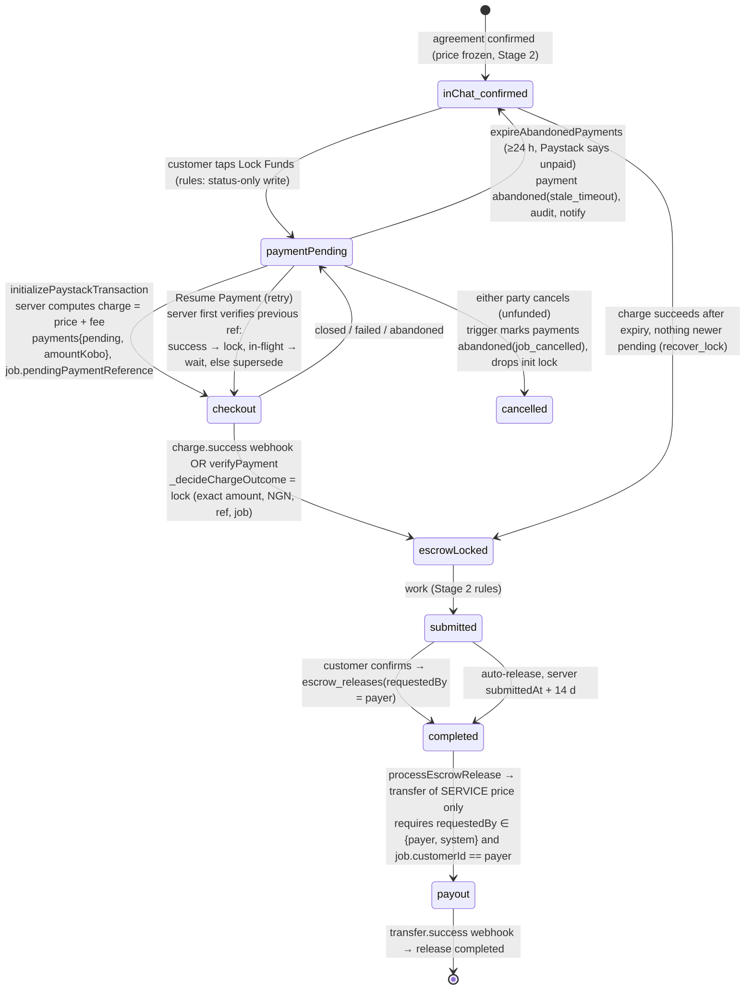

# HandyTrust Remediation — Stage 3 Report: Payment Initialization, Verification & Escrow Integrity (2026-11-03)

**Nothing was deployed, committed or pushed. No production Firebase and no Paystack system (live or test) was accessed.** Paystack was replaced by injected fakes in every test; Firestore ran in the local emulator.

---

## 0. Pre-Stage-3 verification of Stage 2

| Check | Result |
|---|---|
| Stage 2 suites re-run before any Stage 3 change | Flutter 103/103, functions 50/50, rules 84/84 ✔ |
| **Payout identity protection** | Previously checked only by pure-function tests. **Now proven end to end in the emulator** (`stage3_escrow_emulator.test.js`): a release requested by the artisan → refused, no transfer, admin alert. A job whose customer ≠ payer → refused. |
| **Cancellation-request idempotency** | **Gap found.** The rule correctly allows only one pending request, but the Cloud Function used `admin_alerts.add()`, so a redelivered trigger would create duplicate alerts and duplicate notifications to the other party. **Fixed:** deterministic alert ID (`paidcancel_{jobId}_{requestedAtMs}`) with `create()`; the notification is sent only after a first create. Emulator-tested. |
| **Suspension consistency** | Firestore: new activity blocked, existing jobs allowed ✔. Cloud Functions: no suspension checks, which is correct for D9 "existing jobs continue" (a suspended customer can still pay for an existing job), and payouts are never initiated by the artisan ✔. Flutter: **the router still locks suspended users out of the whole app** (`lib/routes/router.dart:131`), so the "restricted existing-jobs mode" (D9 final decision) is **not yet implemented**, and **fraud-type freezes don't exist yet** (no suspension type is recorded). See §5, risks R-3/R-4. |

---

## 1. Platform-fee economics (D1) — recalculated from official pricing

**Sources (fetched 2026-11-03):** Paystack *Transactions pricing* (official): local **1.5% + ₦100, ₦100 waived under ₦2,500, capped at ₦2,000**; international **3.9% + ₦100** (Amex **4.5%**). Paystack *Transfers pricing* (official): **₦10** ≤ ₦5,000, **₦25** ₦5,001–₦50,000; **₦50** above ₦50,000 (shown in Paystack's official stamp-duty worked example). Paystack *Stamp Duty* (official): **₦50 per transfer ≥ ₦10,000 from the balance, since 18 Feb 2026, borne by the merchant.** Refunds: Paystack states **processing fees are not returned**. Not modelled: VAT on Paystack fees (ask Paystack/your accountant).

**Exact formulas (in kobo, as now implemented and tested):**
```
service   = round(agreedPrice × 100)
fee       = max(round(service × 5%), minPlatformFee)        [policy D1]
charge    = service + fee
paystack  = min(round(charge × 1.5%) + (charge ≥ ₦2,500 ? ₦100 : 0), ₦2,000)
transfer  = service ≤ ₦5,000 → ₦10 ; ≤ ₦50,000 → ₦25 ; else ₦50
stamp     = service ≥ ₦10,000 → ₦50 ; else 0
net       = fee − paystack − transfer − stamp
refund before work (D2) → HandyTrust net = −paystack  (customer gets 100% of charge)
```

**Result (computed by `functions/test/stage3_payments.test.js`, every naira from ₦100 to ₦200,000):**

| Policy | Agreed prices where HandyTrust loses money |
|---|---|
| **Approved: 5%, no floor** | **₦100–₦291** (the transfer fee exceeds 5%) and **₦2,381–₦3,211** (the charge crosses ₦2,500, so the ₦100 flat fee applies) |
| 5% with a **₦200 minimum platform fee** | **none** |
| 5% with a **₦3,212 minimum job value** (no floor) | **none** |

Selected points (approved policy, computed in code): ₦3,000 job → −₦7.25. ₦10,000 → +₦167.50 (stamp duty now included, down from the Stage 2 estimate of ₦217.50). ₦50,000 → +₦1,537.50. ₦200,000 → +₦7,900. **Every pre-work refund loses the full processing fee** (₦257.50 on a ₦10,000 job).

**Recommendation (your decision — not applied):** set `minPlatformFeeNgn = 200` in `config/platform`. It removes every loss band while keeping small jobs on the platform. The trade-off is that the effective fee is high on tiny jobs (₦1,000 → 20%, ₦2,000 → 10%; 5% applies from ₦4,000). The alternative, `minJobValueNgn = 3212` (or a round ₦3,500), keeps a flat 5% but excludes small jobs from online payment. Both are one configuration value; **the code defaults are exactly your approved policy** (5%, no floor, ₦100 minimum job value, matching the existing payment-screen minimum). Refund losses are inherent to D2 and can only be reduced by fewer pre-work cancellations.

**International cards:** at 3.9% + ₦100 they lose money on every job below ₦19,337, and Amex (4.5%) below ₦27,271 (computed with the same formulas). Per D1 they must stay disabled. **The real control is the Paystack account setting** (see §2); code can't stop a foreign card from being charged. Stage 3 records the card country on every payment and raises a `non_domestic_card_payment` admin alert if one ever gets through.

---

## 2. Approvals and clarifications needed (not legal advice)

| Area | What to confirm, and with whom |
|---|---|
| **Paystack — settlement vs. escrow (operationally critical)** | Payouts are transfers **from the Paystack balance**. If the account settles collections to your bank automatically, the balance won't hold the escrowed funds and **payouts will fail for insufficient balance**. Confirm with Paystack how settlement is configured, and whether collections can be held in the balance for the 14-day review window plus dispute time. |
| Paystack — transfers | Transfers must be enabled on the account; API transfers typically require turning off transfer OTP in the dashboard. Confirm both, plus any limits. |
| Paystack — marketplace/escrow use case | Disclose the model (collect from customers, hold, pay third-party artisans, keep a 5% fee) and ask whether it's permitted under your agreement, or whether they require their marketplace products (split payments / subaccounts) or extra review. |
| Paystack — international payments | Confirm international card acceptance is **disabled** on the account (D1). |
| Paystack — refunds & chargebacks | Refund API availability; behaviour of refunds on bank-transfer/USSD payments; who bears a chargeback after an artisan has already been paid. |
| Legal — holding funds | Whether collecting and holding customer funds on behalf of artisans needs a CBN licence or a particular structure (e.g. a commercial-agent arrangement, or using a licensed escrow partner). **Counsel.** |
| Legal/tax — fee | VAT on the 5% platform fee and HandyTrust's VAT registration; how the fee and refund policy are disclosed in customer terms (consumer protection). **Accountant/counsel.** |
| Legal — terms | Customer terms (fee, 14-day window, refunds per D2, disputes) and an artisan agreement (payout timing, the full agreed price, dispute outcomes). |
| Data protection | Payment data stays with Paystack; NDPA 2023 duties already flagged for D8 location data and ID documents. |

---

## 3. Payment lifecycle (as implemented after Stage 3)



**Every successful charge goes through one decision function** (`_decideChargeOutcome`, shared by the webhook, `verifyPayment`, the init retry check and the expiry sweep):

| Situation | Outcome |
|---|---|
| Exact match on the job's current pending payment | **lock** |
| Same charge redelivered / webhook + verify race | **already_locked** / **already_recorded** (no change, HTTP 200) |
| Underpaid, overpaid, missing fee, non-NGN, metadata for another job | **requires_refund** + admin alert; job **not** funded |
| Paid after the job was cancelled | **requires_refund** (`paid_after_cancellation`) |
| Old reference paid while a newer one is pending | **requires_refund** (`superseded_by_newer_payment`) |
| Second charge after the job was already funded | **requires_refund** (`duplicate_or_late_payment`) |
| Charge with no payment record at all | **requires_refund**, recorded in `orphan_charges/{reference}` (Admin-SDK only) |
| Paid just after the 24 h expiry, nothing newer pending | **recover_lock**: the customer's payment is honoured |

Refund-required records and alerts use deterministic IDs, so a redelivery never duplicates them. The webhook now answers **200** for every recorded outcome. Previously, any unexpected state threw and returned **500**, so Paystack kept retrying it. **The refund itself (D2) is Stage 4.** Until then these are an admin queue (§5, R-1).

---

## 4. What changed

### 4.1 `functions/index.js`
| Change | Why |
|---|---|
| `config/platform` (+ `_normalizePlatformConfig`, `_loadPlatformConfig`): `platformFeePercent` 5, `minPlatformFeeNgn` 0, `minJobValueNgn` 100, `abandonedPaymentHours` 24. Invalid values fall back per key; a bad config can never zero the fee | D1/D5 configurable through trusted backend settings (client writes to `config` are already denied by rules) |
| `_computeCharge` (integer kobo) used by `initializePaystackTransaction` and the new `getPaymentBreakdown` callable | D1 fee charged on top; the UI shows the same server numbers (HT-013) |
| Payment records now store `serviceAmount`, `platformFee`, `totalCharged`, `amountKobo`, `currency`, `feePolicy`; `amount` stays the service price (payout/wallet/admin readers unchanged) | Exact-match verification; backward-compatible |
| `initializePaystackTransaction`: sets `job.pendingPaymentReference` / `paymentInitializedAt`. On a retry it first verifies the previous reference with Paystack: success → lock and return `alreadyPaid`; in flight / unverifiable → refuse (no second charge); otherwise mark it superseded | Duplicate-initialization and retry safety |
| `_decideChargeOutcome` + rewritten `_lockEscrow(jobId, reference, charge)` (transactional; records Paystack fees, channel, card country) | HT-016 strict charge matching; late/duplicate payments; webhook retry storms |
| Webhook passes the signature-verified `event.data`; `verifyPayment` now checks that the caller is the job's customer or an admin, uses `HttpsError` (HT-035), and reports success only when the charge actually funds the job | HT-016, HT-035 |
| `_paystackVerify`: Paystack 400/404 → `not_found` (definitely unpaid); network/5xx still throw (never assumed unpaid) | Safe expiry decisions |
| **New scheduled `expireAbandonedPayments` (hourly)** + `_sweepAbandonedPayments`, `_decideStalePaymentAction`: after `abandonedPaymentHours`, verify every reference involved. Success → lock (recovers missed webhooks); in flight / unverifiable → wait; definitely unpaid → transactional revert to `inChat` (agreement kept), payments `abandoned`, server audit-log entry, init lock dropped, customer notified | D5 abandoned payments, HT-009, HT-010 (payment part) |
| On cancel from `paymentPending`: pending payments → `abandoned(job_cancelled)`, init lock dropped | Late payment after cancellation is detected, never applied |
| Payout pays `_payoutAmountNgn(payment)` = the **service price**, never the fee | D1 |
| `processEscrowRelease` body extracted to `_processEscrowRelease(releaseRef, releaseId, http)` (the trigger is unchanged in behaviour; `http` is injectable for tests) | Testability |
| **Double-payout fix (pre-existing bug, found by the new emulator test):** after the transfer call the release status was set to Paystack's raw status, typically `pending`, which re-opened the idempotency claim, so a redelivered trigger would start a **second transfer**. A release is now `processing` (or `failed`) after the call, with the raw status in `paystackTransferStatus` | Financial integrity |
| `_releaseEscrow` no longer calls `_recordJobOutcome` (the `onJobCompleted` trigger already does) | HT-017 double counting |
| `_handlePaidCancellationRequest` idempotent (see §0) | Stage 2 gap |

### 4.2 Flutter
| File | Change |
|---|---|
| `lib/core/services/paystack_service.dart` | `getPaymentBreakdown()` + `PaymentBreakdown`. `initializeTransaction` returns `null` on `alreadyPaid` and reads the server's breakdown |
| `lib/screens/payment/payment_screen.dart` | Fee breakdown comes **from the server** (the hard-coded 5% calculation is removed). Skips the status write when resuming a `paymentPending` job (HT-009). Stops with a clear error if starting payment failed (HT-042). Handles `alreadyPaid` |
| `lib/core/services/workflow_gate_service.dart` | `paymentPending`: customer gets **"Resume Payment"**; artisan is told to wait for confirmed payment |
| `lib/models/payment_model.dart` | Statuses `abandoned`, `requiresRefund` (previously any unknown status parsed as `pending`). Fields `platformFee`, `totalCharged`, `chargedTotal` |
| `lib/screens/wallet/wallet_screen.dart` | Status labels for the two new statuses ("Expired", "Refund Pending"; required by an exhaustive `switch`). Customer "total spent" uses what was actually charged |

### 4.3 Tests
| File | Tests |
|---|---|
| `functions/test/stage3_payments.test.js` (**new**) | 36 pure tests: fee maths and rounding, config normalization, payout amount, the full `_decideChargeOutcome` matrix, stale-payment decisions, **exact D1 loss-band computation** |
| `functions/test/stage3_escrow_emulator.test.js` (**new**) | 19 emulator tests: lock, duplicate webhook, underpayment, late payment after cancellation, duplicate charge, orphan charge, non-NG card, the expiry sweep (revert, recover, missed-webhook lock, in-flight/unverifiable/young, configurable hours), auto-release window + single count, **payout pays the service price only**, payout identity refusals, **no double payout on trigger redelivery**, idempotent cancellation alert |
| `firestore-tests/security_regression.test.js` | +2: clients can't write `pendingPaymentReference`/`paymentInitializedAt`/`paymentReference`/`paymentExpiredAt`; can't touch `config`, `orphan_charges` or `payment_init_locks` |
| `test/payment_stage3_test.dart` (**new**) | 6: Resume Payment step (customer/artisan), `PaymentBreakdown` parsing, `PaymentModel` fee fields + new statuses |
| `functions/package.json` | `npm test` includes the new files |

No `firestore.rules` change was needed in Stage 3: the new server-owned fields are already outside every client whitelist (proven by the new tests).

---

## 5. Test results (executed 2026-11-03)

| Suite | After Stage 2 | **After Stage 3** |
|---|---|---|
| Flutter `flutter test` | 103 | **109 / 109 passed** |
| Functions `npm test` (emulator) | 50 | **105 / 105 passed** |
| Rules `npm test` (emulator) | 84 | **86 / 86 passed** |
| `flutter analyze` | — | No errors. Only the pre-existing unused-import warning in `lib/core/platform_utils.dart` (untouched) |

Adversarial scenarios covered: underpayment, missing fee, foreign currency, wrong-job metadata, unknown reference, duplicate webhook, webhook/verify race, second charge, old-reference-after-retry, payment after cancellation, payment after expiry, artisan-requested release, rewritten customer identity, trigger redelivery on payout, client writes to server-owned payment fields and config. Normal customer/artisan scenarios: pay → lock; resume after an abandoned checkout; expiry → pay again; confirm → payout of the agreed price; auto-release after 14 days.

**Not executed:** an end-to-end run in Paystack **test mode** (I have no test keys and must not access payment systems). See the checklist in §7.

---

## 6. Migration and compatibility risks

| # | Risk | Mitigation |
|---|---|---|
| M-1 | **Old app builds** still compute "5%" locally on the payment screen. It matches the server only while `minPlatformFeeNgn = 0` | Don't set a fee floor until the new build has been adopted, or gate on a minimum app version |
| M-2 | Old builds receiving `alreadyPaid` (rare: a retry whose earlier attempt actually succeeded) fail to parse it and show "Payment could not be started", though escrow is locked | Acceptable (money correct; the job page shows Payment Complete). Disappears with the new build |
| M-3 | Old builds have no "Resume Payment" button | The expiry sweep returns their stuck jobs to `inChat` after 24 h so they can pay again |
| M-4 | **Payments initialized before this deploy** have no `amountKobo` | Expected charge falls back to `amount × 100`, which is exactly what was charged pre-fee. Tested |
| M-5 | `paymentPending` jobs from before this deploy have no `pendingPaymentReference`/`paymentInitializedAt` | Lock logic accepts a missing reference; the sweep falls back to `lastUpdatedAt`. Tested |
| M-6 | **Existing `escrow_releases` left in `pending` after a transfer was already initiated** (by the old double-payout bug) | **Before deploying,** list releases with `status == 'pending'` **and** a `paystackTransferCode`, then set them to `processing` by hand. Otherwise a future re-trigger could pay again |
| M-7 | Paystack may still be retrying webhooks that previously got a 500 | After deploy they're handled and land in the refund queue as `requires_refund` where appropriate |
| M-8 | New scheduled function `expireAbandonedPayments` | Needs Cloud Scheduler (already used by `autoReleaseEscrow`) and the `PAYSTACK_SECRET_KEY` secret binding |
| M-9 | `config/platform` doesn't exist yet | Defaults apply (= approved policy). Create it only to change policy |
| Deploy order | Functions first (all changes are additive or stricter), then the app. No rules change this stage | — |

---

## 7. Remaining risks

| # | Risk | Severity | Plan |
|---|---|---|---|
| R-1 | **Refunds aren't automated.** `requiresRefund` payments, `orphan_charges` and paid-cancellation requests are an admin queue, refunded by hand in the Paystack dashboard. D2's "verify refund status with Paystack before marking refunded" isn't implemented yet | High (operational) | **Stage 4** |
| R-2 | Dispute settlement still moves no money (HT-007) | Critical (unchanged) | **Stage 4** |
| R-3 | **D9 fraud/safety freezes don't exist.** With no suspension type, an artisan suspended for fraud still gets an auto-released payout | High | Stage 4 (freeze flag checked by `processEscrowRelease` and `_releaseEscrow`) + admin UI |
| R-4 | **D9 restricted existing-jobs mode** isn't implemented (the router locks suspended users out entirely) | Medium | Stage 5 |
| R-5 | Approved fee policy loses money in two bands (§1) | Medium (financial) | Your decision on `minPlatformFeeNgn` / `minJobValueNgn` |
| R-6 | International cards can't be blocked in code | Medium | Paystack account setting (§2); alerts are in place |
| R-7 | **Settlement configuration** could make every payout fail (§2) | High (operational) | Confirm with Paystack before go-live |
| R-8 | A retry can be refused with "previous payment still being processed" while Paystack reports a slow bank transfer as in flight | Low (UX) | By design (prevents double charges); the sweep resolves it |
| R-9 | Trigger wiring (webhook HTTP handler, schedule, `onJobCompleted` → abandon/timers) is reviewed, not run in a Functions emulator. The functions they call are emulator-tested | Medium | Stage 7 Functions-emulator harness |
| R-10 | `_alertAdminDispute` / `onDisputeCreated` still use `add()` (possible duplicate alerts on redelivery). Pre-existing, cosmetic | Low | Stage 4 (dispute work) |
| R-11 | Sweep processes at most 500 `paymentPending` jobs per hourly run | Low | Fine at current scale; paginate later |

**Paystack test-mode checklist for you (before go-live):**
1. Pay ₦10,000 → charge ₦10,500, job escrowLocked, payment `paystackFeesKobo` recorded.
2. Close checkout → Resume Payment → pay → single charge.
3. Leave unpaid for 24 h → job back to inChat with a notification.
4. Cancel during checkout, then complete payment → payment `requiresRefund` + admin alert.
5. Confirm completion → the transfer is ₦10,000 (not ₦10,500).
6. Redeliver the webhook from the dashboard → no change.

---

## 8. Stage 3 acceptance criteria (Stage 1 §7)

| Criterion | Status |
|---|---|
| No client can influence the charged amount, the payout amount or the review window | **Met.** Charge = server `_computeCharge` on the frozen price; payout = service price; window = server `submittedAt` (rules + emulator tests) |
| Escrow locks only on an exact payment match | **Met.** Amount (kobo), currency, reference and job, from Paystack's own data; every mismatch → refund queue (tested) |
| Abandoned payment resumable from the UI and auto-reverted server-side | **Met.** Resume Payment + hourly expiry with Paystack verification (tested) |
| Fee model matches displayed numbers end to end | **Met in code and tests** (the UI shows the server's `getPaymentBreakdown`, computed by the same function as the charge). **Paystack test-mode confirmation is outstanding (§7 checklist)** |
| Auto-release counts once | **Met** (emulator test) |
| Duplicate initialization / retries / late payment after cancellation / webhook verification | **Met** (tested) |
| Refunds and dispute fund handling | **Out of scope by design: Stage 4** |

**Stage 3 is complete, pending your review.** Before Stage 4, please decide R-5 (fee floor or minimum job value) and confirm the Paystack settlement question (R-7), since the refund and dispute-settlement design in Stage 4 depends on how funds sit in the Paystack balance.
