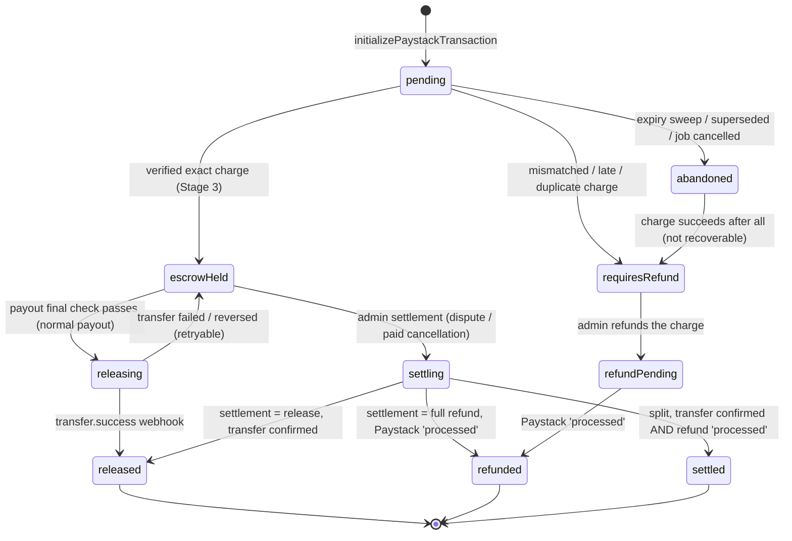
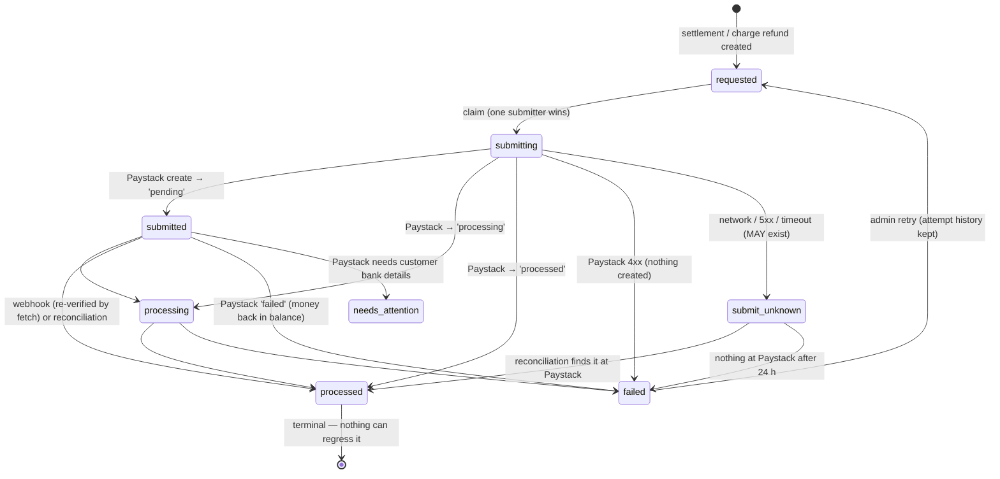
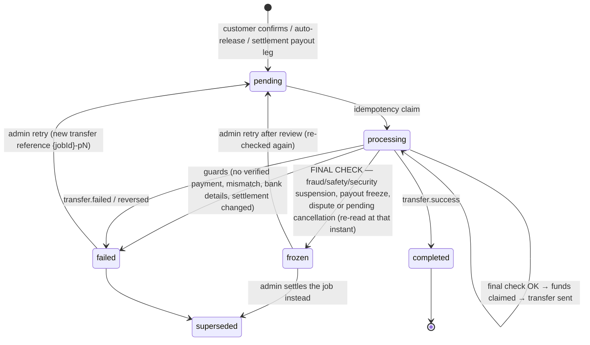
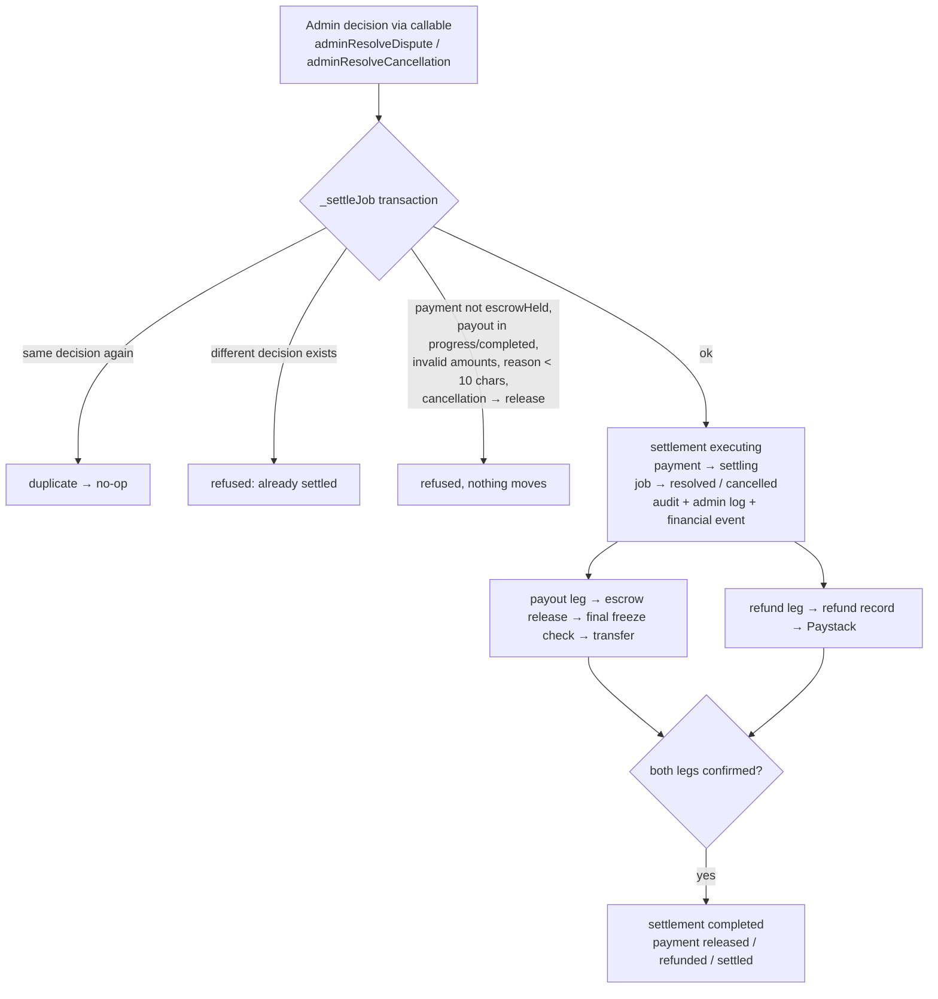

# HandyTrust Remediation — Stage 4 Report: Refunds, Dispute Settlement, Fraud Freezes (2026-11-03)

**Nothing was deployed, committed or pushed. No production Firebase and no Paystack system (live or test) was accessed.** All Paystack refund and transfer calls in the tests go to injected fakes, and Firestore ran in the local emulator.

---

## 0. Pre-implementation review

| Check | Finding |
|---|---|
| Stage 3 payment lifecycle re-read | Confirmed. Stage 4 builds on its single charge-decision function and payment records. |
| Existing payout state machine | `escrow_releases`: pending → processing → completed/failed. **Gap:** the payment document was never claimed during a payout, so nothing stopped a refund and a payout from both drawing on the same funds. **Gap:** auto-release marked the payment `released` *before any money moved*. Both fixed. |
| Dependencies | Refunds, payouts and settlements all act on one `payments` document per job, which is now the single **funds mutex** (§2). Disputes depend on `jobs`, `disputes` and the new `settlements`. Freezes depend on `users`/`artisans` (`accountStatus`, `suspensionType`, `payoutFrozen`) and `jobs.payoutFrozen`. |
| **Paystack refund API limitations** (official docs mirror) | `POST /refund {transaction, amount?}`; no `amount` means a full refund; the refund can't exceed the transaction. Statuses: `pending`, `processing`, `processed`, `failed`, plus a `needs-attention` webhook when Paystack needs the customer's account number. **A failed refund is credited back to the merchant balance, so a retry is possible.** Webhooks carry `transaction_reference` and `status` but **no refund ID**. "Processed" can still take up to **10 business days** to reach the customer. **Not documented on the pages available:** the unit of `amount` (kobo assumed, as for all other Paystack amounts), the list-refunds filter (`transaction` assumed), and the needs-attention retry endpoint. Each assumption is isolated in one injectable client and must be confirmed in test mode (§7). |
| Design consequences | One refund record per transaction (ID = Paystack reference). A webhook is treated as a *prompt to verify*: the refund is re-fetched when its ID is known. Ambiguous submissions (network error) are **never** retried blindly and are resolved by reconciliation. |

---

## 1. D1 — minimum job value ₦3,212 (implemented)

- **Backend config:** `PLATFORM_CONFIG_DEFAULTS.minJobValueNgn = 3212` (`config/platform` can override it; that document is Admin-SDK/console write only).
- **Enforcement:**
  - **Cloud Functions:** `getPaymentBreakdown` and `initializePaystackTransaction` refuse jobs below the minimum.
  - **Firestore rules:** quotes (create and edit), customer agreement confirmation and artisan acceptance must be ≥ `minJobValueNgn()`, which reads the same config and defaults to 3212.
- **Shown to users before they commit:**
  - job request ("Minimum job value for secure payment: ₦3,212");
  - quote submission (blocked below the minimum, with a message);
  - quote acceptance (blocked, "ask the artisan to revise");
  - agreement confirmation (helper text and check);
  - direct booking (helper text and check).
- **Validated against official Paystack pricing:** the automated loss-band test (Stage 3 formulas: 1.5% + ₦100 waived below ₦2,500, ₦2,000 cap; transfer ₦10/₦25/₦50; ₦50 stamp duty ≥ ₦10,000) now asserts **no loss band anywhere from ₦3,212 to ₦200,000**, that ₦3,211 is refused, and that ₦3,212 nets ≥ ₦0.
- **International:** unchanged. It must stay disabled at the Paystack account level; code only alerts (`non_domestic_card_payment`).

---

## 2. Financial state machines (as implemented)

### 2.1 Payment document: the funds mutex
Every money movement first claims the payment inside a Firestore transaction. Two movements can't both succeed, because each requires a specific prior state.

### 2.2 Refund record (`refunds/{paystackReference}`)

### 2.3 Payout / escrow release (`escrow_releases/{jobId}`)

### 2.4 Settlement (`settlements/{jobId}`) and job outcome

| Outcome | Artisan receives | Customer refunded | HandyTrust retains |
|---|---|---|---|
| `release` (dispute only) | full agreed service price | 0 | the 5% fee |
| `full_refund` | 0 | **everything paid, incl. the 5% fee** (D2) | 0 (and absorbs the non-refundable Paystack fee) |
| `split` | admin amount ≤ service price | admin amount; artisan + refund ≤ total paid | the remainder, recorded explicitly |
| `decline` (paid cancellation) | nothing moves; the job continues | — | — |

---

## 3. What changed

### 3.1 `functions/index.js`
| Area | Change |
|---|---|
| **Payout (`_processEscrowRelease`)** | Rewritten. Normal and settlement payouts share one path. **The last step before the transfer is one transaction** that re-reads the job, payment, settlement, `users/{artisan}` and `artisans/{artisan}`, evaluates `_payoutBlockReason`, and only then claims the funds (`escrowHeld → releasing`, or the settlement payout leg → `processing`). A freeze → release `frozen`, payment untouched, `payout_frozen` alert, financial event. A concurrent settlement → abort. A transfer-call error is the *only* thing treated as a failed transfer; bookkeeping after an accepted transfer can never mark it failed (**bug found by the Stage 4 tests:** an `undefined` field had turned a started transfer into "failed", which an admin retry would have paid twice). Retried payouts use a new Paystack reference `{jobId}-pN`. |
| **Freezes** | `_payoutBlockReason`. Fraud/safety/security suspensions, **and unclassified legacy suspensions (fail closed)**, explicit artisan or job `payoutFrozen`, plus (for normal payouts) a dispute or pending cancellation request. Administrative/verification suspensions don't freeze (D9 restricted mode). |
| **Auto-release (`_releaseEscrow`)** | Re-evaluates freezes inside its own transaction at run time (not when the timer started). Blocked → job stays `submitted`, `autorelease_blocked` alert. No longer marks the payment `released` early. Skips settled jobs. |
| **Transfer webhooks** | `_onTransferSucceeded` / `_onTransferFailed`: idempotent; stale attempts ignored; failure returns the funds claim (payment back to `escrowHeld`) so an admin can retry; pre-Stage-4 transfers (unclaimed payment) are still marked released (migration fix). |
| **Refunds** | `refunds` collection; `_submitRefund` (claim → create → Paystack status); `_applyRefundStatus` (monotonic, `processed` terminal, mirrored to payment/job/settlement, financial event, alerts on failed/needs-attention, customer notification on processed); `_onRefundWebhook` (re-verifies by fetch; amount-mismatch alert); `_reconcileRefunds` + **scheduled `reconcileRefunds` every 3 h**; `_retryRefund` (only after a Paystack-reported failure). |
| **Settlements** | `_settleJob`, `_executeSettlement`, `_finalizeSettlementIfDone`, `_validateSettlement`. Disputes: release / full refund / split. Paid cancellations (D2): full refund / split, **never a straight release**. Mandatory reason (≥ 10 characters). Duplicate-safe. |
| **Other admin operations** | `_declineCancellationRequest`, `_refundCharge` (the Stage 3 refund queue; refunds the amount *actually captured*, now recorded as `chargedAmountKobo`), `_retryPayout`, `_setPayoutFreeze`. |
| **Admin callables** (all check `admins/{uid}`) | `adminResolveDispute`, `adminResolveCancellation`, `adminRefundCharge`, `adminRetryRefund`, `adminRetryPayout`, `adminSetPayoutFreeze` |
| **Audit trail** | Append-only `financial_events` for every money state change. `admin_audit_logs` written **server-side** for every decision. Job `auditLogs` entries for settlements. |
| D1 | `minJobValueNgn` default 3212 |

### 3.2 `firestore.rules`
- `minJobValueNgn()` enforced on quote create/edit, customer agreement confirmation and artisan acceptance.
- **Admin client** job updates: now only a status change on an **unfunded** job (requested/matched/inChat/paymentPending → requested/matched/inChat/cancelled). Previously `isAdmin()` allowed any write, including `resolved` with no money movement. Admin **delete**: unfunded jobs only (HT-008).
- `suspensionType`, `payoutFrozen` and the freeze audit fields are server/admin-only on `users` and `artisans`.
- A customer can't create an escrow release once a settlement exists.
- `refunds`, `settlements`, `financial_events`: admin read only; no client writes.

### 3.3 Flutter
| File | Change |
|---|---|
| `lib/core/services/admin_finance_service.dart` (**new**) | Wrapper for the six admin callables |
| `lib/providers/platform_config_provider.dart` (**new**) | Reads `config/platform` (default ₦3,212) for display and validation |
| `lib/screens/admin/admin_finance_dialogs.dart` (**new**) | Settlement dialog (outcomes, split amounts, held-amount breakdown, mandatory reason), reason dialog, suspension-type dialog |
| `lib/screens/admin/admin_dashboard_screen.dart` | Dispute resolve/dismiss → settlement dialog → `adminResolveDispute`. Alert rows: **"Take action"** for paid cancellation requests, charges requiring refund, failed refunds, frozen/failed payouts. New alert labels. Suspension requires a type (fraud/safety/security freeze payouts). |
| `lib/screens/job/job_detail_screen.dart` | D1 checks (quote acceptance, agreement price + helper text). The cancelled-job box shows the **real refund state** ("in progress" / "processed — up to 10 business days" / "delayed") |
| `lib/screens/home/service_request_screen.dart`, `lib/screens/artisan/open_jobs_feed_screen.dart`, `lib/screens/artisan/secure_booking_screen.dart` | D1 minimum shown and checked |
| `lib/models/payment_model.dart`, `lib/screens/wallet/wallet_screen.dart` | Statuses `releasing`, `refundPending`, `settling`, `settled` + wallet labels |
| `lib/models/job_model.dart` | `refundStatus`, `settlementOutcome`, `settlementStatus` |
| `lib/core/services/dispute_service.dart` | `resolveDispute` marked `@Deprecated` (the rules now refuse its status-only write) |

### 3.4 Tests
| File | Tests |
|---|---|
| `functions/test/stage4_settlement_emulator.test.js` (**new**) | 34 emulator tests (scenarios in §4) |
| `functions/test/stage4_pure.test.js` (**new**) | 16 tests: freeze rules, settlement validation, refund status machine |
| `functions/test/stage3_payments.test.js` | Updated for the ₦3,212 default: the Stage 3 loss bands are now pinned to an explicit ₦100 config as a historical record, plus 2 new D1 tests |
| `firestore-tests/security_regression.test.js` | +7: minimum job value (default and config), admin client can't move money or rewrite funded jobs, admin may still cancel/delete unfunded jobs, freeze fields server-only, financial records unreadable, no release after settlement |
| `test/stage4_test.dart` (**new**) | 9: config default/override/inclusive minimum, new payment states, job refund mirror |
| `functions/package.json` | Runs the new files |

---

## 4. Test results (executed 2026-11-03)

| Suite | After Stage 3 | **After Stage 4** |
|---|---|---|
| Flutter `flutter test` | 109 | **118 / 118 passed** |
| Functions `npm test` (emulator) | 105 | **157 / 157 passed** |
| Rules `npm test` (emulator) | 86 | **93 / 93 passed** (incl. full-size-document cost tests) |
| `flutter analyze` | — | No errors. Only the pre-existing unused-import warning (`lib/core/platform_utils.dart`) |

Required scenarios and where they're proven (`stage4_settlement_emulator.test.js` unless noted):

| Requirement | Tests |
|---|---|
| Full refunds | "refund is NOT marked refunded until Paystack reports processed"; duplicate/out-of-order webhooks; needs-attention; admin callable path |
| Partial refunds | Split settlement (cancellation and dispute); invalid-split refusals |
| Failed and retried refunds | Paystack-reported failure → retry → processed; retry refused unless failed; 4xx rejection; network error → `submit_unknown` → reconciliation finds it; nothing at Paystack after 24 h → failed |
| Dispute release / refund / split | Three dedicated tests + audit-trail test |
| Fraud suspension before auto-release | Auto-release blocked + alert; legacy suspension fails closed; administrative suspension still pays (D9) |
| Fraud suspension during payout processing | Freeze applied via the test hook *after* the claim, *before* the final check → frozen, no transfer |
| Freeze on admin settlement payouts | "fraud freeze beats an admin decision" |
| Duplicate admin actions | Same settlement twice → one refund; different decision → refused; idempotent decline; duplicate charge refund |
| Concurrent refund and payout | Concurrent conflicting settlements → exactly one wins; settlement landing during a payout → payout aborts, money moves once; refund refused once the payout has claimed the funds |
| Transfer failure / retry / stale webhook | Funds claim returned, retry uses `{jobId}-p2`; stale success ignored, duplicate success a no-op |
| Legitimate flows | Customer confirm → payout of the service price (Stage 3/4); auto-release with administrative suspension; full rules suite of legitimate customer/artisan payloads (93) |
| Authorization | All six admin callables refuse unauthenticated and non-admin callers; an admin call reaches the engine |

---

## 5. Migration and compatibility

| # | Item | Action |
|---|---|---|
| M-1 | **Jobs already agreed below ₦3,212** can no longer be paid (server refuses). Quotes and agreements below it can't be created by any app version | Before deploying, count them (aggregate script, D10). Either finish them by temporarily lowering `config/platform.minJobValueNgn`, or cancel them with notice |
| M-2 | Old admin app builds: dispute "resolve" now fails (the rules refuse status-only resolution) | Admins must use the new build |
| M-3 | **Existing suspensions have no `suspensionType`**, so they now **freeze payouts** (fail closed) | Have admins re-classify current suspensions after deploy (the suspend dialog requires a type) |
| M-4 | Pre-Stage-4 transfers still `processing` with an unclaimed payment | Handled: their success webhook marks the payment released (tested) |
| M-5 | Stage 3 M-6 still applies (releases left `pending` with a transfer code by the old bug) | Fix manually **before** deploy |
| M-6 | Existing `resolved` disputes with funds still `escrowHeld` (from before Stage 4) | Not auto-migrated. Re-open them as admin settlements, case by case (the engine requires `disputed`); they'll appear in the D10 aggregate count |
| Deploy order | Functions → rules → app (admin + customer). The rules reference `config/platform`, which may be absent (the default applies) | — |

---

## 6. Remaining risks

| # | Risk | Severity | Plan |
|---|---|---|---|
| R-1 | Refund `amount` unit (kobo assumed), list-refunds `transaction` filter, and fetch endpoint aren't confirmed in Paystack's docs | **High until confirmed** | Test-mode checklist (§7); one injectable client to adjust |
| R-2 | `needs_attention` refunds must be completed in the Paystack dashboard (the customer's account number is needed); no in-app flow | Medium | Alert + manual; consider in-app collection later |
| R-3 | **Paystack balance/settlement configuration** (Stage 3 R-7) still determines whether payouts *and* refunds can be funded | **High (operational)** | Confirm with Paystack before go-live |
| R-4 | Chargebacks (a customer disputes with their bank after payout) aren't modelled | Medium | Policy + manual handling; consider a chargeback webhook later |
| R-5 | D9 restricted existing-jobs **app mode** still not built (the router locks suspended users out), although the server already lets administrative suspensions complete | Medium | **Stage 5** |
| R-6 | No dedicated admin UI button for *artisan/job payout freeze* toggles (`adminSetPayoutFreeze` exists and is tested; the suspension types cover fraud freezes) | Low | Add with Stage 5 admin work |
| R-7 | Webhook HTTP and schedule wiring run only through their handler functions (tested), not in a Functions emulator | Medium | Stage 7 harness |
| R-8 | `onDisputeCreated` / `_alertAdminDispute` still use `add()` (possible duplicate alerts) | Low | Stage 5 |
| R-9 | Platform-retained remainders on splits need accounting treatment (and VAT, per Stage 3 §2) | Low (finance) | Accountant |
| R-10 | Legal/Paystack approvals (escrow model, CBN, VAT, terms) from Stage 3 §2 are unchanged | High (business) | Owner action |

---

## 7. Paystack test-mode checklist (owner, before go-live)
1. Pay ₦10,000 (charge ₦10,500) → request cancellation → admin **Full refund** → refund `submitted`. When the dashboard shows it processed, the job reads "Refund processed" and the refund amount is **₦10,500** (this confirms the kobo unit, R-1).
2. Split ₦6,000 / ₦4,500 on a ₦10,000 job → a ₦6,000 transfer and a ₦4,500 refund; the settlement completes only after both.
3. Force a refund failure (Paystack test card/scenario) → `refund_failed` alert → **Retry** → processed.
4. Suspend the artisan as **fraud** → confirm completion → payout `frozen`, alert. Reactivate → **Retry payout** → paid once.
5. Redeliver refund and transfer webhooks from the dashboard → no change.
6. Call `GET /refund?transaction=<ref>` once to confirm the list filter (R-1).

---

## 8. Stage 4 acceptance criteria

| Priority / requirement | Status |
|---|---|
| 1. Secure full and partial refunds | **Met.** Server-only, admin-authorized, amount-validated, idempotent |
| 2. Actual money movement for dispute outcomes | **Met.** Release / full refund / split (HT-007 closed) |
| 3. Fraud-related suspension and payout freezes | **Met** (server). Admin UI for suspension types done; freeze toggle UI pending (R-6) |
| 4. Auto-release and manual payout respect freezes and suspension | **Met.** Evaluated at run time in both, and **immediately before every transfer** in the funds-claim transaction |
| **Critical:** no automatic or manual payout to a fraud-frozen artisan; frozen payment protected + alert | **Met.** Tested before auto-release, before payout, during payout processing, and for admin settlements |
| 5. Admin cancellation and dispute-resolution workflow | **Met.** Callables + dashboard dialogs + alert actions |
| 6. Refund status reflects Paystack's actual lifecycle | **Met in code/tests.** Only Paystack-reported status advances a refund; `processed` is terminal. **Test-mode confirmation outstanding (§7)** |
| 7. Idempotency and concurrency protection | **Met.** Payment funds mutex, create-once settlements/refunds, claims, deterministic alerts; concurrency tests |
| 8. Complete financial audit trail | **Met.** `financial_events` (append-only, server-only) + server-side `admin_audit_logs` + job audit logs |
| D1 minimum job value shown before submit/accept; configurable; validated against official pricing | **Met** |

**Stage 4 is complete, pending your review.** Before go-live, please action R-1 (test-mode checklist), R-3 (Paystack balance configuration) and migrations M-1, M-3, M-5 and M-6.
