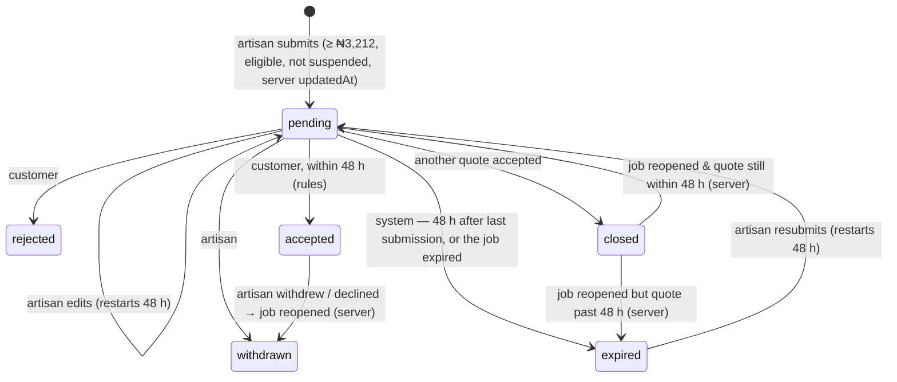
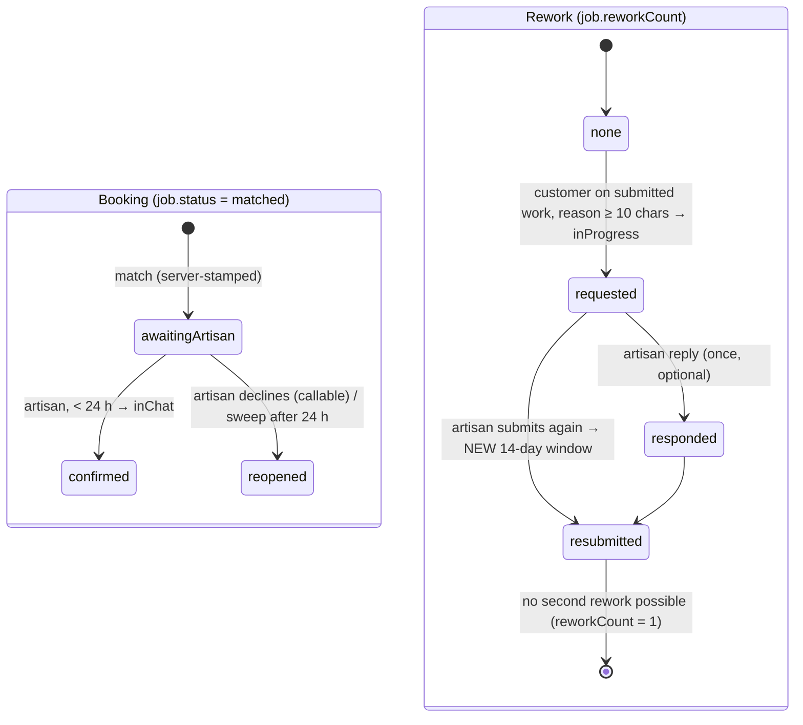

# HandyTrust Remediation — Stage 5 Report: Workflow Lifecycle Completion (2026-11-03)

**Nothing was deployed, committed or pushed. No production Firebase and no Paystack system was accessed.** The Firestore emulator and fake Paystack clients were used throughout. No UI redesign: only the controls needed for the new lifecycle steps were added, in the existing visual style.

---

## 1. Changed files

| File | Change |
|---|---|
| `firestore.rules` | `cfgNum()` (trusted config), `isFreezingSuspended()`, `_quoteStillValid()`. Booking confirmation by the artisan within the deadline (matched → inChat). Customer chat only on a confirmed booking. Rework transition (one per job). Artisan rework response. Disputes by either party (always against the other). Unfunded cancellation is customer-only. Freezing suspension blocks progress, agreement, scheduling, progress updates and chat on existing jobs. Quote `updatedAt` must be server time; quote acceptance only within validity; an expired quote can be resubmitted |
| `functions/index.js` | Config keys `openJobDays` (7), `quoteValidityHours` (48), `bookingConfirmationHours` (24). **`_reopenJob`** (transactional reopen, quote revival/expiry, audit, notifications, stats). **`artisanWithdrawFromJob`** callable (decline/withdraw). **`expireMarketplaceDeadlines`** (hourly) + `_expireMarketplaceDeadlines`. `initializePaystackTransaction` refuses fraud/safety/security/unclassified-suspended payers. `onJobCompleted`: normalizes new bookings (`bookingStatus`, `bookingRequestedAt`), sends booking request/confirmation notifications, clears timers on rework and notifies the artisan; **cancellation stats now count only an artisan's own cancellation** |
| `functions/package.json` | Runs the new test file |
| `functions/test/stage5_lifecycle_emulator.test.js` (**new**) | 18 emulator tests |
| `firestore-tests/security_regression.test.js` | 25 new Stage 5 tests; 7 existing tests updated for intentional policy changes (§5) |
| `firestore-tests/escrow_payout.test.js` | Test 13: the happy path now includes the artisan confirming the booking (D7) |
| `lib/models/job_model.dart` | `JobStatus.expired` (terminal). `bookingStatus`, `bookingRequestedAt`, `bookingConfirmedAt`, `awaitingArtisanConfirmation`. `reworkCount`, `reworkReason`, `reworkRequestedAt`, `reworkResponse`, `canRequestRework`. `reopenCount`, `reopenReason`, `expiredAt` |
| `lib/models/quote_model.dart` | `QuoteStatus.expired` |
| `lib/models/user_model.dart` | `suspensionType`, `hasRestrictedSuspension`, `hasFreezingSuspension` |
| `lib/core/services/job_service.dart` | `canConfirmBooking` / `confirmBooking`; `canRequestRework` / `requestRework`; `canRespondToRework` / `respondToRework`; `bookingStatus` written on every new match; `submitted → inProgress` added to the transition table |
| `lib/core/services/dispute_service.dart` | `raiseDispute` is role-aware (D3) |
| `lib/core/services/workflow_gate_service.dart` | Matched awaiting the artisan (artisan: "Accept Booking"), rework in progress ("Resubmit Work"), expired → closed; `WorkflowAction.confirmBooking` |
| `lib/providers/escrow_provider.dart` | `confirmBooking`, `requestRework`, `respondToRework`, `withdrawFromJob` (callable) |
| `lib/providers/platform_config_provider.dart` | `quoteValidityHours`, `bookingConfirmationHours`, `quoteIsValid` |
| `lib/routes/router.dart` | Restricted existing-jobs mode for suspended users |
| `lib/screens/auth/suspended_screen.dart` | Mode-specific copy; "View My Existing Jobs" |
| `lib/screens/job/job_detail_screen.dart` | Accept Booking; Decline Booking / Withdraw from Job (artisan); Request Changes (once) + reason dialog; rework section with a one-time artisan reply; Report a Problem / Raise Dispute for both parties on funded jobs; expired box; restricted-mode notice for freezing suspensions; quote-acceptance validity check; corrected "14 days" copy (was "48 hours") |
| `lib/screens/dispute/dispute_screen.dart` | Raises against the other party, whoever raises |
| `lib/screens/artisan/secure_booking_screen.dart` | Direct booking stops at the booking request (no auto-chat, no auto-agreement) |
| `lib/widgets/job_status_badge.dart` | Colour for `expired` |
| `test/stage5_test.dart` (**new**) | 14 Flutter tests |

---

## 2. Workflow state diagrams (updated)

### 2.1 Job lifecycle (complete)

```mermaid
stateDiagram-v2
    [*] --> requested: customer posts (≥ ₦3,212 to pay; not suspended)
    requested --> expired: system — 7 days without a booking (server time)
    requested --> cancelled: customer
    requested --> matched: customer accepts a VALID quote (≤ 48 h) or books directly
    matched --> inChat: ARTISAN confirms booking within 24 h (server time)
    matched --> requested: artisan declines / 24 h expiry → reopen, valid quotes revived
    matched --> cancelled: customer
    inChat --> paymentPending: customer (agreement confirmed by both, schedule set)
    inChat --> requested: artisan withdraws → reopen (counts as artisan cancellation)
    inChat --> cancelled: customer
    paymentPending --> escrowLocked: server — exact verified charge (Stage 3)
    paymentPending --> inChat: server — unpaid after 24 h (Stage 3)
    paymentPending --> requested: artisan withdraws → reopen; open checkout abandoned, late charge refunded
    paymentPending --> cancelled: customer (checkout abandoned, late charge refunded)
    escrowLocked --> inProgress: artisan starts
    escrowLocked --> disputed: either party
    escrowLocked --> escrowLocked: paid-cancellation REQUEST (admin decides, Stage 4)
    inProgress --> submitted: artisan submits (server submittedAt → 14-day window)
    inProgress --> disputed: either party
    submitted --> completed: customer confirms → payout (Stage 4 final freeze check)
    submitted --> completed: server auto-release ≥ 14 d after LATEST submission (freeze-checked)
    submitted --> inProgress: customer requests rework — ONCE, reason required
    submitted --> disputed: either party
    disputed --> resolved: admin settlement — release / refund / split (Stage 4)
    escrowLocked --> cancelled: admin-approved paid cancellation → refund (Stage 4)
    inProgress --> cancelled: admin-approved paid cancellation → refund / split (Stage 4)
    completed --> [*]
    resolved --> [*]
    cancelled --> [*]
    expired --> [*]
```

### 2.2 Quote lifecycle

### 2.3 Booking confirmation and rework sub-flows

### 2.4 Suspension modes (D9)
| Suspension type | New jobs / quotes / bookings | Existing jobs | Chat | Pay into escrow | Payouts to them | Disputes | Unfunded exit / paid-cancellation request |
|---|---|---|---|---|---|---|---|
| administrative, verification | ✗ | ✓ progress and complete (restricted mode) | ✓ | ✓ | ✓ | ✓ | ✓ |
| fraud, safety, security, **unclassified (fails closed)** | ✗ | view only; **no progress** | ✗ | ✗ | **✗ frozen (Stage 4)** | ✓ | ✓ |

---

## 3. State-transition and authorization matrix (server-enforced)

| From → To | Actor | Preconditions (enforced by rules or server) | Server timestamps | Side effects |
|---|---|---|---|---|
| — → requested | customer | not suspended; unassigned, un-agreed payload | createTime | — |
| requested → matched | customer | not suspended; artisan eligible and not suspended; not self; quote (if any) within validity | matchedAt, bookingRequestedAt | trigger: normalize booking, notify artisan |
| matched → inChat | **artisan** | `bookingStatus` awaiting; < `bookingConfirmationHours` since match; not freezing-suspended | bookingConfirmedAt | notify customer |
| matched → inChat | customer | `bookingStatus == confirmed` (legacy/migrated only) | — | — |
| matched/inChat/paymentPending → requested | artisan via `artisanWithdrawFromJob`, or system (expiry) | unfunded; caller is the job's artisan | reopenedAt | quotes revived/expired; payments abandoned; audit; notifications; stats (withdrawal only) |
| requested → expired | system | open ≥ `openJobDays` from createTime / reopenedAt | expiredAt | quotes expired; audit; notifications |
| inChat → paymentPending | customer | agreement confirmed, schedule ok, price ≥ min; not freezing | — | — |
| paymentPending → escrowLocked / inChat | server | Stage 3 | — | — |
| escrowLocked → inProgress | artisan | not freezing | startedAt | — |
| inProgress → submitted | artisan | ≥ 1 photo; not freezing | **submittedAt == request.time** | trigger: 14-day window |
| submitted → completed | customer | not freezing | completedAt | release → Stage 4 payout (final freeze check) |
| submitted → inProgress | customer | `reworkCount == 0`; reason 10–1000 chars; not freezing | **reworkRequestedAt == request.time** | trigger: timers cleared, artisan notified |
| funded → disputed | customer **or artisan** | dispute against the other party | — | admin alert, notifications |
| unfunded → cancelled | **customer only** | — | cancelledAt | abandon open checkout |
| funded → cancelled / resolved | admin callables only | Stage 4 settlement | — | refund / release / split |
| completed / resolved / cancelled / expired → * | nobody | — | — | terminal |

---

## 4. Test results (executed 2026-11-03)

| Suite | After Stage 4 | **After Stage 5** |
|---|---|---|
| Flutter `flutter test` | 118 | **132 / 132 passed** |
| Functions `npm test` (emulator) | 157 | **175 / 175 passed** |
| Rules `npm test` (emulator) | 93 | **121 / 121 passed** |
| `flutter analyze` | — | No errors. Only the pre-existing unused-import warning in `lib/core/platform_utils.dart` |
| Original audit probes (Appendix A) | — | All exploit probes still blocked; only P-K (address privacy, Stage 6) remains |

**Required scenarios → tests:**

| Requirement | Where |
|---|---|
| Suspended administrative users | rules "administratively suspended customer can complete an existing job and chat"; functions "administratively suspended payer passes the suspension check" |
| Suspended verification users | rules "verification-suspended artisan can progress existing work but not take new work" |
| Fraud-frozen users | rules: customer can't confirm/pay/rework/chat; artisan can't confirm booking/agreement; unclassified fails closed. Functions: payer refused; artisan payout frozen |
| Existing jobs during suspension | rules "fraud-suspended customer CAN still exit unfunded work and open a dispute"; Stage 4 payout freezes intact |
| Expired quotations | rules: expired quote not acceptable, valid one is, no client-time `updatedAt`, resubmission. Functions: 48 h sweep |
| Expired bookings | rules: confirm after 24 h refused, config window. Functions: sweep reopens; a confirmation just before the sweep wins |
| Artisan withdrawal | functions: reopen + quote revival/expiry + stats; refused when funded, for others, when repeated; withdrawal during checkout |
| Direct booking acceptance | rules: artisan confirms, customer can't skip, customer can't create a confirmed match. Flutter: workflow gate |
| Rework request limits | rules: once, reason, server time, customer only, no payout/timer fields |
| Rework submission and renewed review window | rules: response once, resubmission. Functions: auto-release waits 14 d from the NEW submission, releases exactly once |
| Customer confirmation | rules (legitimate payloads, admin-suspended customer); Stage 4 payout tests |
| Automatic release | functions (rework window, single release); Stage 3/4 suites |
| Cancellation in different states | rules: customer cancels requested/matched/inChat/paymentPending; artisan can't; funded only via request |
| Concurrent cancellation and payment | functions: withdrawal during checkout → late charge refunded; lock first → withdrawal refused |
| Duplicate requests | functions: duplicate withdrawal refused; sweep idempotent; Stage 4 duplicate settlements |
| Unauthorized transitions | rules: wrong artisan, customer self-confirm, completed reopen, client expiry/reopen/re-assign, disputes against the wrong party |

---

## 5. Regression of existing functionality

| Check | Result |
|---|---|
| Stage 2–4 financial/security tests | **All still pass**: no duplicate payout, no duplicate refund, no unauthorized settlement, no payout during a fraud freeze, no client-controlled release timestamp, no review before completion (new Stage 5 test across 3 statuses), no ownership change, no bypass of the ₦3,212 minimum |
| Existing tests changed, **only where policy deliberately changed** | 7 rules tests updated: (a) customer `openChat` from `matched` → artisan confirms first (D7), 2 tests including escrow test 13; (b) quote payloads now carry a server `updatedAt` (what `QuoteService` already sends), 3 tests; (c) an *unclassified* suspension now fails closed, so the "suspended artisan progresses" test now uses an *administrative* suspension, with a new freezing variant; (d) the artisan can no longer cancel before payment (D6), with a new test asserting that |
| Legitimate customer/artisan payloads (`JobService`) | All pass, including full-size-document rule-cost tests |
| Pre-existing behaviour changed (called out, not silent) | **Cancellation stats:** a customer's cancellation (or an admin-approved paid cancellation) no longer counts against the artisan's cancellation rate; an artisan's withdrawal after confirming does. Previously *any* cancellation with an artisan assigned counted against them |

---

## 6. Migration requirements (before / at deploy)

| # | Requirement | Why |
|---|---|---|
| **M-1** | **Before enabling `expireMarketplaceDeadlines`**, set `bookingStatus: 'confirmed'` on every job currently in `matched` | They were accepted under the old flow. Otherwise the sweep reopens them (old `matchedAt`) and customers can't open chat |
| **M-2** | **Grace period for existing open jobs and quotes.** At deploy, set `config/platform` `openJobDays` and `quoteValidityHours` high (e.g. 30 days / 720 h), then lower them to 7 / 48 after one week | Otherwise the first hourly run expires every job older than 7 days and every quote older than 48 h at once, and rules refuse acceptance of older quotes |
| M-3 | Deploy order: **functions → app (new build) → rules** | Old builds can't confirm bookings or withdraw. If the rules ship first, old-build artisans can't accept, and the sweep reopens their bookings after 24 h |
| M-4 | Re-classify existing suspensions (Stage 4 M-3 still applies) | Unclassified = freezing (no existing-job progress, no payouts) |
| M-5 | Quote documents missing `updatedAt` | Treated as expired by the rules; artisans can resubmit |
| M-6 | Stage 3/4 migrations (M-6 stuck releases, sub-₦3,212 jobs, old resolved disputes) | Unchanged, still required |

---

## 7. Outstanding risks

| # | Risk | Severity | Plan |
|---|---|---|---|
| R-1 | Trigger wiring (`onJobCompleted` booking normalization, timer clearing on rework, notifications) is reviewed, not run in a Functions emulator. The rules prevent the bypass even if the trigger lags (customer chat requires `confirmed`; artisan confirm needs a server timestamp) | Medium | Stage 7 harness |
| R-2 | Sweeps process at most 500 jobs per status per hourly run | Low | Paginate at scale |
| R-3 | Rework has no time limit for the artisan's resubmission (a job can sit in `inProgress`) | Medium | Disputes/cancellation requests are the exit; a deadline would be a new policy (your decision) |
| R-4 | Reopened jobs restart the 7-day open window from `reopenedAt` | Low | A policy interpretation, flagged for confirmation |
| R-5 | Exact customer address still readable by artisan accounts on open jobs (P-K) | Medium | Stage 6 |
| R-6 | Notifications are still client-written for chat/quote/agreement events (interim relationship rule, Stage 2) | Medium | Stage 6 |
| R-7 | Paystack test-mode checks (Stage 3 §7, Stage 4 §7) and account/legal approvals are still outstanding | High (go-live) | Owner |

---

## 8. Acceptance criteria assessment

| Requirement | Status |
|---|---|
| Valid start, explicit actors, defined transitions, backend-enforced permissions | **Met** (§3, rules + callables + tests) |
| Acceptance/confirmation steps: artisan booking confirmation (quotes and direct bookings) | **Met** |
| Expiry handling with server time and configurable backend settings (7 d / 48 h / 24 h / 24 h) | **Met**; payment expiry from Stage 3 |
| Artisan withdrawal before payment reopens the job (D6) | **Met** |
| Customer cancellation and paid cancellation requests | **Met**; funded cancellations remain Stage 4 settlements only |
| Rework: one request, reason, artisan response, new 14-day window, server timestamps, no reopening of completed jobs, no duplicate payout/review | **Met** |
| Disputes by either party; settlements via the established mechanism; frozen payments never released; refund/payout races fail safe; idempotent admin actions; auditable records | **Met** (Stage 4 engine unchanged; Stage 5 adds no alternative money path) |
| Suspended-user restricted mode, consistent across Flutter, rules and Functions | **Met** (§2.4) |
| Terminal states for every workflow | **Met**: completed, resolved, cancelled, expired; quotes: accepted/rejected/withdrawn/expired |
| No UI redesign, no unrelated screens, no deploy/commit | **Met** |

**Stage 5 is complete, pending your review.** Before deploying, please confirm the migration approach in §6 (especially M-1 and M-2) and decide R-3 (whether rework resubmission should have a deadline).
