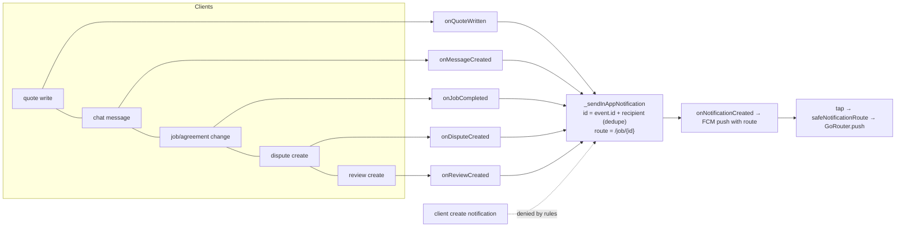
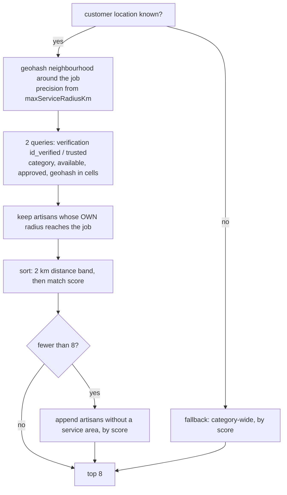

# HandyTrust Remediation — Stage 6 Report: Notifications, Privacy, Matching, Storage (2026-11-03)

Scope (from the Stage 1 plan §4 plus items deferred by Stages 2–5): server-generated notifications and push deep links (HT-015, HT-025, HT-026, HT-044), exact-address privacy (P-K, D9), distance-first matching (HT-022, D8), Storage rules (HT-023, HT-029), audit-log integrity (HT-028), payout copy (HT-024), and dispute-alert idempotency (Stage 4 R-8). **Nothing was deployed, committed or pushed; no production Firebase or Paystack access.** The open Stage 5 decisions keep their defaults: no rework resubmission deadline, and a reopened job gets a fresh 7-day window.

---

## 1. Changed files

| File | Change |
|---|---|
| `functions/index.js` | **Server-generated notifications:** `onQuoteWritten` (new/resubmitted quote, withdrawn, declined, not chosen), `onMessageCreated`, agreement-status changes, work started, cancellation (to the other party), dispute raised (to whichever party it's against), review received. All carry a `route` and are deduplicated by trigger event ID. `_sendInAppNotification` gains `route`/`dedupeKey`; the push payload carries `route`. Completion copy no longer claims "funds released". Deterministic dispute admin alerts. **Location privacy:** `onJobCreatedProtectLocation` trigger + `_protectJobLocation`, admin callable `adminBackfillJobLocationPrivacy` (paged). **Payout status mirror:** `_mirrorPayoutStatus` (processing / paid / on_hold / delayed). Config `defaultServiceRadiusKm` (10), `maxServiceRadiusKm` (25). Pure helpers: `_geohashEncode`, `_areaLabel`, `_coarseArea`, `_agreementNotification`, `_statusChangeNotifications`, `_quoteNotification`, `_messagePreview` |
| `firestore.rules` | Notifications: **client create removed** (admin only, for the verification decision). `jobs/{id}/private/location`: read by the customer, admins, and the assigned artisan **only after booking confirmation**; written only by the customer while the job is open. Job create accepts the coarse `area*` fields. Artisan service area validated (`latitude`/`longitude` ranges, radius ≤ `maxServiceRadiusKm`, server timestamp). **Audit-log entries** must name the writer, this job, server time, and no fake admin override |
| `storage.rules` | Cross-service checks. **Dispute evidence:** uploader + dispute parties + admins (was any signed-in user). **Job photos:** uploader + job parties + admins + artisan accounts while the job is open. **`profiles/{uid}` avatar path added** (HT-029; avatar upload was default-denied). `isAdmin()` hardened (`token.get('admin', false)`) |
| `firestore.indexes.json` | +2 composite indexes for radius queries (artisans: category, isAvailable, approvalStatus, verificationStatus, serviceGeohash3/4). Additions only; existing formatting kept |
| `lib/core/utils/geo.dart` (**new**) | Geohash (same encoding as the server; reference-tested), neighbourhood cells, distance, coarse area, area label |
| `lib/core/services/distance_matching.dart` (**new**) | Pure distance-first ranking and nearby-jobs filtering |
| `lib/core/services/matching_service.dart` | **Rewritten:** geohash-neighbourhood queries around the job, each artisan's own radius respected, distance-first ordering, fallback for artisans without a service area |
| `lib/widgets/service_area_card.dart` (**new**) | D8 capture: GPS on tap only (no background tracking), manual service address, radius chips bounded by config, consent wording |
| `lib/screens/artisan/business_profile_screen.dart` | Embeds the service-area card |
| `lib/screens/artisan/open_jobs_feed_screen.dart` | Feed filtered to the artisan's radius, nearest first (unchanged if no area is set) |
| `lib/providers/matching_provider.dart`, `lib/providers/platform_config_provider.dart` | Radius config wired in |
| `lib/firebase/firestore/firestore_repository.dart` | `createJob` writes the coarse area to the job and the exact location to `private/location` in one batch |
| `lib/providers/escrow_provider.dart` | `jobPrivateLocationProvider`; notification writer removed |
| `lib/screens/job/job_detail_screen.dart` | Location card (exact address only when permitted, otherwise the area label). Completed-job copy follows `payoutStatus`. Line endings normalized |
| `lib/screens/admin/admin_dashboard_screen.dart` | Job location read from the private document |
| `lib/core/services/quote_service.dart`, `dispute_service.dart`, `chat_service.dart`, `lib/screens/review/review_screen.dart` | **All 11 client notification writes removed** (plus the Firestore reads that existed only to find a recipient) |
| `lib/providers/notification_provider.dart` | Push taps navigate via GoRouter (`Navigator.pushNamed` never worked under GoRouter); `safeNotificationRoute` allow-list |
| `lib/models/notification_model.dart`, `lib/screens/notifications/notifications_screen.dart` | `route` field; in-app taps use it |
| `lib/models/job_model.dart`, `lib/models/artisan_model.dart` | `areaLat/areaLng/areaGeohash4/areaLabel/payoutStatus`; `serviceAddress/serviceRadiusKm/serviceGeohash4` (the existing unused `latitude/longitude` are now the GPS service location) |
| Tests | `functions/test/stage6_emulator.test.js` (**new**, 11), `firestore-tests/storage_rules.test.js` (**new**, 9), `firestore-tests/security_regression.test.js` (+9 new; 3 interim client-notification tests converted to lockdown tests; 2 audit payloads aligned with what `JobService` actually writes), `test/stage6_test.dart` (**new**, 14), package scripts |

---

## 2. Flows (as implemented)

### 2.1 Notifications

### 2.2 Exact-location visibility
| Viewer | requested | matched (awaiting artisan) | inChat → resolved |
|---|---|---|---|
| Customer | exact | exact | exact |
| Assigned artisan | — | **area only** | **exact** |
| Other artisan accounts | area only | area only | — (job not readable) |
| Admin | exact | exact | exact |

### 2.3 Distance-first matching

---

## 3. Test results (executed 2026-11-03)

| Suite | After Stage 5 | **After Stage 6** |
|---|---|---|
| Flutter `flutter test` | 132 | **146 / 146 passed** |
| Functions `npm test` (Firestore emulator) | 175 | **186 / 186 passed** |
| Firestore rules `npm test` | 121 | **130 / 130 passed** |
| Storage rules `npm run test:storage` (**new**; Firestore + Storage emulators) | — | **9 / 9 passed** |
| `flutter analyze` | — | No errors. Only the pre-existing unused-import warning |
| Original audit probes | — | All exploits still blocked. **P-K:** blocked for new jobs (rules test: the private location isn't readable by artisans); existing jobs need the backfill (§5, M-2) |

Key assertions:
- A stranger, **and even a real counterparty**, can no longer create a notification.
- A redelivered trigger produces one notification.
- An artisan-raised dispute notifies the customer.
- The exact location stays hidden from the matched artisan until they confirm.
- An old-build job's exact location is moved and stripped.
- Geohash matches the published reference on both server and client.
- The nearer artisan ranks first across distance bands, and match quality breaks ties within a band.
- Out-of-radius artisans are excluded.
- Artisans without a location appear after nearby ones, not hidden.
- Dispute evidence is visible to the parties only, and uploaders can read back their own files.
- The avatar path works.
- Forged, backdated or fake-admin audit entries are refused.
- Payout status reads on_hold → processing → paid.

---

## 4. Regression of existing behaviour

| Item | Result |
|---|---|
| Stages 2–5 money and security tests | All pass unchanged |
| Tests changed | 3 rules tests that asserted the *interim* Stage 2 client-notification path are now lockdown tests (the same payloads must fail). 2 audit-log test payloads now include `timestamp`/`isAdminOverride`, as `JobService._buildAuditEntry` always does |
| Behaviour changes (intended) | Notification titles/bodies now come from the server. "Dispute raised" goes to whoever the dispute is against (previously always the artisan). Completion messages say "payout processing" until Paystack confirms. The open-jobs feed is radius-filtered once an artisan sets a service area |

---

## 5. Migration and deploy requirements

| # | Requirement | Why |
|---|---|---|
| **M-1** | **Notification lockdown order: deploy functions → force app update → rules.** Or keep the Stage 2 interim notification rule until the minimum installed app version is the Stage 6 build | Older builds still write notifications. Under the new rules, those writes fail **after** the real action succeeded: quote submission, agreement steps, raising a dispute and posting a review would show an error although they worked (HT-044). Chat already swallows the error |
| **M-2** | **Run `adminBackfillJobLocationPrivacy`** (repeat with `nextCursor` until null) right after deploying functions | Moves exact locations off existing job documents. Until then, P-K remains open for existing jobs |
| M-3 | Deploying `storage.rules` with cross-service rules: Firebase asks to grant the Storage service agent read access to Firestore. Approve it | Cross-service rules otherwise deny |
| M-4 | Create the two new composite indexes (`firebase deploy --only firestore:indexes`) before the new app ships | Radius queries need them in production |
| M-5 | Ask existing artisans to set their service area (dashboard prompt / message) | Until they do, they appear only in the fallback section of matching |
| M-6 | Old app builds keep writing the exact location on job creation; the trigger strips it within seconds | A brief exposure window until the build is adopted |
| — | Stage 3–5 migrations | Unchanged, still required |

---

## 6. Outstanding risks

| # | Risk | Severity | Plan |
|---|---|---|---|
| R-1 | **`responseTimeMinutes` (15% of the trust score) is never computed.** It's 30 for everyone, so that component is identical for all artisans. Since Stage 2 it can't be manipulated | Medium (trust accuracy) | Compute server-side from chat timestamps (future stage; needs a policy on what counts as a response) |
| R-2 | Trigger wiring (onQuoteWritten, onMessageCreated, onJobCreatedProtectLocation, notification fan-out) is exercised through its handlers, not a Functions emulator | Medium | Stage 7 harness |
| R-3 | Self-declared artisan location isn't verified (an artisan could set a false location to appear nearby) | Low–Medium | Accepted for MVP; admin review / future verification |
| R-4 | Matching fetches at most 100 artisans per verification status per neighbourhood | Low | Fine at current scale |
| R-5 | Distance isn't yet *displayed* on artisan cards or feed items (ordering only) | Low (UX) | Stage 8 UI |
| R-6 | Orphaned local emulators from these runs: **PID 30304 (port 8090)** and **PID 30112 (port 8190)** | — | Stop with `Stop-Process -Id 30304,30112` |
| R-7 | Paystack test-mode checklists and account/legal approvals (Stages 3–4) are outstanding | High (go-live) | Owner |

---

## 7. Acceptance criteria

| Criterion | Status |
|---|---|
| No client can create notifications; every event notifies the right recipient; no duplicates on redelivery (HT-015, HT-025, HT-044) | **Met** (rules + handler tests). Rollout order per M-1 |
| Push and in-app taps navigate correctly and safely (HT-026) | **Met in code/tests** (GoRouter + allow-list). Device check pending (Stage 7) |
| Exact customer address revealed only after assignment (D9, P-K) | **Met for new jobs**; existing jobs after backfill (M-2) |
| Distance-first matching with configurable radii, GPS captured once, manual address (D8, HT-022) | **Met** |
| Dispute evidence and job media restricted; avatar path works (HT-023, HT-029) | **Met** (9 Storage tests) |
| Audit entries can't be forged or backdated by clients (HT-028) | **Met** (interim rules-level; a fully server-authored audit trail would be a larger change) |
| Payout copy reflects reality (HT-024) | **Met** (server-mirrored `payoutStatus`) |
| One review per job, trust inputs server-only | **Met** (Stage 2), with R-1 noted |
| No deploy/commit, no production access, no UI redesign | **Met** |

**Stage 6 is complete, pending your review.** Next in the plan is Stage 7 (full regression and end-to-end testing: CI, a Functions-emulator trigger harness, the Paystack test-mode run, a device check of push navigation). Stage 8 is the UI redesign.
