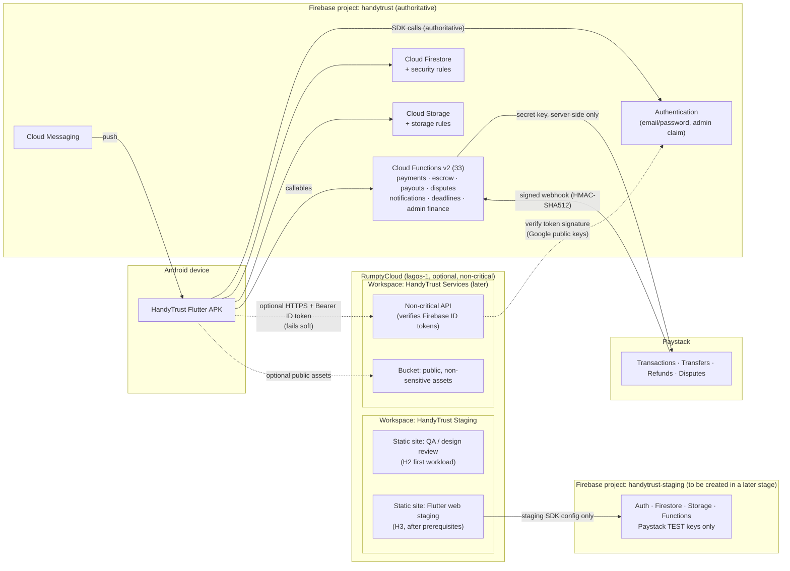

# RumptyCloud hybrid integration — target architecture

**Stage:** H1 proposal (not implemented).
**Owner decision applied:** Firebase stays authoritative for identity, data, rules, Functions, notifications, the job lifecycle, agreements, bookings, disputes, Paystack, escrow and payouts. RumptyCloud is optional and non-critical.

## 1. Principles

1. **Firebase is the system of record.** RumptyCloud never stores the authoritative copy of anything Firebase owns, and never writes to the money path.
2. **Optional means optional.** The APK must work fully, including paying, releasing escrow and resolving disputes, when every RumptyCloud service is down. This matters because RumptyCloud runs from a single region and zone with no SLA.
3. **No production data in staging.** Staging uses a separate Firebase project, Paystack test keys and synthetic users only.
4. **One identity.** A RumptyCloud API trusts only Firebase ID tokens. It has no user table, passwords or sessions of its own.
5. **Least credential.** RumptyCloud services hold no Paystack secret. They hold no production Firebase service-account key unless a later stage justifies one explicitly.

## 2. Diagram



**Lines:**
- Solid lines exist today.
- Dotted lines are optional, future paths.
- No line connects RumptyCloud to Paystack, to production Firestore writes, or to production Storage.

### Plain-text version

```
Flutter APK ──────────────► Firebase (Auth, Firestore, Storage, Functions, FCM)   [authoritative]
                               │
                               └── Cloud Functions ──► Paystack ──webhook──► Cloud Functions

Flutter APK ·· optional ····► RumptyCloud API (Firebase ID token required)       [non-critical]

RumptyCloud ── Staging workspace: QA site, Flutter web staging ──► Firebase STAGING project only
```

## 3. What runs where

| Concern | Firebase | RumptyCloud |
|---|---|---|
| Sign-in, sessions, password reset, email verification | ✅ | ✗ |
| Customer, artisan and admin data; jobs; quotes; chat | ✅ | ✗ |
| Agreements, bookings, scheduling, disputes, reviews | ✅ | ✗ |
| Paystack initialization, webhook, verification, transfers, refunds, chargebacks | ✅ (Functions) | ✗ |
| Escrow lock and release; 14-day review; payouts; payout freeze | ✅ (Functions) | ✗ |
| Notifications and push | ✅ | ✗ |
| Identity documents, dispute evidence, job photos | ✅ (Storage) | ✗ |
| QA / design-review site | — | ✅ Staging workspace (H2) |
| Flutter web staging | Staging Firebase project | ✅ static hosting (H3) |
| Marketing / landing site | — | ✅ (subdomain; root domains unsupported) |
| Non-critical read-mostly APIs, background utilities | — | ✅ later stages |

## 4. RumptyCloud API: authentication and authorization design

Applies to any future "Web Service/Backend" deployment the app calls.

### 4.1 Client side (future Flutter change; not part of H1)

- Get a fresh token per request: `await FirebaseAuth.instance.currentUser?.getIdToken()`. The SDK refreshes it automatically before its one-hour expiry.
- Send it as `Authorization: Bearer <ID token>` over HTTPS only.
- Replace the unused `SecureTokenManager` / `AuthInterceptor` pattern. Long-lived tokens should not be stored in secure storage.
- On a network error, a 5xx or a timeout, **hide the optional feature**. Never block a core flow.
- On a 401, refresh the token once (`getIdToken(true)`) and retry once.

### 4.2 Server side (in the RumptyCloud service)

1. Reject any request without `Authorization: Bearer …`, except the unauthenticated readiness path (`/healthz`). RumptyCloud requires that path to answer without auth.
2. Verify the token with the Firebase Admin SDK (`auth().verifyIdToken(token)`) or an equivalent JWT library. The checks:
   - RS256 signature against Google's published securetoken public keys, cached per their `Cache-Control`;
   - `aud` = the Firebase project ID;
   - `iss` = `https://securetoken.google.com/<project-id>`;
   - `exp` and `iat` within allowed clock skew;
   - `sub` non-empty (= uid).

   Signature verification needs only the project ID. **No service-account key is required.**
3. Mirror the Firestore rules' `isSignedIn()`:
   - reject `firebase.sign_in_provider == "anonymous"`;
   - require `email_verified == true`, matching the app's router gate.
4. **Revocation:** `verifyIdToken(token, checkRevoked = true)` needs Admin SDK credentials. Without them, a revoked token stays valid for up to one hour. That is acceptable only for non-critical, read-mostly endpoints; the security review covers this.
5. **Roles:**

   | Need | Source available to RumptyCloud | Decision |
   |---|---|---|
   | Admin-only endpoint | `admin: true` custom claim (set by `onAdminGranted`, cleared by `onAdminRevoked`) | Allowed. Note that a claim change appears only on the next token refresh (≤ 1 h) |
   | Artisan- or customer-only endpoint | **Not in the token.** Roles live in `users/{uid}.roles` in Firestore | Don't build such endpoints on RumptyCloud yet. Options for a later stage: (a) a Cloud Function mints `roles` custom claims (a Functions change), or (b) the API reads Firestore with a narrowly scoped service account (a production credential on a third-party platform; not recommended) |
   | Ownership ("my data") | `sub` / uid | Enforce `resource.ownerUid == token.uid` server-side |

6. Log uid, endpoint and result. Never log the token.
7. Rate-limit per uid and per IP in the service itself. No platform WAF or rate limiting is documented.

### 4.3 What a RumptyCloud API must never do

- Call Paystack or hold any Paystack key.
- Write to production Firestore or Storage, or call admin finance callables.
- Become required for login, booking, payment, escrow, disputes or notifications.

## 5. Environments

| Environment | Firebase | RumptyCloud | Data |
|---|---|---|---|
| Local / CI tests | Emulators (`demo-*` projects) | — | Synthetic |
| Staging | `handytrust-staging` (to be created; Paystack **test** keys) | Workspace "HandyTrust Staging" | Synthetic only |
| Production | `handytrust` | Workspace "HandyTrust Services" (later, only for approved non-critical services) | Real |

Separate workspaces give the resource isolation the docs promise ("Resources are not shared between workspaces"). They also limit what a person's API key can touch, because keys inherit a role per workspace.

## 6. Failure and exit

- **RumptyCloud outage:** staging and QA sites are unavailable; optional app features hide; production is unaffected.
- **Exit:** delete deployments and the workspace, remove DNS CNAMEs, revoke API keys and uninstall the GitHub App. Nothing in Firebase needs to change, because nothing authoritative was moved.

## 7. Dependencies before anything beyond H2

- A staging Firebase project, a client build-time environment switch (flavors or `--dart-define`) and a web Paystack checkout. All are code or config changes needing their own approval.
- A domain plan (subdomains only).
- A data-protection assessment against Nigeria's Data Protection Act 2023 before any personal data reaches RumptyCloud. Today the plan sends none.
