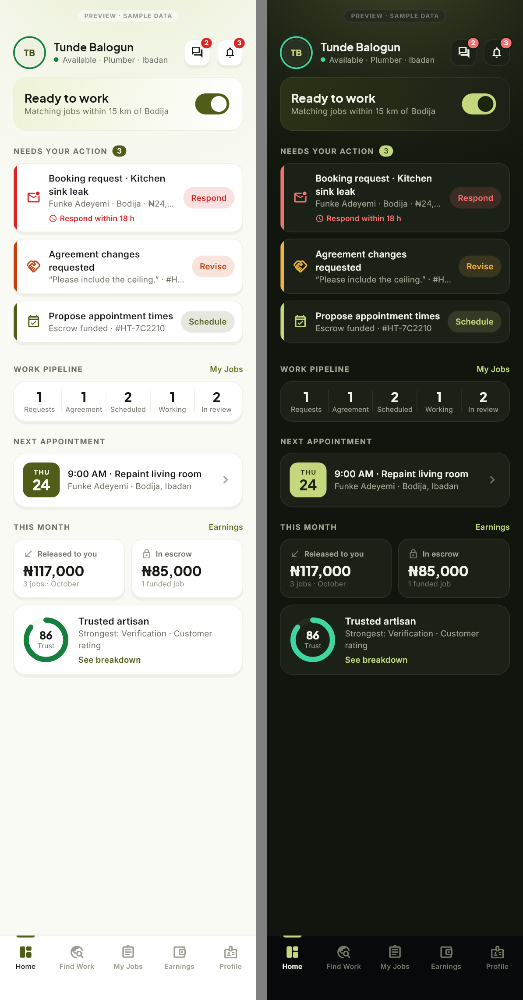
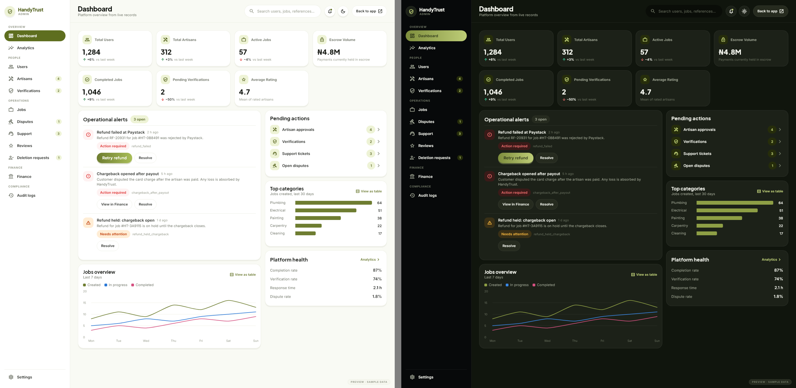
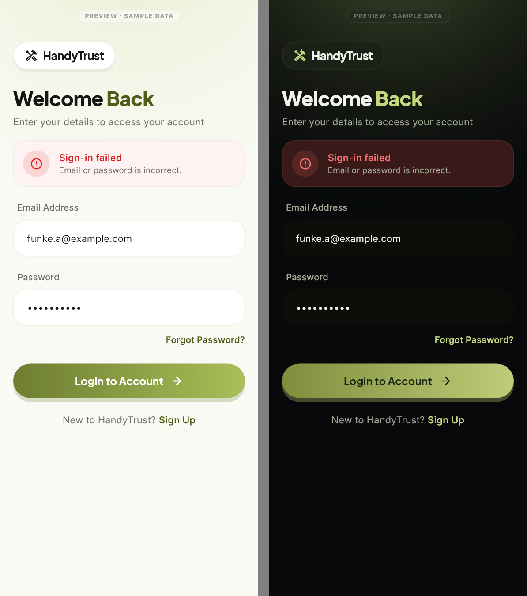
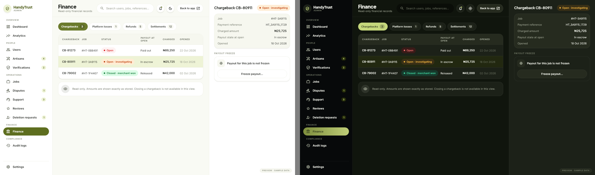

# HandyTrust — Stage 8.1 Preview Review

Date: 2026-11-04 · Status: **STOP. Rendered previews are ready for your review. No destructive implementation has started.**

**Scope:**
- All three roles, plus authentication and every remaining old screen (D-1).
- Extended by your complete-audit request to every screen, dialog and sheet in the app.

**Where to look:**
- The **full gallery** of 70 previews (140 renders, light and dark) is in `STAGE8_COMPLETE_DESIGN_PREVIEW_REPORT.md`.
- Screen IDs are in `STAGE8_COMPLETE_SCREEN_INVENTORY.md`, the navigation in `STAGE8_COMPLETE_NAVIGATION_MAP.md`, and what still needs a decision in `STAGE8_MISSING_DESIGNS.md`.
- The rules are in `STAGE8_1_DESIGN_SPECIFICATION.md` (v2).

## Key screens (light | dark)

**Artisan Home**, with the approved 5-item navigation:

**Admin dashboard**, desktop; alerts show a readable label with the original id:

**Sign In**, error state:

**Admin Finance**, read-only with payout freeze:

## 1. Design decisions taken in the previews

1. **One system for all three roles.**
   - Every preview uses only `HtPalette` / `HtType` / `HtSpace` / `HtRadius` and the Stage 8 components.
   - New components are built from the same tokens.
   - There's no separate admin palette.
2. **Admin layout.**
   - Desktop: rail sidebar, top bar, tables, right-side detail panel.
   - Mobile: drawer, stacked cards, sheets.
   - Same colours and type as the customer app; denser rows.
3. **Charts.**
   - Brand-olive first series, then blue and magenta.
   - Validated for colour-blind separation and contrast in both themes.
   - Legends for 2+ series; "View as table" on every chart.
4. **Metrics stay honest.**
   - KPI trends are shown only where the existing dashboard computes one.
   - Other tiles state their definition ("Payments currently held in escrow", "Mean of rated artisans").
5. **Alert labels (F-2).**
   - Readable label, severity text and icon, **plus the original identifier**.
   - Covers all 28 alert types (catalogue in the spec, §6).
6. **Destructive actions.**
   - Danger-tone buttons; confirmations name the target.
   - Admin finance actions require a reason where the server requires one.
   - Job deletion is offered only for unpaid jobs (F-1).
7. **Authentication.**
   - Brand pill, two-tone headline, form fields as in the onboarding/Stitch language.
   - Error and loading states use the existing `friendlyError` messages.
   - No new sign-in methods.
8. **Material pickers.** The date and time pickers are themed from the palette, through a proposed `htThemeData`, so system dialogs match the design.

## 2. Deviations from the approved design system

| Deviation | Reason |
|---|---|
| The portfolio photo viewer is black in both themes | Neutral backdrop for photos; standard viewer convention |
| The Paystack checkout page isn't restyled | Third-party page inside the webview; only the frame is ours |
| Camera and gallery pickers aren't restyled | OS-provided UI |
| Admin tables use a denser row (52 pt) and 13–13.5 pt body text | Data density on desktop; the same font family and colours |
| New tokens: chart series and `htInfo` | Not in Stage 8; added and validated (spec §2) |
| Heading font is still provisional; photo tiles are placeholders | Carried over from Stage 8 (needs the Stitch font name); previews never load real user photos |

## 3. Existing functionality vs proposed visual changes

The full split is in the spec, §9; a short version:

| Kind | Items |
|---|---|
| **Restyled only** | Every auth flow, every customer, artisan and admin workflow listed in the inventory |
| **Approved new exposure** | Finance (read-only); payout freeze |
| **Fixes** | F-1 job deletion; F-2 alert labels; F-3 role label; F-8 / F-9 copy changed to 14 days |
| **Navigation changes (approved)** | Artisan 5-item nav; admin sidebar grouping; artisan route redirect (D-6) |
| **Proposed, awaiting approval** | Styled not-found page; "Contact support" on Suspended; payout banner on artisan Home; transaction detail sheet; `/admin/finance` URL |

## 4. Unresolved questions (please answer before Phase C)

| ID | Question |
|---|---|
| Q-1 | Archival for jobs with payment or dispute history: (a) no delete for such jobs (shown in the preview; no backend change), or (b) add an admin archive flag (model + rules change) |
| Q-2 | In-app password reset (deep links + `confirmPasswordReset`): keep the Firebase-hosted page (current), or build it (architectural change)? |
| Q-3 | Password rules (F-10): apply the sign-up rule (8+ characters, uppercase, number) to change-password and the error copy too? |
| Q-4 | Expose the existing chargeback actions (`adminCloseChargeback`, `adminSetChargebackInvestigation`) in Finance? |
| Q-5 | Allow a read-only parse of the existing `payoutFrozen*` fields in `JobModel` / `ArtisanModel` so the freeze state can be shown? |
| Q-6 | Keep the service-time promises in copy ("24–48 hours", "within 48 hours", "within 7 days")? |
| Q-7 | Approve the optional transaction detail sheet (`cu11`), or keep transactions opening the job? |
| Q-8 | Confirm no separate notification-details screen (the destination screen acts as the detail) |
| Q-9 | F-11: fix the dual-role My Jobs bug (it uses `isCustomer` instead of `activeRole`) as part of the AR-03 replacement? *(recommended)* |

## 5. Verification

| Check | Result |
|---|---|
| `flutter analyze test_visual/previews` | No issues found |
| `flutter test test_visual/previews --update-goldens` | **140 passed** |
| `flutter test test_visual/previews` (plain re-run against the goldens) | **140 passed** |
| `flutter test test_visual` (Stage 8 visual suite + previews) | **230 passed** |
| Overflow and layout exceptions | None in any render |

**No changes to the app or backend in this step:**
- `lib/`, `functions/`, `firestore.rules` and `storage.rules` are untouched since the end of Stage 8.
- The `git diff` stat for `lib/` is identical (14 files, the Stage 8 changes).

**Recovery point:**
- The local branch `stage-7.3-verified-baseline` is intact.
- Stage 8 and 8.1 work is uncommitted on `stage-8-ui-replacement`.
- Nothing has been pushed or deployed.

**STOP. Waiting for your explicit approval of the previews and answers to Q-1 to Q-9 before any destructive implementation.**
