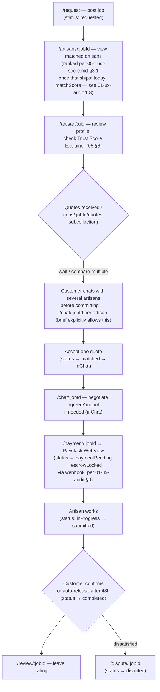
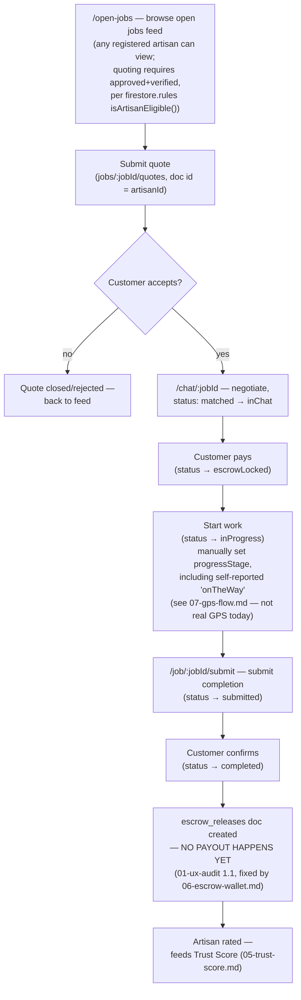
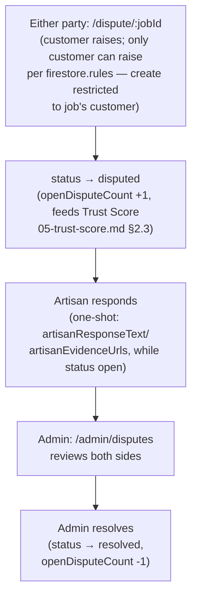

# 03 — Information Architecture, Navigation & User Journeys

**Sequencing note**: per `01.5-critical-review-and-hardening-sprint.md` §6, this phase was recommended *after* `06-escrow-wallet.md`, `07-gps-flow.md`, and `08-messaging-notifications.md`, specifically so navigation wouldn't be designed against screens that don't exist yet. Only `05-trust-score.md` is done so far. Proceeding now at your request — this doc is split into **Settled** sections (grounded in the current, verified route table, safe to build against today) and **Provisional** sections (marked, to be revised once 06/07/08 land, since they touch surface area — Wallet, GPS/tracking, notification preferences — that doesn't exist yet).

---

## 1. Settled: current navigation architecture (verified against `lib/routes/router.dart` directly)

### 1.1 What's already correct — keep the pattern
- Single centralized `redirect:` callback handling auth-gate, email-verification gate, suspension lockout, admin guard, and the dual-role interstitial — this is the right architecture (one source of truth for "can this user be here right now," not scattered per-screen checks). Its inline comments are unusually good — e.g., explicitly documenting *why* `/` used to be special-cased and why that was wrong. Preserve this pattern for every new gated route added in future phases.
- The admin `ShellRoute` (`router.dart:294-362`) keeping `AdminShell` mounted across section switches, with the admin-gate check running once rather than per-click — correct use of GoRouter's shell pattern. **This is the template to reuse** if any future area (e.g., a Wallet section with its own sub-navigation) needs the same "persistent chrome, swappable content" treatment.
- `AuthChangeNotifier` re-listening to `isAdminProvider` and `currentUserProfileProvider`, not just raw auth state — correctly handles live account suspension and admin-grant/revoke without requiring the user to navigate away and back.

### 1.2 Full current sitemap

```mermaid
flowchart TD
    Splash["/  (splash)"] -->|signed out| Login["/login"]
    Login --> Register["/register"]
    Register --> RegisterArtisan["/register/artisan"]
    Login --> Forgot["/forgot-password"]
    Splash -->|signed in, unverified| VerifyEmail["/verify-email"]
    Splash -->|signed in, verified| Home["/home (bottom-nav shell)"]

    Home -->|dual-role, no active role picked| RoleSelect["/role-select"]
    Home -->|suspended| Suspended["/suspended"]
    Home -->|admin doc exists + navigates| AdminShell["/admin/* (persistent shell)"]

    subgraph BottomNav["Bottom nav shell (shared MainShellScreen)"]
        Home
        Jobs["/jobs"]
        MyChats["/my-chats"]
        Profile["/profile"]
    end

    Home --> Request["/request (post job)"]
    Home --> BrowseArtisans["/browse-artisans"]
    Home --> Favorites["/favorites"]
    Request --> ArtisanList["/artisans/:jobId"]
    ArtisanList --> ArtisanProfile["/artisan/:uid"]
    BrowseArtisans --> ArtisanProfile

    Jobs --> JobDetail["/job/:jobId"]
    JobDetail --> Chat["/chat/:jobId"]
    JobDetail --> Payment["/payment/:jobId"]
    Payment --> PaymentWebview["/payment/:jobId/webview"]
    JobDetail --> DemoPayment["/demo-payment/:jobId (ungated — see 01-ux-audit 2.2)"]
    JobDetail --> JobSubmit["/job/:jobId/submit"]
    JobDetail --> Review["/review/:jobId"]
    JobDetail --> Dispute["/dispute/:jobId"]

    Profile --> Verification["/verification"]
    Profile --> BankDetails["/bank-details"]
    Profile --> BusinessProfile["/business-profile"]
    Profile --> Portfolio["/portfolio"]
    Portfolio --> PortfolioProject["/portfolio-project"]
    Profile --> Settings["/settings"]
    Profile --> Support["/support"]
    Home --> OpenJobs["/open-jobs (artisan)"]
    Home --> Notifications["/notifications"]

    AdminShell --> AdminDash["dashboard"]
    AdminShell --> AdminUsers["users"]
    AdminShell --> AdminArtisans["artisans"]
    AdminShell --> AdminJobs["jobs"]
    AdminShell --> AdminVerif["verifications"]
    AdminShell --> AdminDisputes["disputes"]
    AdminShell --> AdminReviews["reviews"]
    AdminShell --> AdminSupport["support"]
    AdminShell --> AdminDeletions["deletions"]
    AdminShell --> AdminAudit["auditLogs"]
    AdminShell --> AdminAnalytics["analytics"]
    AdminShell --> AdminSettings["settings"]
```



### 1.3 Verified dead code — two screens, not one

`01-ux-audit.md` §3.4 flagged `PhoneLoginScreen` as unrouted. Grepping every reference to it *and* to `CustomerRegistrationScreen` (`lib/screens/auth/customer_registration_screen.dart`) across the entire `lib/` tree found **both are referenced nowhere outside their own file** — not routed, not embedded as a sub-widget by another screen, nothing imports them. Two dead screens, not one.

**Product decision needed, not just cleanup**: is phone-based sign-in an intended entry point? `firebase_auth` supports it and it's a common pattern for a Nigerian user base where phone numbers are often more reliably reachable than email. If yes, `phone_login_screen.dart` needs a real route + a link from `/login`; if no, delete it. Same binary choice for `customer_registration_screen.dart` — either it's meant to be the customer-specific step of `/register` (in which case something should route to it) or it's superseded by whatever `RegisterScreen` currently does inline and should be deleted. **Recommendation**: keep phone login (real product value for this market — see `01.5`'s Nigerian-market framing) and wire it in; delete `CustomerRegistrationScreen` unless a quick check of `RegisterScreen`'s current implementation shows it's missing customer-specific fields entirely (a 5-minute check before deleting, not before flagging the decision).

### 1.4 Navigation issues carried over from `01-ux-audit.md`, now placed in IA context
- **2.1 role-unaware FAB — MOOT as of `02-design-system-v2.md` §9.3**: the nav bar is being rebuilt to match the visual reference (flat bar, filled-pill active state, **no center FAB at all**). "Post a job" moves to an in-content action instead (a hero CTA on the customer's Explore tab, matching the reference's own cropped-but-visible green CTA button sitting above the nav). With no shared FAB left, there's nothing to be role-unaware — the original bug is fixed by removing the component it lived in, not by patching it.
- **3.1 hidden admin-gesture entry point**: architecturally, this means the app has *two* admin entry points — the real one (`isAdminProvider`-gated `/admin/*` routes, reachable via direct URL/deep link) and the undiscoverable gesture-based one from customer home. IA recommendation: **remove the gesture entirely**; an account with the admin claim should simply see an "Admin" destination somewhere reachable (e.g., in the profile menu, or a distinct app-launch path) once signed in — the routes are already properly gated, only the *discovery* mechanism is the problem.

---

## 2. Provisional: navigation additions pending later phases

These are placeholders, not specs — each depends on a phase that hasn't shipped yet. Revisit this section when 06/07/08 land; do not build against these entries as final.

- ~~**Wallet**~~ — **RE-RESOLVED by `02-design-system-v2.md` §9.4** (overriding the `06-escrow-wallet.md` §6 placement below it superseded): Wallet is now a primary bottom-nav tab (Explore, My Tasks, Wallet, Profile), per the visual reference used for the nav redesign — not a Profile row. The nav itself is being rebuilt (see §5 below), so this isn't a simple added route anymore; it's part of the nav-shell rebuild.
- ~~**GPS/ETA tracking view**~~ — **RESOLVED by `07-gps-flow.md` §5**: an inline `LiveEtaCard` on `job_detail_screen.dart` during the `onTheWay` window, not a new route. Map vendor decided (Google Maps Platform, cost-controlled via throttled Directions API calls, not per-position-ping).
- ~~**Notification preferences**~~ — **RESOLVED by `08-messaging-notifications.md` §5**: `/settings/notifications`, full spec including the deliberate non-suppressible exception for dispute/suspension notifications (§5.1).
- ~~**Chat archive/search**~~ — **RESOLVED by `08-messaging-notifications.md` §3.3/§3.4**: archive is a filter tab within `/my-chats` (per-user `archivedChats` subcollection, no new route); search ships as client-side thread-preview filtering for the MVP, full-text search explicitly deferred pending real usage data.
- **Trust Score Explainer** (spec'd in `05-trust-score.md` §6): **this one is settled**, not provisional — it's a modal bottom sheet triggered from existing surfaces (artisan card, profile, quote list), explicitly designed to add zero new routes. No IA change needed; noted here only for completeness.

---

## 3. User journeys

Five journeys covering the brief's required flows, built from the actual state machine (`job_service.dart`'s `allowedTransitions`, verified in `01-ux-audit.md` §0) and the verified route table above — not idealized flows disconnected from what the app can actually do today.

### 3.1 Customer: post a job → hire → pay → complete → review



**Note on step H→payout**: this journey ends at "escrow released" from the *customer's* point of view, but per `01-ux-audit.md` 1.1, nothing currently moves money to the artisan after this point — that gap is invisible in this diagram because it's a backend completeness issue, not a navigation one, but it's the reason `06-escrow-wallet.md` needs to ship before this journey can be called genuinely complete end-to-end.

### 3.2 Artisan: discover → quote → work → get paid



### 3.3 Dispute journey (both parties)



**Gap surfaced by this journey**: there is no in-app path from an active *chat* directly into a dispute/report — a customer or artisan mid-conversation who wants to flag a problem has to separately navigate to `/dispute/:jobId`, which isn't discoverable from the chat screen itself. Confirmed missing in `01-ux-audit.md` §5 ("Complaint reporting from chat" — ❌). This journey diagram is what makes the gap concrete: there's a whole missing arrow from `Chat` into this flow.

### 3.4 Verification journey (artisan)

```mermaid
flowchart TD
    A["/register/artisan — profile created\n(approvalStatus: pending)"] --> B["/verification — selfie + govt ID"]
    B -->|or| C["'Verify Later' — pending_later status,\nskips upload, does NOT block onboarding"]
    B --> D["Admin: /admin/verifications reviews"]
    D -->|approve| E["verificationStatus → id_verified\n(Trust Score recomputes,\n05-trust-score.md §1.1)"]
    D -->|reject| F["verificationStatus → rejected,\nartisan can resubmit\n(rules: owner update allowed\nonly while rejected/pending_later)"]
    C --> G{"Artisan tries to quote\non open-jobs feed"}
    G -->|blocked by isArtisanEligible()| H["Rules reject the write —\nno proactive UI warning found\n(01-ux-audit 2.8)"]
```

**This journey makes 2.8 concrete**: the diagram shows the artisan can walk the entire "Verify Later" path, reach the open jobs feed, and only discover they're blocked when a Firestore write silently fails — the missing arrow here is a UI state between "Verify Later" and "tries to quote" that should proactively explain the gate, not let the user discover it via a failed write.

---

## 4. Navigation architecture recommendations (settled, buildable now)

1. ~~**Fix the FAB's role-awareness**~~ — superseded, see §1.4: the nav rebuild removes the FAB entirely rather than patching its role-awareness.
2. **Remove the hidden admin gesture, replace with a discoverable, properly-gated entry point** — e.g., a conditional "Admin Dashboard" row in the profile screen's menu, visible only when `isAdminProvider` resolves true. No route changes needed — `/admin` is already correctly gated; only discovery changes.
3. **Resolve the two dead screens** (§1.3) — a product decision, not a design one; flagging for you rather than deciding unilaterally since it affects whether phone auth is a supported entry point going forward.
4. **Add the missing chat→dispute/report path** (§3.3's gap) — a "Report an issue" action within `/chat/:jobId`'s app bar or overflow menu, routing to the existing `/dispute/:jobId`. This doesn't need to wait for `08-messaging-notifications.md`'s full reporting redesign — it can link to the dispute flow that already exists today as an interim fix, with `08` later replacing it with a richer in-chat reporting UI.
5. **Add a proactive "Verify Later" gate state** (§3.4's gap) — surfaced on `/open-jobs` itself (a persistent banner/disabled-state on the quote action) rather than only discovered via a rejected write. No new route needed.

Items 1, 2, 4, and 5 above have no dependency on the deferred phases and can move into the Phase 1.5 hardening sprint's scope or ship independently at any time — flagging them here didn't have to wait for the "settled" architecture pass to be useful.

---

**Next**: per the original sequencing, `06-escrow-wallet.md` (Hardening Sprint Track A) is the natural next step to resolve this doc's Wallet placeholder — or `07-gps-flow.md`/`08-messaging-notifications.md` if you'd rather keep pulling independent tracks forward. Once any of those land, this document's §2 placeholders should be revisited and converted from provisional to settled.
