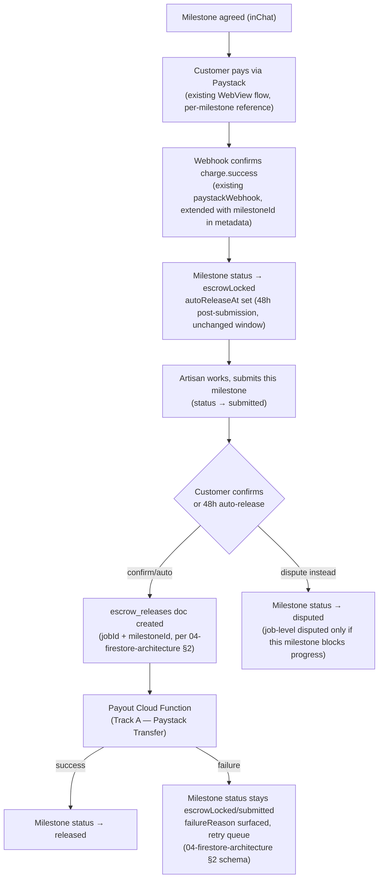

# 06 — Escrow, Milestone Payments & Wallet

Executes Phase 1.5 Hardening Sprint Track A (`01.5-critical-review-and-hardening-sprint.md`), builds the `escrow_releases` schema from `04-firestore-architecture.md` §2 into a full flow, and closes the brief's milestone/material-payment/refund/wallet gaps documented in `01-ux-audit.md` §5. This is the single highest-stakes doc in the program — it's the direct fix for Critical Finding 1.1 (escrow release doesn't currently pay anyone).

---

## 1. What exists today, precisely (grounds every decision below)

Verified directly (`lib/models/job_model.dart`, `lib/models/payment_model.dart`): a job has exactly **one** `agreedAmount` (double) and **one** `paymentReference` (string). `PaymentModel` mirrors this — one `amount`, one `status`, one `paystackReference` per job. This is a genuinely single-payment architecture — there is no data model support for splitting a job's price into parts today. Every design decision below has to either extend this model or explicitly justify replacing it; §2 explains the choice made.

The job state machine itself (`JobService`, `allowedTransitions`) is sound and **is not being rewritten** — `01-ux-audit.md` §0 already praised this, and `04-firestore-architecture.md` §10 explicitly ruled out a schema restructure. Milestones are added *orthogonally* to the existing coarse job states, not by multiplying job states combinatorially (see §2.2's rationale).

---

## 2. Milestone payments — architecture decision

### 2.1 The model change
Replace the single `agreedAmount`/`paymentReference` pair with a `jobs/{jobId}/milestones/{milestoneId}` subcollection, agreed during the existing `inChat` negotiation stage (where `agreedAmount` is already editable today per `firestore.rules`' narrower field-scoped update rule):

```
jobs/{jobId}/milestones/{milestoneId}
  label: string              // "Materials", "50% Deposit", "Final Payment" — customer/artisan-defined, not a fixed enum
  amount: number
  type: 'material' | 'labor' | 'final'   // brief distinguishes material from labor payments explicitly
  order: number               // sequence — materials/deposit typically precede final
  status: 'proposed' | 'agreed' | 'escrowLocked' | 'released' | 'refunded' | 'disputed'
  paystackReference: string?
  escrowLockedAt: Timestamp?
  autoReleaseAt: Timestamp?
  releasedAt: Timestamp?
  createdAt: Timestamp
```

`jobs.agreedAmount` becomes a **derived, denormalized sum** of milestone amounts (kept for backward-compatible display and for the simple case — see §2.3), not the source of truth once milestones exist.

### 2.2 Why orthogonal to job status, not a rewrite of it — explicit rationale
The temptation is to add milestone-aware states to `JobStatus` itself (`escrowLocked25`, `escrowLocked50`, ...) — rejected outright. `JobService`'s state machine is already correctly scoped to the *job's* lifecycle (has it been posted, matched, worked on, completed, disputed) — that's a different axis from *how many payment tranches* it has. Combining them would explode the state machine's transition table combinatorially for no benefit, and would break every existing rule/query keyed on `JobStatus` (`_isValidJobTransition`, the composite indexes, the admin dashboard's status filters — all verified in `04-firestore-architecture.md`).

Instead: `jobs.status` stays coarse and derives its meaning from milestone aggregates —
- `escrowLocked` (job-level) means **at least one** milestone is locked (work can begin on that portion)
- `inProgress` unchanged — artisan is working
- `submitted` means **all** milestones have been marked submitted by the artisan
- `completed` means **all** milestones are `released`

This is a Cloud-Function-maintained aggregate (recomputed on every milestone status change, same transactional pattern `_recordJobOutcome` already uses), not a client-computed value — keeps the single-writer-per-collection rule from `04-firestore-architecture.md` §7 intact.

### 2.3 Backward compatibility / simple case
Most jobs (a same-day repair, a small task) don't need 3 milestones — forcing every job through a milestone-negotiation UI would be a regression for the common case. **Default**: every job gets exactly one auto-created milestone (`type: 'final'`, `amount: agreedAmount`, `label: 'Full Payment'`) unless the customer/artisan explicitly opts into a milestone breakdown during negotiation. This preserves today's one-payment UX as the default path and makes milestones strictly additive, not a mandatory new step for every job.

---

## 3. Escrow lock/release flow (per milestone)



**Metadata threading**: the existing `verifyPayment` Cloud Function already cross-checks `metadata.jobId` against the client-supplied value as a fraud guard (confirmed in `01-ux-audit.md` §0) — extend the same metadata object with `milestoneId` so the webhook and payout function both resolve to the correct subdocument, not just the parent job.

---

## 4. Payout automation (executing Track A concretely)

This is Critical Finding 1.1's actual fix. Per-milestone rather than per-job, otherwise unchanged from `01.5` Track A / `04-firestore-architecture.md` §2:

1. `escrow_releases` doc created (customer confirms, or auto-release fires) — now includes `milestoneId`.
2. Payout Cloud Function (Firestore-triggered on creation + a scheduled sweeper for resilience): validate artisan has bank details (`artisan_private/{uid}`) → create/reuse Paystack Transfer Recipient → initiate Transfer → write `processing`.
3. Paystack Transfer webhook (new, mirrors `paystackWebhook`'s existing HMAC-verification pattern) confirms success/failure asynchronously → updates `escrow_releases.status` and the milestone's status together, transactionally.
4. **Failure path is a first-class UX state, not a silent Firestore field**: if an artisan has no bank details, the payout function must not just fail quietly — it should (a) notify the artisan with a direct link to `/bank-details`, (b) leave the milestone visibly "payment pending your bank details" in the Wallet screen (§6) rather than looking identical to a normal in-progress payout, and (c) surface to admin's Escrow Monitoring queue if unresolved past a threshold (e.g., 72h).
5. Reconciliation sweep (daily scheduled function, per `01.5` A5): compare `pending`/`processing` releases older than the SLA window against Paystack's actual transfer list — catches any release that silently fell through (webhook missed, function crashed mid-write) rather than trusting the happy path alone.

---

## 5. Material payments, refunds

**Material payments**: modeled as `type: 'material'` milestones (§2.1) — no separate system needed. The one product-facing difference: material milestones are typically requested *before* work starts (artisan needs money to buy materials) rather than after — so material milestones should be allowed to enter `escrowLocked` while the job is still in an earlier overall state, which the aggregate-derivation in §2.2 already accommodates naturally (job goes `escrowLocked` the moment *any* milestone locks, materials included).

**Refund workflow** (❌ in `01-ux-audit.md` §5's gap table — genuinely missing, not just under-specified):
- Triggered from dispute resolution (`disputes/{disputeId}`, admin-resolved per `03-ia-navigation-journeys.md` §3.3's journey) — admin's resolution outcome needs a third option beyond today's implicit binary, scoped **per milestone**, not per job:
  - Release to artisan (existing path, unchanged)
  - Refund to customer — calls Paystack's Refund API against the milestone's original charge reference (a genuinely new Cloud Function, `refundMilestone`, admin-callable only)
  - Split — partial refund + partial release, both calling their respective Paystack APIs against the same original charge (Paystack supports partial refunds; the transfer side then only moves the artisan's portion)
- **New `escrow_releases`-equivalent needed for the refund direction**: today's schema (`04-firestore-architecture.md` §2) only models money moving *to* the artisan. Add a parallel `status` value or a `direction: 'payout' | 'refund'` field so the same reconciliation/monitoring infrastructure (§4 point 5) covers both directions rather than building two separate systems.

---

## 6. Wallet screen — new surface (full spec per the brief's checklist)

Confirmed absent today (`01-ux-audit.md` §5) — no dedicated wallet UI exists, only raw `payments` records. Two role-specific variants sharing one component shell:

- **Purpose**: give both parties a single place to see money in motion — what's escrowed, what's been paid/received, what's pending action. Directly serves the brief's "clear payment breakdown" and "payment history" requirements.
- **User goal**: Customer — "where is my money and is it protected?" Artisan — "when do I get paid, and is anything blocking it?"
- **Layout**: top summary card (customer: "In Escrow" / "Total Spent"; artisan: "In Escrow" / "Available/Paid Out" / a prominent alert state if any payout is blocked per §4.4), followed by a chronological ledger list grouped by job.
- **Components**: new `WalletSummaryCard`, new `LedgerRow` (job title, milestone label, amount using the `AppTextStyles.currency`/tabular-figures treatment defined in `02-design-system.md` §3, status chip reusing the existing `escrowLocked`/`escrowPending`/`escrowReleased` tokens — now with the dark-mode pairs added per that doc's Gap 1 — plus the new `escrowFailed` token for the payout-failure state).
- **Interactions**: tap a `LedgerRow` → detail sheet (Paystack reference, timestamps, link to the parent job); artisan's blocked-payout banner is tappable, routing straight to `/bank-details`.
- **Navigation — SUPERSEDED by `02-design-system-v2.md` §9.4**: this originally placed Wallet inside Profile rather than the bottom nav, reasoning it's a moderate-frequency screen not deserving a permanent slot. The visual reference used for the nav redesign includes Wallet as one of exactly 4 bottom-nav tabs (Explore, My Tasks, Wallet, Profile) — that decision now wins. **Wallet is a primary bottom-nav destination**, not a Profile row. Keep the direct entry point from `NotificationBell` for payment-related notifications, unaffected by this change.
- **Loading state**: skeleton ledger rows using the existing `shimmer_loaders.dart` pattern (`02-design-system.md` §6.2 confirms shimmer variants should cover every major list type — Wallet is one).
- **Empty state**: "No transactions yet" for a brand-new account — distinct copy for customer ("Post a job to get started") vs. artisan ("Complete your first job to see payouts here").
- **Error state**: a failed ledger fetch shows a retry action, not a blank screen — standard pattern, no new component needed beyond what `02-design-system.md` §6.4 already flagged as a missing shared `ErrorStateView` to build early.
- **Success state**: N/A as a persistent state, but a milestone transitioning to `released` while the screen is open should animate the ledger row (using `AppAnimations.normal`) rather than silently re-rendering — small polish, cheap to include.
- **Accessibility**: status must never be color-only (same rule as `05-trust-score.md` §6's explainer sheet) — every ledger row's status chip pairs an icon with the color, not color alone.
- **Animations**: standard list-item and modal-sheet transitions per `02-design-system.md` §4 — no bespoke motion needed.
- **Firestore implications**: reads `jobs/{jobId}/milestones` across the user's jobs (a collection-group query, `milestones` collection-group filtered by `customerId`/`artisanId` — **new composite index needed**, flagged for `04-firestore-architecture.md`'s index list once this ships) plus `escrow_releases` for payout-status detail. No new writes from this screen — it's read-only, all mutations happen through the existing job/dispute/payment flows.
- **Security considerations**: must only ever query the signed-in user's own milestones/releases — same ownership-scoping pattern as every other user-facing list in the app; no new rule pattern needed, just correct application of the existing `isOwner`/party-scoping convention (`04-firestore-architecture.md` §1).

---

## 7. Automatic reminders (escrow-specific slice of the brief's notification requirement)

Full notification-preferences UI is `08-messaging-notifications.md`'s territory — but the specific *triggers* below are escrow-domain logic and belong here, to be delivered through whatever general notification mechanism `08` designs:

- **Escrow reminder**: customer has a `submitted` milestone awaiting confirmation, sent once at ~24h and once at ~40h before the 48h auto-release fires — gives the customer a real chance to act (confirm or dispute) before the system decides for them, which is both better UX and reduces disputes-after-the-fact ("I didn't even see it").
- **Payout blocked reminder**: artisan has a milestone stuck in the §4.4 failure state — daily reminder until resolved, since an unpaid artisan silently waiting is the exact harm Finding 1.1 exists to prevent.
- **Material payment requested**: if material-type milestones (§5) are proposed by the artisan mid-negotiation, the customer needs a distinct, prompt notification (not lumped in with general chat notifications) since it's a money-request, not a conversational message.

---

## 8. Rollout sequencing

1. Ship the single-milestone-default model (§2.3) first — this alone fixes Critical Finding 1.1 (payout automation, §4) without requiring the negotiation UI for multi-milestone breakdowns yet. **This is the minimum viable fix and should not wait for the rest of this doc.**
2. Ship the Wallet screen (§6) against the single-milestone model — still valuable, still closes a real brief gap, doesn't need multi-milestone support to exist.
3. Ship multi-milestone negotiation UI + material payments (§2.1, §5) as the next increment — genuinely new negotiation UX, higher design/engineering cost, correctly sequenced after the payout plumbing (step 1) is proven working end-to-end in production with the simple case.
4. Ship refund workflow (§5) alongside or immediately after multi-milestone support, since split-refund scoping depends on milestones existing to split across.
5. Escrow reminders (§7) can ship in parallel with any of the above once `08-messaging-notifications.md`'s general mechanism exists — no hard ordering dependency.

---

**Next**: `07-gps-flow.md` and `08-messaging-notifications.md` remain independent and un-blocked. Once either lands, `03-ia-navigation-journeys.md` §2 should be revisited — this doc already resolved that section's Wallet placeholder (§6 above).
