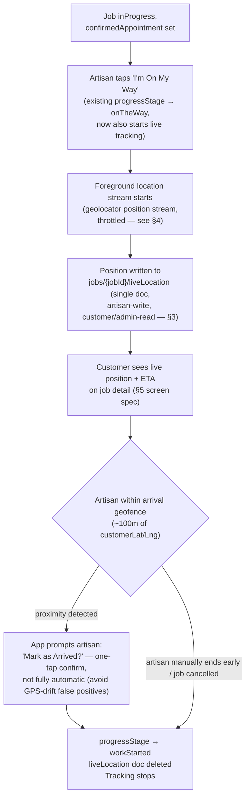

# 07 — GPS / "On My Way" Arrival Flow

Closes the brief's explicit GPS requirement (`## GPS` — appointment accepted → artisan taps "I'm On My Way" → location sharing begins → customer sees ETA → arrival → tracking ends automatically) and the gaps confirmed in `01-ux-audit.md` §3.5/§5. Feeds the deferred Punctuality factor in `05-trust-score.md` §2.6 and resolves `03-ia-navigation-journeys.md` §2's GPS placeholder.

---

## 1. What exists today, precisely

Verified directly in `lib/models/job_model.dart`:
- `appointmentSlots: List<DateTime>` (artisan-proposed) and `confirmedAppointment: DateTime?` (customer-picked, a single specific date+time, not a window) **already exist** — the appointment-scheduling half of this flow is real, not a gap.
- `JobProgressStage.onTheWay` exists as one of 8 manual stages the artisan self-sets (`accepted → onTheWay → workStarted → ...`) via `JobService.updateJobProgress` — but it's purely a status label. No location data is attached to it anywhere.
- `customerLat`/`customerLng` exist on the job doc, but are captured **once**, at job-posting time (`service_request_screen.dart`'s `_fetchLocation()`, a single `Geolocator.getCurrentPosition()` call) — this is the job site's address, not anyone's live position.
- `ArtisanModel.latitude`/`longitude` are the artisan's static registered/business location, used only for the matching-distance bonus (`matching_service.dart`) — never updated live, never surfaced to a customer.
- **No live position field exists anywhere** — not on the job, not on the artisan, not in any subcollection. **No map package** (`google_maps_flutter` or any alternative) is in `pubspec.yaml`. `geolocator`/`geocoding`/`permission_handler` are present but every usage found is the single one-shot capture above.

So today's "On My Way" is a label an artisan can tap with zero connection to their actual location or an ETA — the brief's flow doesn't exist yet at all, confirmed rather than assumed.

---

## 2. Flow design



**Why a confirm tap at arrival, not full automation**: GPS accuracy in dense urban areas (multi-story buildings, Lagos traffic corridors) makes a pure geofence trigger unreliable — a false "arrived" firing while still a block away would look broken to the customer and undermine exactly the trust this feature exists to build. A one-tap confirm keeps the automation useful (it prompts at the right moment) without making an unreliable signal authoritative on its own.

---

## 3. Data model & Firestore rules

```
jobs/{jobId}/liveLocation/current   (single doc, not a history collection)
  lat: number
  lng: number
  heading: number?
  updatedAt: Timestamp
  active: boolean          // true only during the onTheWay window
```

**Deliberately a single ephemeral doc, not a location-history collection** — the brief is explicit ("Do NOT continuously track artisans"), and retaining a position history has no product justification and a real privacy cost. The doc is overwritten in place, not appended, and is **deleted outright** the moment tracking ends (§2, step H) — no soft-delete, no retained trail. This is a deliberate minimization choice, not an oversight.

**Rules** (extends the pattern in `04-firestore-architecture.md` §1 — job-party scoping, same shape as `messages`/`quotes` subcollections):
```
match /jobs/{jobId}/liveLocation/{doc} {
  allow read: if isSignedIn() && (isJobParty(jobId) || isAdmin());
  allow write: if isSignedIn() && isMatchedArtisan(jobId)
    && get(/databases/$(database)/documents/jobs/$(jobId)).data.status == 'inProgress';
}
```
Write restricted to the matched artisan only, and only while the job is genuinely `inProgress` — an artisan can't write stale/fake position data outside the legitimate window, and the check reuses the existing `firestore.get()` cross-service-style pattern already established for job-state-dependent rules elsewhere in the ruleset.

---

## 4. Map package & ETA computation — a real decision, not a default

No map package exists today, so this phase has to actually decide one, not just assume Google Maps:

| Option | Pros | Cons |
|---|---|---|
| **Google Maps Platform** (`google_maps_flutter` + Directions/Distance Matrix API) | Best-in-class traffic-aware ETA, most familiar UX for Nigerian users (already dominant), mature Flutter support | Per-request billing that scales with usage — a live-updating ETA polling the Directions API naively could get expensive fast; requires API keys + billing setup per platform (Android/iOS/Web each need their own key) |
| **OpenStreetMap-based** (`flutter_map` + a routing backend like OSRM/Mapbox) | No Google billing dependency, viable self-hosted option | Rougher default UX, no traffic-aware ETA without a paid routing add-on anyway (OSRM alone gives distance/time without live traffic) — the cost saving is smaller than it first looks once traffic-awareness is added back in |

**Recommendation**: Google Maps Platform, but with a **cost-control design from day one**, not bolted on later: don't call the Directions/Distance Matrix API on every position ping (which could be every 15-30s per active delivery). Instead:
- Client-side: straight-line distance/heading update on every position ping (free, instant, good enough for the map pin moving smoothly).
- Server- or client-throttled Directions API call every ~60-90 seconds (or on a meaningful position delta) to refresh the actual traffic-aware ETA text ("Arriving in ~12 min").
- This hybrid gives a smooth-feeling live map with a real, traffic-aware ETA number, at a fraction of the naive per-ping API cost.

This is a genuine budget decision for a pre-revenue-scale startup — flag it explicitly for whoever owns infra cost in `11-production-roadmap.md` rather than treating "add a map" as a free feature addition.

---

## 5. New surface: Live ETA/Map card (full spec)

Lives on `job_detail_screen.dart` during the `onTheWay` window — not a new route, per `03-ia-navigation-journeys.md`'s note that this belongs inline on job detail rather than as a top-level destination.

- **Purpose**: let the customer see, in real time, that the artisan is genuinely en route and roughly when they'll arrive — replacing anxious "are they actually coming?" uncertainty with a live signal, which is directly a trust feature.
- **User goal**: "Is my artisan on the way, and when will they get here?"
- **Layout**: a card inserted into the existing job-progress timeline (`job_progress_timeline.dart`/`job_progress_tracker.dart`, per `02-design-system.md` §6.2's note that these render discrete stages, not live position — this card is the companion piece, not a merge) showing a small embedded map with the artisan's live pin and a prominent ETA text line above it.
- **Components**: new `LiveEtaCard` (map view + ETA text + artisan avatar/name), reusing existing `user_avatar.dart`; no new design tokens needed beyond what `02-design-system.md` already defined, except the map itself needs a light/dark map style variant to stay consistent with the app's theme toggle (Google Maps supports custom JSON map styling for this).
- **Interactions**: tap the card to expand to a full-screen map view; tap the artisan avatar to open chat (existing `/chat/:jobId`) for a quick message without leaving the flow.
- **Navigation**: inline on `job_detail_screen.dart`, no new route.
- **Loading state**: before the first position ping arrives, show "Waiting for [artisan] to start their trip..." rather than a blank/broken map — the artisan may tap "On My Way" and take a moment before their first GPS fix resolves.
- **Empty state**: N/A once tracking starts (the card only renders during the active `onTheWay` window) — outside that window, the timeline shows the discrete-stage view only, no map card at all, consistent with the brief's "do not continuously track" framing (the card's very absence outside this window is the privacy control made visible).
- **Error state**: if the artisan's location permission was denied or the stream drops, show a plain "Artisan is on the way — live location unavailable" message rather than a stuck/frozen map, so a permissions failure doesn't read as the artisan having stopped.
- **Success state**: on arrival confirmation (§2 step G/H), the card transitions to a brief "Arrived!" state (using `AppAnimations.slow`/`bounceCurve` — this is exactly the kind of rare celebratory moment `02-design-system.md` §4 reserved that motion tier for) before the timeline moves on to `workStarted`.
- **Accessibility**: the ETA text must be the primary accessible content (screen-reader-first), not just a visual map — a map pin alone conveys nothing to a screen-reader user; "Artisan arriving in approximately 12 minutes" as a text-first announcement matters as much as the visual.
- **Animations**: pin position updates should interpolate smoothly (standard map SDK behavior) rather than jump on each ping — matters more here than most components since jerky motion on a live-tracking feature reads as buggy/untrustworthy.
- **Firestore implications**: a `snapshots()` listener on `jobs/{jobId}/liveLocation/current` — single-doc listener, cheap, no new index needed (direct doc read, not a query).
- **Security considerations**: rules already scope this correctly (§3) — the UI layer's job is simply to never attempt to render this card outside the `inProgress`/`onTheWay` window, both because the data won't exist then and because showing "last known location" stale data after tracking ends would violate the feature's own privacy intent.

---

## 6. Battery, permissions, and platform review risk

- **Foreground-only, by design** — the brief explicitly scopes this to "while traveling to a booked job," which maps to foreground/while-in-use location permission, not background/always. This is also the right call for app-store review risk: Apple's App Store Review and Google Play both apply real scrutiny to apps requesting background/"always" location access, requiring a clear justification screen and often triggering extended review. Staying foreground-only (the artisan has the app open and active while driving/traveling to the job) avoids that entirely — recommend this as a hard constraint, not just a default, given the review-risk cost of the alternative.
- **Throttling**: position updates on a distance filter (e.g., only emit a new position when the artisan has moved ≥25-50m) rather than a fixed short time interval — reduces both battery drain and Firestore write volume without materially hurting the customer-facing experience, since a stationary-in-traffic artisan doesn't need write-every-15-seconds precision.
- **`permission_handler`** (already a dependency) should be used to request location permission with an in-context primer screen *before* the OS system prompt — explaining why it's needed ("so [customer] can see when you'll arrive") immediately before the artisan first taps "I'm On My Way," rather than requesting it generically at app install/registration time, which both improves grant rates and is the currently-recommended platform pattern for permission requests.

---

## 7. Trust Score tie-in (resolves the deferral in `05-trust-score.md` §2.6)

Now that arrival has a real, measurable moment (§2's confirm-tap), Punctuality becomes buildable: compare `confirmedAppointment` (the agreed time) against the arrival-confirmation timestamp (§2 step H). Per `05-trust-score.md` §2.6's already-agreed rebalancing: Response Time 15%→10%, new Punctuality slot at 10%, everything else unchanged. Concrete bracket proposal (mirroring the existing response-time bracket style for consistency): on-time or early = 100, ≤15min late = 80, ≤30min late = 60, ≤60min late = 30, >60min late or no-show = 0. This is now a decision `05`'s owner can finalize rather than a pure placeholder, since the data source this section defines makes it measurable.

---

## 8. Rollout sequencing

1. Ship appointment-day "On My Way" tap → live position write + basic straight-line ETA first, without the Directions API cost-optimization layer — validates the core flow cheaply before adding paid API calls.
2. Add the throttled Directions/Distance Matrix API layer (§4) once the basic flow is confirmed working, so traffic-aware ETA lands as a refinement, not a blocker to shipping the feature at all.
3. Wire Punctuality into `05-trust-score.md`'s formula (§7 above) only after real arrival-confirmation data exists — same "don't harden a score nothing reads yet" principle `05` already established for its own gaming-vector work.
4. Map-styling/dark-mode parity (§5) can ship as a fast-follow polish pass, not a launch blocker.

---

**Next**: `08-messaging-notifications.md` remains independent and un-blocked — the last of the three tracks `03-ia-navigation-journeys.md` §2 flagged as provisional. Once it lands, that IA doc's placeholders are fully resolved and `09-screens-customer-artisan.md` can begin.
